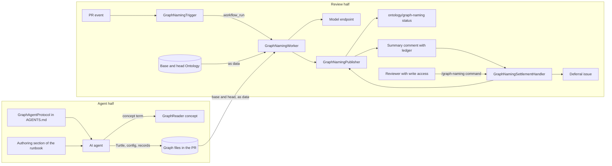

# Agent-maintained knowledge graph

## Product owner: vision

### Problem

In a repository with the Ontology Kit installed, developers are the only people who use the repository. They read `docs/ontology.md` and the generated graph README. They ask their agent about the repository, ask it to add or refine graph entries, and ask it for function and class names that match concepts already in the `Ontology` or the `SourceKnowledgeGraph`. The installed `OntologyProtocol` shapes design-time work: use the exact names, and define a missing concept first, then write the code. The installed `GraphAgentProtocol` covers only finding things and refreshing the graph before a pull request. Nothing tells an agent to check the graph before it names code, to record the components and symbols it implements, or how to write a good entry when asked. So in a pencils-down run, or a run through the feature skills and superpowers, the agent keeps the ontology current but leaves the source graph behind it. The graph's labels, `kit:denotes` links and evidence then drift from the names in the code and the ontology.

### Users

- Developers in repositories with the kit installed, who read the ontology and graph documents and direct their agents. JEPA-Speech's maintainer is the first.
- The agents those developers direct, in both modes: an autonomous pencils-down run, and a run through the claude-plugins persona skills plus superpowers. All of them follow the repository's `AGENTS.md`, which is where the kit installs its protocols.
- Division ontology repositories, made from the division-ontology template, which import each repository's ontology and source graph at a pinned commit. They depend on the quality of the source facts but are not changed by this feature.

### Outcomes and measures

Success is the owner's own judgement in a trial on JEPA-Speech, after reinstalling the kit there. No numeric targets or retrieval baselines are set.

1. **Names match before code is written.** When an agent names a new function, class or component for a concept the ontology or graph already holds, it looks the concept up first and uses the matching name. Measure: in a trial run, the owner judges the new names against the ontology and the existing `GraphNode` labels.
2. **The graph is maintained with the code.** When an agent implements a component or symbol, it adds or updates the graph entries in the same change, as it already does for the ontology: label, `kit:denotes` where it names a concept, `kit:implements` to the concept it realises, and `GraphEvidence` pointing at the source. Where the code lands outside the graph's declared coverage, the agent proposes widening the coverage in the same change rather than leaving the work unrecorded. Measure: the owner reviews the trial pull request and judges whether the graph changes, including any widened coverage, are complete and well formed.
3. **Requests to add or refine an entry produce good entries.** Given authoring guidance, an agent asked to add or refine a graph entry chooses a label, kind, concept link and evidence that the owner accepts. Measure: the owner makes several such requests in JEPA-Speech and judges the results.
4. **"What implements this concept?" has an answer.** A developer or agent can start from an ontology concept and find the graph nodes that denote or implement it, rather than relying on a substring of a label or IRI. Measure: the owner asks for several concepts and checks the answers against source.
5. **Mismatched graph names are found by a model and settled by a human.** A model-assisted check compares graph labels, `kit:denotes` links and the names of linked code symbols with the ontology, and reports likely mismatches on the pull request. Its results take effect only when a human reviewer accepts them. The deterministic graph check stays offline and unchanged in what it proves. Measure: the owner judges the findings on trial pull requests as useful and not noisy.
6. **Model results reach a reviewer early and are easy to settle.** A human reviewer learns of the check's results as soon as they exist, not at merge time, and can settle each one in a step or two: accept it, reject it with a reason, or defer it by creating an issue that records the results for later review, for example after consulting stakeholders or subject-matter experts. Deferring lets the pull request proceed, and the issue keeps the open question visible. Measure: in the trial, the owner judges that results reached them promptly, that settling them took little effort, and that deferred results could be picked up again from their issue.

### Scope

- A stronger `GraphAgentProtocol`, installed into `AGENTS.md`, that tells the agent to check the ontology and graph before naming code, to record implemented components and symbols with their concept links, and to maintain the graph in the same change as the code. That includes code symbols linked to the concepts they realise, not only files, and proposing wider declared coverage, for the maintainer to review, when new code for a concept falls outside it.
- Authoring guidance for "add or refine this graph entry" requests.
- A concept-first lookup in the `GraphReader` that follows `kit:denotes` and `kit:implements` from an ontology concept.
- A model-assisted semantic match of graph names against the ontology: labels, `kit:denotes` links and the names of linked code symbols. It runs separately from the deterministic `GraphChecker`, in the way the `SemanticReviewWorker` runs separately from the term linter, and its results take effect only on human acceptance.
- A review path for those results that draws a human reviewer's attention as early as possible and lets them accept, reject with a reason, or defer a result to a newly created issue so the pull request can proceed.
- Widening [#35 B11](../source-knowledge-graph/02-behaviours.md) from "keep semantic review human" to "a model may produce semantic results about the graph, and they take effect only when a human accepts them". The deterministic validation script still makes no model call and needs no secret or network access. This reverses part of an accepted decision, so the design pull request's Narrative sections carry a `correction` entry citing `docs-feature-behaviours-for-source-knowledge-graph`.
- Implemented components and symbols only: every entry the agent writes is evidenced by source that exists.
- Changes ship in the kit's templates, byte-identical in every adopting repository, with variation in `ontology.config.json`.
- A trial on JEPA-Speech after reinstalling the kit.

### Out of scope

- Planned components: graph entries for parts an architecture designs before any code exists.
- Changes to the claude-plugins persona skills or to superpowers. Phase-specific hooks in the skills would be a separate change in claude-plugins; this feature reaches every workflow through `AGENTS.md`.
- Cross-repository search, embedding search, the runtime workspace, the SPA, the REST API, SPARQL and MCP. These belong to the division ontology repository.
- Any network call, model call or secret in the deterministic `GraphChecker`, the `GraphReader` or the renderer.
- A model check of whether each assertion is supported by its evidence. The widened B11 allows one, with human acceptance, but it is a follow-up; this feature's check covers naming only.
- Automatic judgement of semantic accuracy, as [#62](../human-readable-source-knowledge-graph/01-vision.md) accepted. A model result that a human must accept, reject or defer is not automatic, so #62 stands unchanged.
- Installing a source graph in this repository.
- Numeric success targets and retrieval baselines.

### Research

- **The two protocols differ in reach.** The [installed ontology protocol](../../../templates/protocol/ontology-protocol.md) acts at design time: use the exact names, and define a missing concept before the code. The [installed source graph protocol](../../../templates/protocol/source-graph-protocol.md) covers reading the graph before a task, citing it, and refreshing it before a pull request. It says nothing about naming code against the graph, recording new components, or authoring entries.
- **`AGENTS.md` reaches every workflow.** The persona skills in `.claude/skills` (sourced from claude-plugins) and superpowers both follow the repository's `AGENTS.md`. Of the persona skills, only feature-analyst touches the ontology; feature-architect (components) and feature-dev (file and class names) touch neither the ontology nor the graph. A stronger protocol in `AGENTS.md` therefore reaches every workflow without a change in claude-plugins. (Previous session's review of the skills.)
- **The vocabulary already has the links.** The [graph vocabulary](../../../templates/source-graph/graph-schema.ttl) defines `kit:implements` ("a source element realizes the named concept or behaviour") and `kit:component`, `kit:source-symbol` and `kit:concept` kinds. The [graph checker](../../../templates/scripts/check-source-graph.mjs) requires `kit:denotes` on concept nodes and checks that the ontology holds the target.
- **Search is literal.** The [graph reader's search](../../../templates/scripts/query-source-graph.mjs) matches lower-cased substrings of a node's IRI and label. It does not follow `kit:denotes` or `kit:implements`, so it cannot answer "what implements this concept?".
- **There is a precedent for a model-assisted check.** The ontology semantic review runs in its own workflows (`ontology-semantic-review.yml`, `-request`, `-dismiss`), apart from the deterministic term linter. [#35 B11](../source-knowledge-graph/02-behaviours.md) keeps semantic review of the graph human and keeps the validation script free of model calls, secrets and network access; the [narrative entry](../../../narrative/entries/20261102-docs-feature-behaviours-for-source-knowledge-graph.md) that accepted it says maintainers remain responsible for claims. [#62](../human-readable-source-knowledge-graph/01-vision.md) keeps automatic accuracy judgement out of scope. The owner's widening keeps the offline validation script and keeps humans responsible, through acceptance of model results.
- **Settling a finding is hard today.** In the [ontology semantic review](../../../templates/docs/ontology-semantic-review.md) a finding blocks the merge until a maintainer posts a comment of exactly `/ontology-dismiss <64-hex-finding-id> <40-hex-head-sha> <reason>`, copying both identifiers from the run comment. One command settles one finding, the dismissal expires on the next push, and there is no way to defer a finding for later review. The graph review path should be easier than this.
- **The wider system.** Each business area's division ontology repository imports every app repository's ontology and source graph at pinned commits and runs the runtime workspace, including embedding search. This kit's job is the quality of the source facts those imports read. (Owner's brief.)
- **Trial ground.** JEPA-Speech is the live graph trial; this repository has no graph installed. Its graph at `main` commit `71f8a2b` (reviewed 2026-11-18) is still the adoption pilot:
  - Declared coverage is the console Domain and Application projects and their tests: 8 of the repository's 254 tracked C# source files. The graph holds 4 concept nodes; the ontology serialisation declares 110 classes and individuals.
  - Every `kit:implements` assertion links a source file to a concept. There are no `kit:source-symbol` nodes, so no class or function is linked to the concept it realises.
  - Two later feature commits, `47acd6c` (model download progress) and `a42010c` (download retry), added the concepts AssetDownloadProgress and AssetDownloadRetry to JEPA-Speech's ontology along with their code, in files outside declared coverage. Their graph changes only refreshed the evidence blob IDs for the ontology files. The agent maintained the ontology and the graph's refresh records, but added no graph facts for what it built. The graph check passed throughout, because it checks refresh records against declared coverage, not whether new code got graph entries.

## Analyst: behaviours

These behaviours extend `RefreshSourceKnowledgeGraph` and `GroundWithSourceKnowledgeGraph` through a stronger `GraphAgentProtocol`, and add four use cases: `AuthorGraphEntry`, `FindConceptImplementations`, `ReviewGraphNaming` and `SettleGraphNamingResult`. "The agent" is any agent following the `AgentInstructionFile` of a `TargetRepository` with the source graph enabled, in a pencils-down run or through the persona skills and superpowers. "A permitted reviewer" is a person with write access to the repository (write, maintain, admin or owner role), as decided in U5. The [#35 behaviours](../source-knowledge-graph/02-behaviours.md) B1–B15 still hold except where B25 below widens B11.

### Outcome 1: names match before code is written

- **B1 Look up before naming.** Given the agent is about to name a new function, class, component or file for a concept, when it chooses the name, then it has first read the `Ontology` and run `FindConceptImplementations` (or the `GraphReader` search when it does not yet know the concept) for that concept, and it uses the ontology's exact name as the name or as the distinguishing part of the name (for example a symbol named after the concept plus a role suffix such as Service or Repository).
- **B2 Stay consistent with existing symbols.** Given the graph already holds a `kit:source-symbol` or `kit:component` node that implements the same concept, when the agent names a related new symbol, then it follows the existing node's naming and states in its reply which node it matched.
- **B3 Missing concept first.** Given the concept is in neither the `Ontology` nor the graph, when the agent needs a name for it, then it adds the concept to the `Ontology` first, as the `OntologyProtocol` requires, and only then names the code. It never links new code to an approximate existing concept.
- **B4 Ontology wins a conflict.** Given a graph label or existing symbol name conflicts with the `Ontology`, when the agent names new code, then it uses the ontology term, names the conflict in its reply and in the pull request body, and does not rename the existing code or graph entry unless the task asks for it (#35 B6).
- **B5 Reach through `AGENTS.md`.** Given the kit is installed or upgraded with the source graph, when any agent reads the `AgentInstructionFile`, then the spliced `GraphAgentProtocol` block carries B1–B4, B6–B11 and B26, with no change to the claude-plugins persona skills or superpowers.

### Outcome 2: the graph is maintained with the code

- **B6 Record what was built.** Given the agent implements a type, function or component that realises a concept named in the `Ontology`, and its source lies in declared covered `GraphCoverage`, when it prepares the change, then the same change adds or updates the graph entries: a `GraphNode` for the source element, a concept node with `kit:denotes` to the ontology IRI (created if absent), a `kit:implements` `GraphAssertion` from the source element to the concept node, and `GraphEvidence` citing the source lines, as well as the `GraphRefreshRecord`s the existing protocol already requires. `node scripts/check-source-graph.mjs --staged --base <merge-base>` passes.
- **B7 Symbol or file.** Given a named type or function in the change is the implementation of an ontology concept (for example a class, record or enum with the concept's name, or a function that carries out a use case), when the agent records it, then it records a `kit:source-symbol` node labelled with the symbol's exact name as written in source, with evidence covering its declaration, and links it by `kit:implements`. A file-level `kit:implements` is enough when no single symbol realises the concept (the concept is spread across several functions in the file). Where a `GraphNode` for the containing file exists, the agent also asserts `kit:contains` from the file to the symbol. Members that do not realise a concept on their own get no node.
- **B8 No retrofit.** Given existing file-level `kit:implements` assertions that the change does not touch, when the agent records new symbols, then it leaves them as they are. Converting old entries is an "add or refine" request (Outcome 3), not a side effect.
- **B9 Propose wider coverage for unknown areas.** Given the change adds code that realises an ontology concept in a path whose `GraphCoverage` status is `kit:unknown`, when the agent prepares the change, then in the same change it proposes widening coverage: a `kit:covered` `GraphCoverage` with the narrowest selector that holds the new code (the new files, or their own directory when the change creates it), the matching selector under the right role in `sourceGraph.evidence` in `OntologyConfig` where no existing selector matches, a `GraphRefreshRecord` for every existing file the new selector covers, and the B6 entries. The check passes on the result.
- **B10 Respect explicit exclusions.** Given the new code lies in a path whose `GraphCoverage` status is `kit:excluded`, when the agent prepares the change, then it proposes no widening and records no graph facts there, and says in the pull request body that the code is in excluded scope, quoting the exclusion's reason.
- **B11 Make the graph changes visible in the pull request.** Given the change adds, changes or removes graph entries or proposes wider coverage, when the agent opens or updates the pull request, then the body lists each added or changed concept link (source element, relationship, concept), each widened selector with the number of files it newly covers and why, and any code that realises a concept but stays unrecorded, with the reason. A maintainer who declines a widening asks for it to be dropped; the agent then removes the widened selector, its records and the entries that depended on it, and lists the code as unrecorded.
- **B12 Only implemented code.** Given a component or symbol is designed but not yet in source, when the agent maintains the graph, then it records nothing for it. Every entry it writes cites source that exists at the pull request's revision.
- **B45 Turtle first, Markdown generated.** Given the agent adds, changes or removes graph entries, coverage or refresh records, for maintenance (B6–B12) or on request (B13–B19), when it prepares the change, then it edits only the Turtle files under `sourceGraph.root` and `OntologyConfig`, runs `node scripts/check-source-graph.mjs --staged --base <merge-base>` until it passes, and only then runs `node scripts/render-source-graph.mjs` to regenerate the graph's Markdown at `sourceGraph.markdownPath`, staging it in the same pull request and checking it with `--check --staged`. It never writes or edits the generated Markdown by hand, and it does not reverse the order: a Markdown change with no Turtle change behind it is never proposed.

### Outcome 3: requests to add or refine an entry produce good entries

- **B13 Choose the label.** Given a request to add or refine a graph entry (`AuthorGraphEntry`), when the agent chooses the label, then it uses: for a concept node, the ontology term exactly; for a `kit:source-symbol`, the symbol's name exactly as in source; for a source file, test or document node, its repository-relative path; for a component or system, the name the source uses for it (project, package or assembly name).
- **B14 Choose the kind.** Given the same request, when the agent chooses the kind, then it picks a core `GraphVocabulary` kind, and declares a local kind in the manifest, with a definition, only when no core kind fits; it says in its reply why no core kind fitted.
- **B15 Choose the concept link.** Given the entry names or realises an ontology concept, when the agent links it, then a concept node carries `kit:denotes` to the ontology IRI and a source element links to that concept node by `kit:implements`; when the concept is missing from the `Ontology`, B3 applies.
- **B16 Choose the evidence.** Given the entry needs evidence, when the agent writes it, then it cites the narrowest line range that shows the fact (the declaration for a symbol), the role whose `sourceGraph.evidence` selector matches the path, and the staged blob ID; the basis is `kit:direct` unless the claim is an inference, which cites its observations (#35 B7). If the path is outside covered scope, B9 or B10 applies.
- **B17 Refine keeps identity.** Given a request to refine an existing entry, when the agent changes its label, kind, link or evidence, then the node or assertion IRI stays the same (`GraphNode` identity persists across relabelling), and the reply states what changed and why.
- **B18 Decline what cannot be evidenced.** Given a request for an entry about something with no source in the repository (for example a planned component), when the agent handles it, then it declines, says that only implemented source is recorded, and suggests the ontology for the vocabulary instead.
- **B19 Report the choices.** Given the agent has written the entry, when it replies, then it names the label, kind, concept link and evidence it chose, with one line of reasoning each, and the result of the graph check. The entry is written in Turtle and the Markdown regenerated from it, as B45 requires.

### Outcome 4: "what implements this concept?" has an answer

- **B20 Concept-first lookup.** Given an ontology term (by its exact name, its `:Name` form or its full IRI) and a graph whose nodes denote it, when a developer or agent runs `FindConceptImplementations` in the `GraphReader`, then it returns, at the graph revision: every `GraphNode` whose `kit:denotes` is that ontology IRI, and every `kit:implements` assertion whose object is one of those nodes, with its subject node (file, symbol or component), basis, evidence and evidence status, in the reader's existing text and `--json` forms. Inferred assertions are marked tentative, and a stale revision is marked `STALE`, as for the other reader commands.
- **B21 Both shapes.** Given the graph holds both shapes in use today (a concept node with `kit:denotes`, and file or symbol nodes linked to it by `kit:implements`), when the lookup runs, then both appear, grouped as "denotes" and "implements". It follows no further hops: a component that contains an implementing symbol is not listed unless it has its own `kit:implements`; `path` remains the way to follow longer chains (#35 B2).
- **B22 Term known, nothing linked.** Given the term is in the `Ontology` but no node denotes it, or no assertion implements it, when the lookup runs, then it says so and prints the coverage inventory; it does not say the concept is unimplemented (#35 B3).
- **B23 Not a term.** Given the input is not an ontology term, when the lookup runs, then it exits 2 with a message naming the input as not found in the `Ontology`, and suggests `search`. It does no fuzzy matching.
- **B24 Offline.** Given the lookup runs, then it reads only local Git objects, the graph and the ontology serialisation; it makes no model call and needs no network or secret.

### Outcome 5: mismatched graph names are found by a model and settled by a human

- **B25 Widened #35 B11.** Given a pull request's proposed graph passes `GraphChecker`, then the deterministic check is unchanged in what it proves and still makes no model call and needs no secret or network access after checkout. Separately, a model may produce `GraphNamingResult`s about the graph's names in `ReviewGraphNaming`; a result takes effect only when a permitted reviewer accepts it.
- **B26 Agents never settle.** Given the agent works under any identity, including the maintainer's own token, when results exist, then it never accepts, rejects or defers one. It may correct the graph or code as an accepted result asks (B37) and may reply on the pull request with a proposed correction. Because a token cannot show whether a human or an agent used it, this rule is a protocol instruction, not a mechanical guarantee.
- **B27 What is compared.** Given a `GraphNamingRun`, then it compares only `GraphNode`s added or changed in the pull request (by IRI, against the base graph), and nodes whose denoted ontology item was renamed or removed by the pull request's proposed `Ontology`: for each, its label with the ontology name it denotes; its `kit:denotes` target with what its label names; and, for each `kit:implements` it is the subject of, its label (the symbol name for a `kit:source-symbol`) with the name of the concept it implements. Unlinked concept, component, system and symbol nodes are compared with the `Ontology` only for use of a synonym or alternative spelling of an ontology term. File, test and document paths are not compared.
- **B28 Containing the canonical term is not a mismatch.** Given a symbol or component label contains the canonical name of the concept it implements as a whole word sequence (for example SessionRemovalService implementing SessionRemoval), then no result is reported for that pair.
- **B29 Grounded results only.** Given the model returns a result, then it is reported only if it names a `GraphNode` in the proposed graph, quotes that node's current label or `kit:denotes` target exactly, and cites a real `Ontology` item; otherwise it is dropped and the run records the node as not reviewed with a fixed reason that contains no model output, as `SemanticFinding` grounding does (ADR 0019).
- **B30 Stable result identity.** Given a result, then its identity is derived from the node IRI, the compared values and the cited ontology item, not from the revision or the model's wording, so the same mismatch on a later revision is the same result.
- **B31 Eligible pull requests.** Given the naming review is enabled on the default branch, when a same-repository pull request opens or is pushed, then a `GraphNamingRun` runs. If neither the graph files nor the `Ontology` changed, the run makes no model call and reports no eligible changes. Fork pull requests are out of scope, as for `ReviewSemanticMatch`.
- **B32 Trusted settings.** Given a run, then it uses the model, endpoint, `RequestBudget` and `ModelAuthProvider` settings from the default branch, compares against the pull request's proposed graph and `Ontology`, treats both and the model's reply as data, and executes no pull request code.
- **B33 Not reviewed never blocks.** Given a run cannot review (disabled, credential or model unavailable, too large for the `RequestBudget`, or a partial review), then its status permits merge and says why, as ADR 0002 decides for `ReviewSemanticMatch`; only unsettled or accepted-and-uncorrected results hold the merge.
- **B34 Opt-in.** Given a repository that has not opted in, then the naming review posts nothing and holds nothing. Opting in is a setting in `OntologyConfig` on the default branch, with the installed files byte-identical across adopters.

### Outcome 6: results reach a reviewer early and are easy to settle

- **B35 Early and visible.** Given a run produces results, when it completes, then the pull request shows one summary comment in plain language listing each result with a short label (R1, R2 and so on), the node, the compared names, the ontology item, the reason and the suggested correction, each settled result with its decision, reviewer and reason, and the number of open deferral issues in the repository with a link to them. A fixed commit status on the head fails while any result is unsettled, and its description gives the counts. The summary is updated in place on later runs; a run that finds results not seen before on the pull request also posts a short new comment linking to the summary, so subscribers are notified; a run with nothing new posts none.
- **B36 Settle in one step.** Given a permitted reviewer sees the summary, when they settle a result, then one action records a `NamingSettlement` for one result or for all unsettled results: accept; reject, with a reason in the same action; or defer, with an optional note. No action needs a copied hash, finding ID or commit SHA. The summary and status reflect the settlement within one run of the settlement handler.
- **B37 Accept.** Given a permitted reviewer accepts a result, then the status keeps holding the merge, described as accepted and awaiting correction, until a revision on which the run no longer reports that result. The agent, seeing an accepted result, applies its correction to the graph or code.
- **B38 Reject.** Given a permitted reviewer rejects a result with a non-empty reason, then the result no longer holds the merge and the reason stays visible in the summary. A rejection without a reason is not recorded and the summary says why.
- **B39 Defer.** Given a permitted reviewer defers one or more results in one action, then exactly one new issue is created holding, for each deferred result: its node, compared names, ontology item, reason, suggested correction and links to the node's Turtle and evidence at the pull request's head commit; plus the pull request link, the reviewer, their note, and a fixed label for deferred graph naming results. The summary links to the issue; the deferred results no longer hold the merge.
- **B40 Settlements survive pushes.** Given a result was settled on the pull request, when a later revision produces the same result (B30), then its settlement still applies: a rejected or deferred result stays settled and points to its reason or issue, and no second deferral issue is created. A result whose compared values changed is a new result and is unsettled.
- **B41 Changing a settlement.** Given a result was settled, when a permitted reviewer settles it again on the open pull request, then the latest settlement applies. A deferral issue is never deleted; when its result is later accepted or rejected, the issue gets a comment saying so.
- **B42 Who may settle.** Given a person with write access to the repository, when they settle any result on any pull request, including their own, then the settlement is recorded. Given a person without write access (read or triage role, or no role) attempts to settle a result, then nothing is recorded and the status is unchanged.
- **B43 Settling a result that has gone.** Given a reviewer settles a result that the latest run no longer reports, then nothing is recorded for it and the summary says it is no longer current.
- **B44 Nothing in the graph.** Given results are accepted, rejected or deferred, then no settlement is written into the `SourceKnowledgeGraph` or its generated Markdown; only a correction committed in response to an accepted result changes the graph.

### Uncertainties

| # | Question (from the handoff unless noted) | Decision or deferral |
| --- | --- | --- |
| U1 | What is the review path's earliest point? | The moment a run finishes on the pull request's first eligible revision: one summary comment and a failing status (B35). The authoring agent does not run the model check locally, since it needs the maintainer's model credential; instead it lists its graph changes in the pull request body (B11), so the reviewer sees them before any run. Requesting code-owner review is GitHub's existing behaviour with `CODEOWNERS` and needs nothing new. |
| U2 | How does a reviewer accept, reject or defer in a step or two? | One action per result or for all unsettled results, with no copied identifier (B36). The GitHub mechanism (task-list checkboxes in the summary, a short command using R labels, or a review) is deferred to the architect within B36's constraints. GitHub suggestions for proposed fixes are not required by any behaviour; the architect may add them. |
| U3 | What does a deferral issue contain, how does it link back, and what happens on the next push? | B39 for the contents and links, B40 for later pushes: the settlement survives while the result's identity is unchanged, and no second issue is made. |
| U4 | Does a settled result leave a mark in the graph or its generated README? | No (B44). Settlements are review records on GitHub; the graph holds source-backed facts only, and the renderer stays deterministic. |
| U5 | Who may accept, reject or defer? | Anyone with write access, on any result and any pull request, including their own (B42); the owner's decision. This is wider than the maintainer-only rule for `FindingDismissal`. Agents never settle (B26). |
| U6 | What exactly does the naming check compare, and on which changes? | B27–B28, on added or changed nodes and nodes affected by an ontology rename or removal (B31). A sweep of the whole graph is deferred as a follow-up. |
| U7 | When does the agent record a `kit:source-symbol` node rather than a file-level `kit:implements`? | B7, with B8 for existing entries. |
| U8 | How does the concept-first lookup treat both link shapes? | B20–B21: both, grouped, one hop only. |
| U9 | What does proposing wider coverage involve? | Three places, all in the same change (B9): a `kit:covered` `GraphCoverage` selector in the manifest, a matching role selector in `sourceGraph.evidence`, and a `GraphRefreshRecord` for every existing file newly covered, which `GraphChecker` already requires. Narrow selectors keep the record count small. Excluded scope is never widened (B10). |
| U10 | What does the authoring guidance say? | B13–B19. Where the guidance lives (in the `GraphAgentProtocol` block, or in the installed `docs/source-knowledge-graph.md` with a pointer from the block) is deferred to the architect. |
| U11 | Does accepting a result settle it? (raised in analysis) | Accepting gives the result effect: it becomes a required correction and holds the merge until a revision no longer reports it (B37). Rejecting and deferring let the pull request proceed. This reading of "takes effect only on human acceptance" is the analyst's; the owner can steer it on the design pull request. |
| U12 | Do settlements carry across pull requests? (raised in analysis) | No: a settlement belongs to one pull request. A later pull request that changes the same node again gets the result again. Showing an earlier settlement of the same result on a later pull request is deferred as a follow-up. |
| U13 | Run outcomes, status context, configuration key and installer flag. (raised in analysis) | Deferred to the architect. Behaviour fixed here: the outcome values cover B31 and B33, whether by reusing `SemanticOutcome` or a new enum, and the status context is fixed and distinct from `ontology/semantic-match`. |
| U14 | Assumption: a stronger protocol in `AGENTS.md` reaches the persona skills and superpowers. | Accepted for this feature (B5); the trial tests it. If the trial shows a workflow ignoring it, that is parked as a claude-plugins issue, which stays out of scope. |
| U15 | Assumption: JEPA-Speech's small pilot graph is a fair trial ground for all six outcomes. | Accepted with a trial order for the user phase: first make "add or refine" requests (Outcome 3) for AssetDownloadProgress and AssetDownloadRetry, which exercise B9 because their code is in unknown scope; then run lookups (Outcome 4) against the larger graph; then open a trial pull request with a deliberate naming mismatch for Outcomes 5 and 6. JEPA-Speech already has the semantic review's model settings to reuse. |
| U16 | Assumption: planned components can stay out of the graph without losing design-time naming. | Accepted. B1–B4 apply at design time through the `Ontology` and the graph's existing entries, and the term check and semantic review still cover names in design documents. B12 and B18 keep planned components out. |
| U17 | Assumption: deferral to an issue does not let results pile up unnoticed. | Partly addressed: every summary shows the count of open deferral issues with a link (B35), and the issues share a fixed label. Any further reminder, such as the agent checking open deferrals for the concepts it works on, is deferred as a follow-up. |
| U18 | A model check of whether evidence supports each claim. | Out of scope (vision); a follow-up under the widened B11. |
| U19 | The `correction` narrative entry for the widening of #35 B11. | Not an analyst decision: the architect carries it in the design pull request's Narrative sections, citing `docs-feature-behaviours-for-source-knowledge-graph`. B25 states the widened behaviour. |
| U20 | In what form does the agent write graph entries? (owner steering on the design pull request) | Turtle first; the Markdown is always generated from it by the `GraphRenderer`, never written by hand (B45). This restates for the new behaviours the existing rule that the Turtle is canonical. |

### Terms

Added to `docs/ontology.md` in this phase (this repository has no ontology serialisation to regenerate):

- `GraphNamingRun`: one model-assisted comparison of a pull request revision's graph names with its proposed `Ontology`.
- `GraphNamingResult`: one likely naming mismatch a `GraphNamingRun` reports, with stable identity.
- `NamingSettlement`: a permitted reviewer's accept, reject or defer decision on one `GraphNamingResult` for one pull request.
- `SettlementDecision`: `accepted`, `rejected`, `deferred`.
- Use cases `AuthorGraphEntry`, `FindConceptImplementations`, `ReviewGraphNaming` and `SettleGraphNamingResult`.
- Updated: the `GraphAgentProtocol`, `GraphReader` and `RefreshSourceKnowledgeGraph` descriptions, for B1–B12 and B20.

Subsystems for the run, the summary and the settlement handler are the architect's to name.

## Architect: structure

The feature has two halves that share nothing at runtime. The agent half (Outcomes 1–4) is text and one offline reader command: a stronger `GraphAgentProtocol`, authoring guidance in the installed source graph runbook, and a concept-first lookup in the `GraphReader`. The review half (Outcomes 5–6) is a new opt-in, model-assisted `ReviewGraphNaming` pipeline built the same way as `ReviewSemanticMatch`: a secret-free trigger, a trusted worker that runs default-branch code, a publisher of one fixed commit status and one summary comment, and a settlement handler driven by short PR comment commands. `GraphChecker`, `GraphCheckWorkflow`, `GraphRenderer` and `GraphRenderWorkflow` do not change ([ADR 0020](../../adr/0020-model-graph-naming-results-take-effect-on-human-acceptance.md)).

### Components

| Component | Responsibility | Behaviours |
| --- | --- | --- |
| `GraphAgentProtocol` (changed) | The kit-owned block spliced into the `AgentInstructionFile`. It now also says: look up the `Ontology` and graph before naming code; record symbols and components with `kit:implements` in the same change; propose the narrowest coverage widening for new code in unknown scope and never in excluded scope; list graph changes in a "Graph changes" section of the pull request body; record only implemented source; never settle a `GraphNamingResult`; apply accepted corrections; write graph changes in Turtle, check them, then regenerate the Markdown with the `GraphRenderer`, never editing it by hand. For "add or refine" requests it points to the authoring section of the runbook ([ADR 0025](../../adr/0025-graph-authoring-guidance-in-the-installed-runbook.md)). | B1–B12, B18, B26, B37, B45 |
| Source graph runbook (changed) | The installed `docs/source-knowledge-graph.md` gains an "Authoring graph entries" section with the label, kind, concept link, evidence and refinement rules, worked examples for a `kit:source-symbol` and for a coverage widening, the reply format of B19, and the Turtle-check-render order of B45 as the last step of every example. | B7, B9, B13–B19, B45 |
| `GraphReader` (changed) | Adds a `concept <term>` command to `scripts/query-source-graph.mjs` serving `FindConceptImplementations`. It resolves the term against the ontology serialisation the graph is checked with: an exact local name, a `:Name` form or the full IRI must name a subject there, with no fuzzy matching. It lists nodes whose `kit:denotes` is that IRI, then `kit:implements` assertions whose object is one of those nodes, grouped as "denotes" and "implements", with the existing evidence status, tentative and `STALE` annotations and `--json` output. Unknown term: exit 2 with a hint to use `search`. Known term with nothing linked: the gap message and coverage inventory. | B20–B24 |
| `GraphNamingTrigger` (new) | `ontology-graph-naming-request.yml`, a `pull_request` workflow with no path filter, no secret and no checkout, whose completion starts the worker. It runs on every pull request so the required status always gets a result. | B31 |
| `GraphNamingWorker` (new) | `ontology-graph-naming-review.yml` (a `workflow_run` workflow) and `scripts/graph-naming-worker.mjs`, executed from the default branch. It resolves the pull request and head, checks same-repository eligibility and the opt-in in the default branch's `OntologyConfig`, and fetches as data, through the GitHub API, the base and head Turtle under `sourceGraph.root` and the base and head `Ontology` and its serialisation. It parses them with the kit's own Turtle reader, selects the compared nodes deterministically, drops pairs that contain the canonical name, asks the model in bounded requests and grounds the replies ([ADR 0024](../../adr/0024-deterministic-selection-and-prefilter-for-graph-naming.md)). It produces one `GraphNamingRun` with a `SemanticOutcome`. | B25, B27–B34 |
| `GraphNamingPublisher` (new) | Logic shared by the worker and the handler. It computes the current state from the latest run and the valid settlements, publishes the fixed status `ontology/graph-naming` on the verified head and test-merge commit, and keeps one machine-marked summary comment edited in place, with a short notification comment when a run finds results not seen before ([ADR 0022](../../adr/0022-one-summary-comment-with-a-bot-ledger-for-graph-naming.md)). | B33, B35, B37–B40, B43 |
| `GraphNamingSettlementHandler` (new) | `ontology-graph-naming-settle.yml`, an `issue_comment` workflow run from the default branch with no model secret, and the `settle` mode of the worker script. It parses `/graph-naming` commands, checks the commenter's write access, records `NamingSettlement`s, creates deferral issues, comments on them when a deferral is replaced, and has the publisher recompute the status and summary ([ADR 0021](../../adr/0021-settle-graph-naming-results-with-short-comment-commands.md)). | B36, B38–B43 |
| `ModelAuthProvider`, `RequestBudget` (reused) | The worker authenticates and plans its requests exactly as the `SemanticReviewWorker` does, with the same variables and secrets ([ADR 0023](../../adr/0023-graph-naming-review-as-a-separate-opt-in.md)). | B32, B33 |
| `OntologyConfig` validation (changed) | `ontology-config.mjs` accepts an optional `sourceGraph.namingReview` object with `enabled`, `model` and `baseUrl`, validated like `semanticReview`; it is valid only when `sourceGraph` is enabled. | B34 |
| `Installer` (changed) | A new `--with-graph-naming-review` flag, which requires `--with-source-graph`, copies the three workflows, the worker script and its tests, and the runbook `docs/graph-naming-review.md`. Without the flag nothing is installed. | B5, B34 |
| `GraphChecker`, `GraphRenderer` (unchanged) | No model call, secret or network; no settlement data reaches the graph or its Markdown. | B25, B44, B45 |

### Structure

**Selecting what is compared (B27, B31).** The worker builds base and head graph models by IRI. A node is compared when it is new, when its label, kind or `kit:denotes` changed, when it became the subject of a new or changed `kit:implements` assertion, or when the ontology item it denotes or implements (through the concept node's `kit:denotes`) was removed or had its row changed between base and head. Nodes of kind `kit:source-file`, `kit:test` and `kit:document` are skipped. If no graph file and neither ontology file changed, the run is `no-eligible` with no model call. A malformed graph that the kit's reader cannot parse makes the run `partial` or `unavailable` with a fixed reason; `GraphChecker` reports the structural failure separately.

**Prefilter and pairs (B27, B28).** For each compared node the worker forms pairs: (label, denoted item), (label, implemented concept), and for unlinked concept, component, system and symbol nodes (label, whole ontology). A pair whose label contains the item's local name as a whole PascalCase word sequence (for example SessionRemovalService against SessionRemoval) is dropped before the model sees it and is never reported. The model is asked only whether each remaining label refers to the linked item by a different word or spelling, or to a different item than the one linked, or, for unlinked nodes, uses a synonym of an ontology term.

**Grounding and identity (B29, B30).** A reply is parsed as ADR 0019 parses semantic replies (one surrounding fence tolerated, a `results` array required). A result is kept only if it names the IRI of a compared node, quotes that node's current label or `kit:denotes` target exactly, and cites an ontology item that resolves to one entry of the catalog built from the head `Ontology`, by the ADR 0019 key resolution. Anything else leaves the node not reviewed with a fixed reason. The result key is the SHA-256 of the node IRI, the pair type, the compared values and the canonical ontology key, so the same mismatch on another revision has the same key whatever the model wrote.

**State and settlement (B35–B43).** The summary comment carries a hidden, machine-readable ledger: the latest run (head SHA, outcome, results with their keys), the R label assigned to each result key the first time it appeared on the pull request (labels are never reused), the deferral issue created for each defer command, and the comment IDs already processed. Only a ledger in a comment written by the workflow's bot identity is trusted. Settlements are not stored in the ledger: they are the reviewers' command comments, re-read and applied in creation order on every recompute, with the latest valid one per result key winning. So editing or deleting a command comment changes the outcome, as it does for `FindingDismissal`, and settlements survive pushes because they are keyed by result key, not SHA. The status is `failure` while any current result is unsettled or accepted, and `success` otherwise; its description gives the counts. Worker and handler runs for one pull request share a concurrency group, so updates are serialised, and both re-read the head before publishing.

**Commands (B36, B38, B42).** A command is a PR comment whose first line is `/graph-naming accept|reject|defer <targets> [text]`, where `<targets>` is one or more R labels separated by commas, or `all` for every currently unsettled result. `reject` requires the text, which is the reason; `defer` treats the text as an optional note. One comment is one action. The handler checks the author's permission through the collaborator permission API and accepts write, maintain, admin or owner (`role_name` of `write`, `maintain` or `admin`; a repository owner reports `admin`). Commands from others, commands naming labels that are not current, and rejections without a reason are ignored, and the summary lists them with the reason they were ignored. The summary shows a copyable example command for each result, so no identifier has to be looked up.

**Deferral issues (B39, B41).** On the first processing of a defer command the handler creates one issue titled with the pull request number and the deferred R labels. The body has the pull request link, the head SHA, the reviewer and note, and per result the node IRI, compared values, ontology item, reason, suggested correction, and blob links at the head SHA to the node's Turtle file and to its evidence paths. The issue gets the label `graph-naming-deferred`, which the handler creates if it is missing. The issue number is recorded in the ledger against the command's comment ID, so reprocessing never creates a second issue. When a later command replaces a deferral, the handler comments on the issue and leaves it open. The summary's count of open deferral issues comes from listing open issues with that label.

### Deployment and runtime

- Everything ships in the kit's templates, byte-identical across adopters. New files: `templates/github/workflows/ontology-graph-naming-request.yml`, `-review.yml` and `-settle.yml`; `templates/scripts/graph-naming-worker.mjs` and its tests (the developer may split the module); `templates/docs/graph-naming-review.md`. Changed files: `templates/protocol/source-graph-protocol.md`, `templates/docs/source-knowledge-graph.md`, `templates/scripts/query-source-graph.mjs` and its test, `templates/scripts/ontology-config.mjs`, `bin/install-ontology.mjs`, the README and `docs/how-it-works.md`.
- Opt-in: install with `--with-graph-naming-review` and set `sourceGraph.namingReview` on the default branch to `{ "enabled": true, "model": "…", "baseUrl": "…" }`. With the flag absent or `enabled: false`, the workflows are absent or publish a successful *disabled* status; nothing else posts. The setting is read from the default branch, never from the pull request.
- The review job uses the existing `ontology-semantic-review` environment, restricted to the default branch, and the same secrets and variables: `KEYCLOAK_CLIENT_SECRET` with `ONTOLOGY_OIDC_TOKEN_URL` and `ONTOLOGY_OIDC_CLIENT_ID`, or `ONTOLOGY_SEMANTIC_LLM_API_KEY`, plus `ONTOLOGY_MAX_REQUEST_CHARS` and `ONTOLOGY_MODEL_TIMEOUT_MS`. An adopter with semantic review already set up, such as JEPA-Speech, needs no new secret.
- Permissions: trigger `contents: read`; worker identify `contents: read`, `pull-requests: read`; worker review and finalize `contents: read`, `pull-requests: write`, `issues: write`, `statuses: write`; settlement handler `contents: read`, `pull-requests: write`, `issues: write`, `statuses: write`, with no environment. Every job checks out the default branch with `persist-credentials: false` and executes no pull request content.
- Maintainers add `ontology/graph-naming` as a required status after the workflows reach the default branch. Fork pull requests get an *out-of-scope* success, as for `ReviewSemanticMatch`.
- The concept lookup runs locally, offline, wherever the reader runs today.
- No database or service is added. The state lives in the summary comment's ledger, the command comments and the deferral issues.

### Traceability

| Behaviour | Components |
| --- | --- |
| B1 | `GraphAgentProtocol`, `GraphReader` |
| B2 | `GraphAgentProtocol`, `GraphReader` |
| B3 | `GraphAgentProtocol` |
| B4 | `GraphAgentProtocol` |
| B5 | `GraphAgentProtocol`, `Installer` |
| B6 | `GraphAgentProtocol`, `GraphChecker` (unchanged, validates the result) |
| B7 | `GraphAgentProtocol`, source graph runbook |
| B8 | `GraphAgentProtocol` |
| B9 | `GraphAgentProtocol`, source graph runbook, `GraphChecker` (unchanged) |
| B10 | `GraphAgentProtocol` |
| B11 | `GraphAgentProtocol` |
| B12 | `GraphAgentProtocol` |
| B13 | source graph runbook |
| B14 | source graph runbook |
| B15 | source graph runbook |
| B16 | source graph runbook |
| B17 | source graph runbook |
| B18 | source graph runbook, `GraphAgentProtocol` |
| B19 | source graph runbook |
| B20 | `GraphReader` |
| B21 | `GraphReader` |
| B22 | `GraphReader` |
| B23 | `GraphReader` |
| B24 | `GraphReader` |
| B25 | `GraphNamingWorker`, `GraphChecker` (unchanged) |
| B26 | `GraphAgentProtocol` |
| B27 | `GraphNamingWorker` |
| B28 | `GraphNamingWorker` |
| B29 | `GraphNamingWorker` |
| B30 | `GraphNamingWorker` |
| B31 | `GraphNamingTrigger`, `GraphNamingWorker` |
| B32 | `GraphNamingWorker`, `ModelAuthProvider`, `RequestBudget` |
| B33 | `GraphNamingWorker`, `GraphNamingPublisher` |
| B34 | `OntologyConfig` validation, `Installer`, `GraphNamingWorker` |
| B35 | `GraphNamingPublisher` |
| B36 | `GraphNamingSettlementHandler` |
| B37 | `GraphNamingPublisher`, `GraphAgentProtocol` |
| B38 | `GraphNamingSettlementHandler`, `GraphNamingPublisher` |
| B39 | `GraphNamingSettlementHandler` |
| B40 | `GraphNamingPublisher` |
| B41 | `GraphNamingSettlementHandler` |
| B42 | `GraphNamingSettlementHandler` |
| B43 | `GraphNamingSettlementHandler`, `GraphNamingPublisher` |
| B44 | `GraphChecker`, `GraphRenderer` (unchanged), `GraphNamingPublisher` |
| B45 | `GraphAgentProtocol`, source graph runbook, `GraphChecker`, `GraphRenderer` (both unchanged) |

### Decisions

- [ADR 0020](../../adr/0020-model-graph-naming-results-take-effect-on-human-acceptance.md): widen #35 B11 so a model may produce graph naming results that take effect only on human acceptance; the deterministic check is unchanged. This corrects part of `docs-feature-behaviours-for-source-knowledge-graph`.
- [ADR 0021](../../adr/0021-settle-graph-naming-results-with-short-comment-commands.md): settle results with `/graph-naming` comment commands using per-pull-request R labels, by anyone with write access.
- [ADR 0022](../../adr/0022-one-summary-comment-with-a-bot-ledger-for-graph-naming.md): one summary comment edited in place, holding a bot-written ledger, with a notification comment for new results.
- [ADR 0023](../../adr/0023-graph-naming-review-as-a-separate-opt-in.md): a separate opt-in with its own workflows and status, reusing the semantic review's environment, `ModelAuthProvider`, `RequestBudget` and `SemanticOutcome`.
- [ADR 0024](../../adr/0024-deterministic-selection-and-prefilter-for-graph-naming.md): deterministic selection of compared nodes and a canonical-name prefilter before any model call.
- [ADR 0025](../../adr/0025-graph-authoring-guidance-in-the-installed-runbook.md): rules in the protocol block, authoring guidance in the installed runbook, and the lookup as a reader command.

Terms: the ontology gains the subsystems `GraphNamingTrigger`, `GraphNamingWorker`, `GraphNamingPublisher` and `GraphNamingSettlementHandler` and their relationships, and `SemanticOutcome` now also describes a `GraphNamingRun`.

## User: runbook, guide and acceptance

### Runbook

**Deployed environment used by acceptance:** JEPA-Speech (`jamiemitchellconsultants/JEPA-Speech`) on GitHub Actions, reinstalled from this repository's `main` after the build pull request merges. It reuses JEPA-Speech's existing `ontology-semantic-review` environment, its gateway model settings and its source graph at `docs/source-knowledge-graph`. The trial order is the one U15 sets: "add or refine" requests first, then lookups, then a trial pull request with a deliberate naming mismatch.

#### Deploy (per adopting repository)

1. Upgrade the kit-owned files from a clean checkout of the default branch, on a new branch: `node <kit>/bin/install-ontology.mjs --target <repo> --force --with-source-graph --with-graph-naming-review`, plus every flag the repository already uses (JEPA-Speech: `--with-semantic-review --with-drift-review`). This refreshes the `GraphAgentProtocol` block in `AGENTS.md`, the reader with `concept`, the runbook `docs/source-knowledge-graph.md`, and adds `docs/graph-naming-review.md`, `scripts/graph-naming-*.mjs` with their tests and the three `ontology-graph-naming-*.yml` workflows. Open a pull request, review the diff and merge it.
2. Health check before opting in: on the upgrade pull request and every later one, `ontology/graph-naming` is a success reading "Graph naming review disabled; not reviewed", and no graph naming comment is posted.
3. Opt in on the default branch: add `"namingReview": { "enabled": true, "model": "<model>", "baseUrl": "<base URL>" }` inside `sourceGraph` in `ontology.config.json` and commit it. The config is an input of the generated graph Markdown, so then run `node scripts/render-source-graph.mjs`, check with `--check --staged` and commit the regenerated Markdown in the same pull request, or `source-graph-markdown` fails (#131). Merge it. A repository that already runs the semantic review uses the same model and base URL and needs no new secret; otherwise set up the `ontology-semantic-review` environment as `docs/graph-naming-review.md` describes.
4. Require the status: add `ontology/graph-naming` to the default branch's required status checks.
5. Health check after opting in: a pull request that changes no graph Turtle or ontology file gets "Graph naming: no eligible graph or ontology changes". A pull request that changes a graph Turtle file gets a pending status that becomes success or failure, and one "Graph naming review" summary comment.

#### Operate

- Read the summary comment on the pull request. Each result has an R label, the node, the compared names, the ontology item, the reason, the suggested correction and copyable commands. The status description gives the counts.
- Settle with a comment whose first line is `/graph-naming accept|reject|defer <R labels|all> [text]`. A rejection needs a reason. Anyone with write, maintain or admin role may settle. Agents never settle.
- Deferral issues carry the label `graph-naming-deferred`; the summary links to the open ones and counts them.
- Not-reviewed outcomes (`unavailable`, `partial`, `too-large`, `disabled`, `out-of-scope`, `no-eligible`) permit merge. `too-large` names `ONTOLOGY_MAX_REQUEST_CHARS`; raise that repository variable and push.
- Agents: before naming code, run `node scripts/query-source-graph.mjs concept <Term>`; for graph entries follow "Authoring graph entries" in `docs/source-knowledge-graph.md`, then check and render.

#### Recover and roll back

- Switch the review off: set `sourceGraph.namingReview.enabled` to `false` on the default branch. Every pull request then gets the disabled success and nothing else. Remove `ontology/graph-naming` from the required checks if you also remove the workflows.
- A stuck status: push to the pull request, or re-run the "Ontology graph naming review" workflow run; a settlement command can also be edited or re-posted, and the latest valid one wins.
- Roll back the kit: revert the upgrade commit on the default branch. Deferral issues, summary comments and command comments stay on GitHub; nothing was written into the graph, so the graph needs no rollback.

### User guide

For developers in adopting repositories, JEPA-Speech's maintainer first, and for the agents they direct.

- **Agents name code after the ontology (B1–B5).** Before naming a new class, function, component or file, the agent reads the ontology and runs `concept <Term>`. It uses the ontology term as the name or its distinguishing part, follows an existing symbol's naming, adds a missing concept to the ontology first, and names any conflict in its reply and the pull request body. This comes from `AGENTS.md`, so it reaches the persona skills and superpowers without other changes.
- **The graph keeps up with the code (B6–B12, B45).** When the agent builds something that realises a concept, the same pull request adds the graph entries: a `kit:source-symbol` for the named class or function, its `kit:implements` link to the concept node, evidence on the declaration, and refresh records. Code in unknown scope comes with the narrowest coverage widening; code in excluded scope is left unrecorded with the reason. The pull request body has a "Graph changes" section. The agent edits Turtle, runs the check, then regenerates the Markdown.
- **Ask for a graph entry (B13–B19).** Ask the agent to "add (or refine) a graph entry for X". It replies with the label, kind, concept link, evidence and check result it chose, keeps the IRI when refining, and declines anything with no source yet.
- **Find what implements a concept (B20–B24).** `node scripts/query-source-graph.mjs concept <Term>` takes the term's name, its colon form or the full IRI. It lists the nodes that denote the term and the source elements that implement them, with basis, evidence and staleness, one hop only, and `--json`. A known term with nothing linked prints the coverage instead of saying it is unimplemented. An unknown term exits 2 and suggests `search`. It runs offline.
- **Naming results on pull requests (B25–B35).** Once you opt in, each pull request that changes the graph or the ontology gets one summary comment and the `ontology/graph-naming` status. Only added or changed nodes, and nodes whose ontology item changed, are compared. Names that already contain their canonical term are never reported. A review that cannot run never blocks.
- **Settle in one comment (B36–B43).** `/graph-naming accept R1`, `/graph-naming reject R2 <reason>`, `/graph-naming defer R1,R3 <note>`, or `all` in place of the labels. Accepting holds the merge until a push no longer reports the result. Rejecting or deferring releases it. A deferral opens one issue with everything needed to pick it up later. Settlements survive pushes while the result is unchanged; the latest one wins; a label that is no longer current is ignored and named in the summary.
- **Nothing is written to the graph (B44).** Only a correction you commit changes the graph or its Markdown.
- **Model text in the summary.** Reasons and suggestions are the model's words, shown as data. An @mention in them would notify that person, as in the semantic review.

### Acceptance

Executable tests: `tests/agent-maintained-graph-acceptance.test.mjs` (`node --test tests/agent-maintained-graph-acceptance.test.mjs`), 29 tests that install the kit into a scratch repository and drive the INSTALLED protocol, runbook, reader, checker and graph naming review. The review tests use the real GitHub client over an in-memory GitHub and a local HTTP model stand-in. Scenario setup is shared with the walkthroughs in `tests/helpers/agent-graph-scenarios.mjs`; `node tests/helpers/agent-graph-walkthrough.mjs <symbol|widening|lookup> <new-directory>` prepares a scratch repository for a person-run local walkthrough. The unit-level cases are in the shipped `query-source-graph`, `graph-naming-*` and `ontology-config` tests.

"Local" is a scratch repository on the person's Mac. "Deployed" is JEPA-Speech. The review-half walkthroughs (B25–B44) need GitHub, so their person-run layer is deployed only; locally they are covered by the executable tests.

| Behaviour | Local walkthrough | Deployed walkthrough | Executable test |
| --- | --- | --- | --- |
| B1–B4 | L1: read "Naming code" in the installed `AGENTS.md`. Expect the lookup-before-naming, follow-existing-symbol, missing-concept-first and ontology-wins rules. | D3: ask the agent to add a small class for an existing concept (for example SessionRemoval). Expect it to run `concept`, use the term in the name, and name any conflict. | B1 B2 B3 B4 test |
| B5 | L1: reinstall with `--force`. Expect each graph protocol heading once in `AGENTS.md`. | D1: the upgrade pull request's `AGENTS.md` diff shows the new subsections once. | B5 test |
| B6, B7, B15, B16 | L2: set up `symbol`, run the check against the base, commit, run `concept SessionRemoval`. Expect the check to pass and the lookup to list SessionRemovalService as a direct implementation with evidence on line 12. | D2: the agent's entries for AssetDownloadProgress and AssetDownloadRetry use `kit:source-symbol` nodes with declaration evidence, and the check passes in CI. | B6 B7 B15 B16 test |
| B8, B10–B12, B45 | L1: read "Recording what you build" and the Turtle-first paragraph. Expect the no-retrofit, excluded-scope, "Graph changes" section, implemented-only and check-then-render rules. | D2: the pull request body has a "Graph changes" section; existing file-level entries are untouched; the Markdown was regenerated by the renderer after the Turtle. | B6 B7 B8 B10 B11 B12 B45 test |
| B9 | L3: set up `widening`, run `coverage` for the new file before committing (expect `kit:unknown`), run the check (expect pass), commit, run `coverage` again (expect `kit:covered`). | D2: AssetDownloadProgress and AssetDownloadRetry code is outside JEPA-Speech's coverage; expect a narrow `kit:covered` selector, a matching `sourceGraph.evidence` selector and refresh records in the same pull request. | B9 test |
| B13, B14, B17–B19 | L1: read "Authoring graph entries". Expect the label, kind, concept link, evidence, refine, decline and reply rules. | D2: the agent's reply gives label, kind, concept link, evidence and check result; a refine request keeps the IRI; a request for a planned component is declined. | B13–B19 test |
| B20, B21 | L4: set up `lookup`, run `concept Invoice`, `:Invoice`, the full IRI and `--json`. Expect the same answer, `:node-invoice-service` marked tentative, the Billing component not listed; after a later commit `--rev <base>` prints `STALE`. | D4: run `concept` for SessionRemoval, AuditEvent and the new terms; check each answer against source. | B20 B21 test |
| B22 | L4: `concept Payment`. Expect "No graph node denotes :Payment; that does not mean the concept is unimplemented." and the coverage list. | D4: `concept` for an ontology term with no graph node. | B22 test |
| B23 | L4: `concept Invoices` and `concept invoice`. Expect exit 2 and a suggestion to use `search`. | D4: a misspelt term. | B23 test |
| B24, B25 | L4: run the lookup and the graph check with networking disabled (`--import` stub). Expect both to succeed. | D5: the "source-graph-check" job holds no secret and is unchanged by the upgrade. | B24 B25 test |
| B26, B37 (agent) | L1: read "Graph naming results". Expect "Never accept, reject or defer" and "apply its correction". | D6: the agent never posts a `/graph-naming` command; after `accept`, asked to fix, it corrects the Turtle. | B26 B37 test |
| B27, B28 | executable only | D5: the trial pull request changes one symbol to a synonym label and adds one that contains the term; expect only the synonym reported and the summary counting the other as containing its canonical term. | B27 B28 test |
| B29, B30 | executable only | D5: re-run the review on the same head; expect the same R labels and no second notification. | B29, B30 tests |
| B31 | executable only | D1/D5: a pull request that touches no graph or ontology file gets "no eligible graph or ontology changes". | B31 tests |
| B32 | executable only | D5: the review runs from the default branch's settings even when the pull request edits `ontology.config.json`. | B32 test |
| B33 | executable only | D5: optional, set `ONTOLOGY_MAX_REQUEST_CHARS` very low and push; expect the too-large success naming the variable. | B33 test |
| B34 | executable only | D1: before opting in, expect the disabled success and no comment. | B34 test |
| B35 | executable only | D5: one summary comment, a failing status with counts, and a notification comment. | B35 test |
| B36, B38, B42 | executable only | D6: `/graph-naming reject R<n> <reason>` and `/graph-naming accept all`; expect the summary and status within one settle run. A non-write account is not available in the trial, so the refused case is executable only. | B36 B42, B38, B42 tests |
| B37 | executable only | D6: accept a result, push the correction; expect the status to clear. | B37 test |
| B39–B41 | executable only | D6: defer a result with a note; expect one `graph-naming-deferred` issue with the links; push again (no second issue); later reject it (the issue gets a comment and stays open). | B39, B40, B41 tests |
| B43 | executable only | D6: settle a label after the push that removed it; expect "no longer current". | B43 test |
| B44 | executable only | D6: after settling, the pull request has no commit by the workflow bot and the graph files are unchanged. | B44 test |

#### Results

| Environment | Layer | Result | Date | By |
| --- | --- | --- | --- | --- |
| Local build | Walkthrough L1 (B1–B5, B8, B10–B14, B17–B19, B26, B37, B45) | pass, every step | 2026-11-18 | Jamie Mitchell |
| Local build | Walkthrough L2 (B6, B7, B15, B16) | pass, every step | 2026-11-18 | Jamie Mitchell |
| Local build | Walkthrough L3 (B9) | pass, every step | 2026-11-18 | Jamie Mitchell |
| Local build | Walkthrough L4 (B20–B25) | pass, every step | 2026-11-18 | Jamie Mitchell |
| Local build | Executable tests (29 tests) | approved and run on the person's Mac: 29/29 pass; full `npm test` 667/667 | 2026-11-18 | Jamie Mitchell |
| Local build | Walkthroughs for B27–B44 | none locally: they need GitHub, so they are run in the deployed trial (D5, D6) | - | - |
| Deployed | D1 upgrade (B5): JEPA-Speech#212 reinstalled the kit from `9653c79` | pass: `AGENTS.md` gained each new subsection once; 151 installed tests pass | 2026-11-18 | Jamie Mitchell |
| Deployed | D1 health check before opting in (B32, B34): JEPA-Speech#213, which set `namingReview.enabled` true while `main` did not | pass: `ontology/graph-naming` success "Graph naming review disabled; not reviewed", no graph naming comment | 2026-11-18 | Jamie Mitchell |
| Deployed | D2 "add or refine" request by a fresh agent (B6, B7, B9, B11, B13–B19, B45): JEPA-Speech#215 | pass, every step: lookups first, a `kit:source-symbol` per record with declaration evidence, one-file coverage widening with refresh records and evidence selectors, Turtle then check then render, the B19 reply, a "Graph changes" section | 2026-11-19 | Jamie Mitchell |
| Deployed | D3 naming new code by a fresh agent (B1–B4, B6, B7, B11): JEPA-Speech#216 | pass: a new JEPA-Speech term for the summary type added to its ontology first, then named and recorded; covered scope, so refresh records and no widening | 2026-11-19 | Jamie Mitchell |
| Deployed | D4 lookups (B20–B23) on JEPA-Speech `main` | pass: SessionRemoval, AuditEvent, AssetDownloadProgress and AssetDownloadRetry answers match source; AssetManifest prints the gap and coverage; a misspelt term exits 2 | 2026-11-19 | Jamie Mitchell |
| Deployed | Live naming runs with no model call (B27, B28, B35): JEPA-Speech#215 and #216 | pass: "reviewed 4 node(s); no results" and "reviewed 3 node(s); no results", every name containing its canonical term | 2026-11-19 | Jamie Mitchell |
| Deployed | D5 trial PR with three deliberate mismatches (B27, B29, B35): JEPA-Speech#217 | pass: the live model reported R1–R3 grounded in the right ontology items; status failure "3 unsettled, …"; one notification comment | 2026-11-19 | Jamie Mitchell |
| Deployed | D6 settling on JEPA-Speech#217 (B30, B36–B41, B43, B44) | pass: a rejection without a reason ignored and listed; reject and defer recorded; one `graph-naming-deferred` issue (JEPA-Speech#218) with every field; accept held the merge until the correction push cleared it; R2 and R3 kept their labels and settlements across a live re-run; a stale R1 command "no longer current"; a later rejection of R3 commented on #218, which stayed open; no bot commit | 2026-11-19 | Jamie Mitchell |
| Deployed | B31 out of scope: narrative bot PR JEPA-Speech#214 | pass: "Graph naming not reviewed: PR is out of scope". The "no eligible changes" case was not seen live; executable test only | 2026-11-19 | observed by the agent |
| Deployed | Executable tests: installed graph naming, reader, checker and shared semantic tests on JEPA-Speech `main` (`7656c58`) | 172/172 pass | 2026-11-19 | run by the agent |
| Deployed | Not run live | B33 (too-large and unavailable on a real PR), B42's refused case (no account without write access) and B26 (no agent was asked to settle) are covered by the executable tests only | - | - |
| Deployed | Findings, parked | #131 enabling the review makes the graph README stale and the runbooks did not say so (fixed in #134); #132 the open deferral count lags one run after a deferral; #133 the installer takes the default branch from the checked-out branch. The semantic review also reports the trial labels in the rendered README, so a graph label mismatch is reported twice | 2026-11-19 | - |
