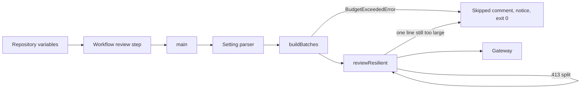

# Configurable drift reviewer request budget

## Product owner: vision

### Problem

The advisory drift reviewer refuses to run for repositories with a mid-sized or large ontology.
`MAX_REQUEST_CHARS` is fixed at 24,000 characters in `templates/scripts/review-ontology-drift.mjs`,
and the reviewer throws "ontology projection and system prompt leave no useful diff budget" before
any model call when the ontology projection plus the system prompt fill that budget. The live
JEPA-Speech run (JEPA-Speech#205) hit this. Measured with the real projection and each repository's
config (system prompt 1,506 characters): DiveVolkTelemetry 11,310 (fits), EventBooking 20,078 (about
2,400 characters of room), JEPA-Speech 58,094 and Grooveloom 73,517 (both fail). The models behind
the gateway have a 131,072-token context and cloud models will have more, so the cap is far below
what they accept. An adopter cannot change it without editing a script that must stay byte-identical
in every repository, and the failure reaches the maintainer as an unexplained red job.

### Users

- Maintainers of adopting repositories whose ontology is larger than a few thousand lines
  (JEPA-Speech, Grooveloom now; EventBooking soon).
- Adopters who later move to cloud models with larger windows and want to raise the budget without
  waiting for a kit release.
- The kit maintainer, who needs a regression guard for large ontologies.

### Outcomes and measures

1. The reviewer runs for JEPA-Speech and Grooveloom. Measure: with the default budget, an ontology
   fixture of about 60 KB produces batches and no budget error.
2. An adopter can change the budget without editing a script. Measure: one repository variable, fed
   to an environment variable, changes the budget; junk values fail with a clear error.
3. When the ontology still does not fit, the maintainer understands why. Measure: the outcome is a
   neutral, explained "skipped: ontology too large for the configured budget", not an unexplained
   red job.
4. Requests stay within what the gateway can answer. Measure: the interplay of the larger budget with
   the model timeout and `max_tokens` is checked and the decision on configurable timeout recorded.
5. The gap that let this through is closed. Measure: a large-ontology case exists in the acceptance
   tests.

### Scope

- Raise the default budget (proposal: 200,000 characters, about 50,000 to 67,000 tokens, leaving at
  least half of a 131,072-token window for the reasoning model's thinking and output; to be justified
  or adjusted in the design).
- A per-repository override through an environment variable fed from a repository variable in the
  workflow template, validated as a positive integer.
- A graceful, explained outcome when the projection still does not fit.
- The 413 and context-length recursive split remains the authoritative fallback.
- Review of the timeout and `max_tokens` interplay, and a decision on making the timeout configurable.
- Unit tests, a large-ontology acceptance case, and updates to the runbook and README.

### Out of scope

- Splitting the ontology projection itself across requests.
- Changing the projection's selection of ontology content.
- Changing prompts, model choice or finding semantics.
- Editing any consumer repository.
- Any change to authentication (feature #92).

### Research

None commissioned. The measurements and the context-window figures come from the JEPA-Speech run
and the home lab owner, relayed by another session; they have not been re-measured from this
repository or checked against the live gateway.

## Analyst: behaviours

Terms: the ontology gains `RequestBudget` (the character budget and model timeout the `DriftReviewer`
runs with). Settings: `ONTOLOGY_MAX_REQUEST_CHARS` and `ONTOLOGY_MODEL_TIMEOUT_MS`, each fed from
a repository variable of the same name. "Fit" means the system prompt plus projection leave at least
500 characters for added lines, as the reviewer already requires.

### Outcome 1: the reviewer runs for large ontologies

- **B1 Raised default.** Given neither setting is present and an ontology projection of 60,000
  characters, when the reviewer plans batches, then it uses a 200,000-character budget and produces
  batches with no budget error.
- **B2 Headroom.** Given the default budget, when the projection plus the system prompt is up to
  about 199,500 characters, then the reviewer still plans batches; above that it takes the skipped
  path (B7).

### Outcome 2: the budget is configurable without editing a script

- **B3 Override.** Given `ONTOLOGY_MAX_REQUEST_CHARS` is a valid positive integer N, when the
  reviewer plans batches, then it uses N as the budget.
- **B4 Unset or empty.** Given the setting is unset, empty or only whitespace (an unset repository
  variable reaches the job as empty), then the default applies.
- **B5 Junk rejected.** Given the setting is anything other than digits forming a positive safe
  integer (for example `abc`, `0`, `-5`, `1.5`, `2e5`, `200_000`, `1000 chars`), when the reviewer
  starts, then it fails before any file, model or GitHub call with an error that names the variable
  and shows the offending value, and exits 1.
- **B6 Workflow wiring.** Given the installed drift-review workflow, then its review step passes
  `ONTOLOGY_MAX_REQUEST_CHARS` and `ONTOLOGY_MODEL_TIMEOUT_MS` from repository variables of the same
  names, and no value is baked into the workflow.

### Outcome 3: a too-large ontology is explained, not a red job

- **B7 Skipped outcome.** Given the system prompt plus projection leave less than 500 characters at
  the configured budget, when the reviewer runs on a pull request, then it makes no model call, posts
  or updates the marker comment with a neutral "skipped: ontology too large for the configured
  budget" message that gives the projection size, the budget and the variable to raise, emits a
  GitHub `notice` line, and exits 0.
- **B8 Persistent token limit.** Given the model keeps rejecting a single added line for token
  limit reasons, when the reviewer exhausts splitting, then the same skipped outcome as B7 results
  (with the reason stated) instead of an error exit.
- **B9 413 split stays.** Given the endpoint answers 413 or `context_length_exceeded` for a batch,
  when the reviewer reviews it, then it splits and retries exactly as today, and that stays the
  authoritative fallback.
- **B10 Dry run.** Given `DRY_RUN` is set and the budget is too small, then it prints the skipped
  message and the sizes, calls nothing and exits 0.

### Outcome 4: requests stay within what the gateway can answer

- **B11 Timeout setting.** Given `ONTOLOGY_MODEL_TIMEOUT_MS` is unset or empty, then the model
  timeout stays 300,000 ms; given a valid positive integer it is used as the timeout; given junk it
  fails as B5 does.
- **B12 Documented coupling.** Given the runbook, then it states that a larger prompt takes longer
  to answer, that the timeout and `max_tokens` (unchanged at 8,192) must be raised together, and
  that the default timeout has not been measured against the gateway with a prompt near the new
  budget.

### Outcome 5: the gap is closed

- **B13 Large-ontology acceptance.** Given an installed repository whose ontology is about 60 KB, when
  the reviewer is run in dry-run mode on a changed Markdown file with default settings, then it plans
  batches and exits 0.
- **B14 Docs.** Given the runbook and README, then they state the default budget, the override, the
  skipped outcome and the timeout caveat.
- **B15 Byte-identical.** Given the change, then no repository-specific value appears in any script.

### Uncertainties

| # | Question | Decision |
| --- | --- | --- |
| U1 | How does "too large" surface: comment, notice or warning exit? | Both a marker comment and a notice line, exit 0: the maintainer sees it on the pull request, the job is not red, and it never blocks a merge. A configuration failure (junk value) stays red. |
| U2 | Default budget value? | 200,000 characters as proposed; the architect justifies it (about 50,000 to 67,000 tokens, leaving at least half of a 131,072-token window). |
| U3 | Validation rules? | Digits only, positive safe integer. No lower or upper bound beyond that; a budget too small for the projection takes the skipped path. |
| U4 | Does a persistent single-line token limit count as "too large"? | Yes (B8): same cause, same outcome. |
| U5 | Is the timeout configurable? | Yes, `ONTOLOGY_MODEL_TIMEOUT_MS`, default unchanged, because the real prefill time of a large prompt on the gateway cannot be measured from here. |
| U6 | Change `max_tokens`? | No, deferred as out of scope; the runbook says to raise it with the timeout. |
| U7 | Split the ontology projection across requests? | Deferred as out of scope (vision). |
| U8 | Is 200,000 right for the live gateway? | Cannot be decided here; unverified until a large-ontology consumer runs it. |

## Architect: structure

### Components

| Component | Responsibility | Serves |
| --- | --- | --- |
| Setting parser in `review-ontology-drift.mjs` (`readPositiveInteger`, `resolveRequestBudget`) | Reads `ONTOLOGY_MAX_REQUEST_CHARS` and `ONTOLOGY_MODEL_TIMEOUT_MS` into a `RequestBudget`; defaults 200,000 and 300,000; rejects junk with an error naming variable and value | B1, B3, B4, B5, B11 |
| `buildBatches` | Plans batches against the budget; throws BudgetExceededError when under 500 characters remain | B1, B2, B7 |
| `reviewResilient` and `reviewBatch` | Unchanged 413 split; throws BudgetExceededError when one line still hits the limit; `reviewBatch` passes the timeout to `modelJson` | B8, B9, B11 |
| `main` | Resolves the budget first (red on junk), reports the skipped outcome through the marker comment, a notice line and exit 0, and in dry-run prints it | B5, B7, B8, B10 |
| Drift-review workflow template | Passes the two variables to the review step | B6 |
| Runbook, README | State default, override, skipped outcome, timeout caveat | B12, B14 |
| Tests: unit tests beside the script and `tests/` acceptance | Executable form of B1-B13 including a roughly 60 KB fixture ontology | B1-B13 |
| `Installer` and byte-identity | No change; script stays identical | B15 |

### Structure

### Deployment and runtime

No new component or service. The change ships in the installed script, workflow and runbook;
each consumer picks it up by re-running the installer with `--force` and may set the two optional
repository variables. Nothing is required: defaults apply when they are unset.

### Traceability

| Behaviour | Components |
| --- | --- |
| B1 | setting parser, `buildBatches` |
| B2 | `buildBatches` |
| B3 | setting parser, `buildBatches` |
| B4 | setting parser |
| B5 | setting parser, `main` |
| B6 | workflow template |
| B7 | `buildBatches`, `main` |
| B8 | `reviewResilient`, `main` |
| B9 | `reviewResilient` |
| B10 | `main` |
| B11 | setting parser, `reviewBatch` |
| B12 | runbook |
| B13 | acceptance tests |
| B14 | runbook, README |
| B15 | `Installer` |

### Decisions

- [ADR 0014: configurable budget, default 200,000 characters](../../adr/0014-configurable-request-budget.md)
- [ADR 0015: neutral skipped outcome for an oversized ontology](../../adr/0015-skipped-outcome-for-oversized-ontology.md)

## User: runbook, guide and acceptance

### Runbook

**Deployed environment used by acceptance:** a GitHub Actions run of the drift review in a consumer
repository whose ontology is large (JEPA-Speech first, then Grooveloom), driven by the user, calling
that repository's configured model gateway. No call is made from this repository.

#### Deploy (per consumer)

1. Upgrade the kit-owned files: `node bin/install-ontology.mjs --target <repo> --force --with-drift-review`;
   commit to the default branch.
2. Optional repository variables: `ONTOLOGY_MAX_REQUEST_CHARS` (default 200000) and
   `ONTOLOGY_MODEL_TIMEOUT_MS` (default 300000). Positive integers only. Nothing is required.
3. Health check: open a pull request that changes a Markdown file. The drift review job must go green
   and either post its findings or stay silent. The job log's configuration check must pass.

#### Operate

- A comment starting "Skipped: ontology too large for the configured budget" means nothing was
  reviewed. Raise `ONTOLOGY_MAX_REQUEST_CHARS` to a size the model accepts and push to re-run.
- Error "ONTOLOGY_MAX_REQUEST_CHARS must be a positive integer, got ..." (or the timeout variable):
  correct the variable; the job is red until you do.
- Timeouts on large prompts: raise `ONTOLOGY_MODEL_TIMEOUT_MS`. The default has not been measured at
  200,000 characters. `max_tokens` is fixed at 8,192.

#### Recover and roll back

- Delete the two variables to return to the defaults. To roll back the code, revert the consumer's
  upgrade commit; the old script fails again on ontologies above about 24,000 characters.

### User guide

For maintainers of an adopting repository.

- **Large ontologies just work (B1, B2, B13).** After upgrading, an ontology up to roughly 199,000
  characters of projection needs no setting.
- **Change the budget without editing a script (B3, B4, B6).** Set the repository variable; unset or
  blank means the default.
- **Typos are caught (B5, B11).** A non-integer value fails the job with the variable's name and
  your value.
- **A skip is explained (B7, B8, B10).** You get a neutral pull request comment and a green job,
  never a silent pass or an unexplained red job.
- **The model's own limit still applies (B9).** If the endpoint rejects a request as too long, the
  reviewer splits the added lines and retries.
- **Mind the timeout (B12, B14).** Larger prompts take longer; the runbook explains how to raise it.
- **Upgrades stay mechanical (B15).** Only variables differ between repositories.

### Acceptance

Executable tests: `tests/drift-budget-acceptance.test.mjs` (`node --test tests/drift-budget-acceptance.test.mjs`).
They install the kit into a scratch repository with a roughly 60 KB ontology and run the INSTALLED
reviewer in dry-run, plus installed-module checks. Nothing calls any model or GitHub.

| Behaviour | Scripted walkthrough (each step with its expected result) | Executable test |
| --- | --- | --- |
| B1, B13 | 1. Install with `--with-drift-review`, replace the ontology with a roughly 60 KB one, commit, branch, add prose. 2. Run `BASE_REF=main DRY_RUN=1 node scripts/review-ontology-drift.mjs docs/notes.md`. Expect "batch" and "budget: 200000 chars", exit 0, no "no useful diff budget". | B1 B13 test |
| B2 | 1. Import the installed planner. 2. Plan with a projection 500 characters under the room. Expect one batch. 3. At 499 under. Expect the skipped error type. | B2 test |
| B3 | 1. Run step 2 above with `ONTOLOGY_MAX_REQUEST_CHARS=90000`. Expect "budget: 90000 chars". | B3 test |
| B4 | 1. Run with the variable set to empty, then spaces. Expect the default budget. | B4 test |
| B5, B11 | 1. Run with `abc`, then the timeout variable set to `0`. Expect exit 1 and the variable named, with the value for the budget. | B5 and B11 tests |
| B6 | 1. Open the installed workflow. Expect both variables mapped from `vars` and no number baked in. | B6 test |
| B7, B10 | 1. Run with `ONTOLOGY_MAX_REQUEST_CHARS=2000`. Expect the notice line "drift review skipped: ontology too large for the configured budget" and exit 0. Deployed: expect the "Skipped" pull request comment and a green job. | B7 B10 test |
| B8, B9 | 1. Make the model reject with a token-limit error on a four-line chunk. Expect it split 4, 2, 2. 2. Reject one line. Expect the typed skip, not a crash. | B8 B9 test |
| B12, B14 | 1. Read the installed runbook and README. Expect the default, the variables, the skip comment and the unmeasured-timeout caveat. | B12 B14 test |
| B15 | 1. Diff the installed script against the template. Expect no difference. | B15 test |

#### Results

| Environment | Layer | Result | Date | By |
| --- | --- | --- | --- | --- |
| Local build | Executable tests (11 tests) | pass; full `npm test` exits 0 | 2026-11-18 | run by the agent; not yet approved by the person acting as user |
| Local build | Scripted walkthroughs | pending, not yet followed by a person | - | - |
| Deployed (JEPA-Speech#205, GitHub Actions, merged) | Live run of the drift reviewer with the 200,000-character default | pass: the 58 KB ontology (58,094-character projection) planned batches, the model call returned no drift in about 18 s, and all 10 pull request checks passed after #108 fixed the Node 20 and 22 test bug | see JEPA-Speech#205 | the user's consumer run; not a person-run walkthrough |
| Deployed | Not verified live | the skipped-comment GitHub API path; the 300,000 ms timeout with a prompt near the budget (the 58 KB run took about 18 s); the person-run walkthroughs, which were not approved by the user | - | - |
