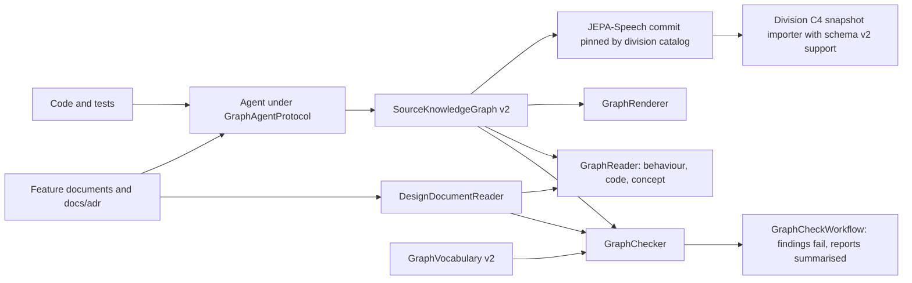

# Source graph links to feature documents

## Product owner: vision

### Problem

A feature's design lives in its documents: the analyst's behaviours, the architect's components and ADRs. The code that results lives in the `SourceKnowledgeGraph`. Nothing connects the two. When pushback changes a behaviour, nobody can ask "what code and tests does this affect?". When an agent or reviewer reads a class, they cannot find which behaviour it serves or which ADR shaped it. A division ontology cannot assemble a feature → behaviour → code view. The only link today is the architect's traceability table, which stops at components that may not exist yet. So people and agents rediscover these connections by hand, or guess.

### Users

- Developers in repositories with the kit and the source graph installed, who run features through the persona skills, read the graph, and want to know why code exists and what a behaviour change touches. JEPA-Speech's maintainer is the first.
- The agents those developers direct, in persona-skill runs and in pencils-down runs, which write the links as they build and use them when an amendment arrives.
- Maintainers reviewing pull requests, who judge whether a link such as "this symbol implements `<slug>#B3`" is true.
- Division ontology repositories, which import each repository's graph at a pinned commit and want to traverse from features through behaviours to code across repositories.

### Outcomes and measures

Success is the owner's own judgement in a trial on JEPA-Speech, after reinstalling the kit and refreshing its persona skills from claude-plugins. No numeric targets are set.

1. **"What does this behaviour touch?" has an answer.** Starting from `<slug>#B3`, a developer or agent finds the components, code and tests linked to it, at a recorded revision. Measure: the owner asks for several behaviours and checks the answers against source.
2. **"Why does this code exist?" has an answer.** Starting from a symbol or component, a developer or agent finds the behaviours it serves and the ADRs that shaped it. Measure: the owner picks several symbols and judges whether the answers are right and useful.
3. **Agents record the links as they build.** In a persona-skill run, links are added in the same change as the code or test they describe, and every link cites evidence that exists. Measure: the owner reviews the trial pull requests and judges the links complete, well formed and not noisy.
4. **Links stay true through amendments.** When pushback changes or retires a behaviour, a deterministic check reports every link to a retired or missing behaviour, and the amendment's handoff can list the code and tests it affects. Measure: in the trial, the owner amends one behaviour and confirms that the affected links are reported.
5. **A division can follow the links.** Behaviours, decisions and their links use core graph kinds and relationships that a downstream consumer can rely on across repositories, and a division import keeps them. Measure: the owner judges that a division import of the trial graph can be traversed from a feature's behaviours to its code. Building a dedicated division view is not part of this measure.

### Scope

- Core graph support for behaviours and decisions (ADRs) as node kinds a division consumer can rely on. A behaviour node has a stable identity derived from `<slug>#B<n>` and cites its declaration in the feature's behaviours document; a retired behaviour stays visible as retired.
- Direct links only: a behaviour to its acceptance test; a component to the code it contains; a component or symbol to the ADR that shaped it; a component to the behaviours the traceability table gives it, once its code exists; and a symbol to a behaviour only where one symbol carries out the use case.
- Lookups both ways in the `GraphReader`: from a behaviour to its components, code and tests, and from a symbol or component to its behaviours and ADRs.
- A deterministic, offline check that reports links to retired or missing behaviours, with no model call.
- A stronger `GraphAgentProtocol` in `AGENTS.md` saying when an agent writes each link, so it reaches every workflow.
- Feature documents and ADRs as eligible evidence under the selected-document role.
- A trial on JEPA-Speech.

### Out of scope

- Nodes for vision outcomes; they are reachable through behaviours.
- Planned components that have no code yet.
- Symbol → behaviour links that could only be inferred from a flow across several symbols.
- Behaviour ids in code comments or commit trailers.
- Retrofitting links for features built before this one, except as an "add or refine" request.
- Changes to the claude-plugins persona skills or to superpowers. Phase-specific hooks would be a separate claude-plugins change.
- A model check of whether a link is true; maintainers judge that, and the graph naming review stays limited to names.
- Cross-repository search, the division runtime, and a dedicated division view of features.

### Research

- **The vocabulary half-expects behaviours.** Schema version 1 of the [graph vocabulary](../../../templates/source-graph/graph-schema.ttl) has nine kinds and no behaviour or decision kind, but `kit:implements` is already defined as realising "the named concept or behaviour", and `kit:document` with `kit:documented-by` can already hold an ADR. The [graph checker](../../../templates/scripts/check-source-graph.mjs) enforces no endpoint kinds and requires `kit:denotes` only on concept nodes, so a repository could model behaviours today as local kinds. [ADR 0008](../../adr/0008-source-graph-vocabulary.md) makes local kinds opaque to cross-repository consumers, so outcome 5 needs them in the core, which is a schema version decision.
- **Lookups are concept-only.** The [graph reader](../../../templates/scripts/query-source-graph.mjs) `concept` command follows `kit:denotes` and `kit:implements` from an ontology term; nothing starts from a behaviour, and reverse lookup is only the generic neighbours command. The installed [graph protocol](../../../templates/protocol/source-graph-protocol.md) already says never to record a planned or designed component.
- **Behaviour ids are written three ways.** Every feature here and in JEPA-Speech starts a behaviour with a bold `B<n>`, but as `**B1 — Title.**`, `- **B1 Title.**` or `**B1. Title.**`, in `02-behaviours.md` (full mode) or `feature.md` (lite mode). No feature has a retired behaviour yet. A deterministic check that a cited line declares `B<n>` has to accept these forms or rely on one fixed form. The claude-plugins analyst skill now makes ids permanent, never reused, and names them `<slug>#B<n>` outside their feature (claude-plugins PR 10, merged).
- **The JEPA-Speech trial ground.** At `main` commit `71f8a2b`, it has one feature (`zener-shape-tracing-motor-test`, full mode, behaviours B1 onwards in `02-behaviours.md`) and six ADRs in `docs/adr/`. Its graph holds 3 component, 4 concept, 3 source-file, 2 test, 2 dependency and 1 document nodes, with `kit:implements`, `kit:tested-by`, `kit:documented-by` and `kit:depends-on` assertions. `docs/adr/**` is configured as selected-document evidence; `docs/features/**` is not. Its persona skills predate stable behaviour ids and need refreshing from claude-plugins before the trial.
- **The division import is generic.** division-ontology's [C4 graph reader](https://github.com/jamiemitchellconsultants/division-ontology/blob/main/src/c4/graph.mjs) reads every `GraphNode`'s kind, label and `kit:denotes`, and every `GraphAssertion`'s subject, relationship, object, basis and evidence, without a fixed list of kinds. New core kinds should survive import; a view that uses them would be division work.
- **Prior art for requirement links.** The [OSLC Requirements Management vocabulary](https://docs.oasis-open.org/oslc-domains/oslc-rm/v2.1/cs01/part2-requirements-management-vocab/oslc-rm-v2.1-cs01-part2-requirements-management-vocab.html) gives a requirement `implementedBy` and `validatedBy` links, the latter to tests, which match `kit:implements` (inverted) and `kit:tested-by`. There is no established RDF vocabulary for ADRs: [e-adr](https://github.com/adr/e-adr) embeds decisions as Java annotations in code. Research on decision traceability ([Gerdes et al., ECSA 2014](https://www.inf.uni-hamburg.de/en/inst/ab/swk/research/publications/pdf/2014-08-25-ecsa2014-wien-gerdes-lehnert-riebisch-paper.pdf)) argues that fine-grained links from decisions to code enable change impact analysis, and [a WICSA 2014 paper](https://swc.rwth-aachen.de/docs/publications/2014_WICSA_DLB_SWC.pdf) notes that architects prefer lightweight links over heavy cross-repository integration, which supports keeping links few and direct.

## Analyst: behaviours

These behaviours add two node kinds to the `SourceKnowledgeGraph`, for a `FeatureBehaviour` and a `DesignDecision`, and two lookups, `FindBehaviourLinks` and `FindCodeDesignLinks`. "The agent" is any agent following the `AgentInstructionFile` of a repository with the source graph enabled. The [#35 behaviours](../source-knowledge-graph/02-behaviours.md) and the [agent-maintained graph behaviours](../agent-maintained-knowledge-graph/feature.md) still hold. Behaviour ids here follow the stable-id rules: once published, an id is never renumbered or reused.

### Outcome 1: "what does this behaviour touch?" has an answer

- **B1 Behaviour node.** Given a feature document declares a behaviour on a line, or list item, whose first bold text starts with `B<n>` (in any of the forms `**B1 — Title.**`, `- **B1 Title.**` or `**B1. Title.**`), when the agent records it, then the graph holds one `GraphNode` of the core behaviour kind whose IRI is derived only from the feature's slug and the id (for example `:behaviour-<slug>-B3`), whose label is the `BehaviourReference` followed by the title as written (`<slug>#B3 Title`), and whose `GraphEvidence` cites the declaration with the selected-document role.
- **B2 One behaviours file per feature.** Given a feature folder, when a behaviour is read, then it comes from `02-behaviours.md` in full mode or from `feature.md` in lite mode. If both files declare behaviours for the same slug at one revision, `GraphChecker` fails and names both files. When a lite feature is promoted, every behaviour node keeps its IRI and only its evidence moves to `02-behaviours.md`, in the same pull request.
- **B3 Behaviour lookup.** Given a `BehaviourReference`, when a developer or agent runs `FindBehaviourLinks` in the `GraphReader`, then it returns, at the graph revision, the behaviour node with its `BehaviourStatus` and any replacement, and every assertion linking it, grouped as components, symbols and tests, each with its subject or object node, basis, evidence and evidence status, in the reader's text and `--json` forms. Inferred assertions are marked tentative and a stale revision is marked `STALE`. It follows one hop; longer chains use `path`.
- **B4 Nothing linked, or nothing known.** Given the behaviour node exists but no assertion links it, when the lookup runs, then it says so and prints the coverage inventory, and never says the behaviour is unimplemented or untested. Given no node exists for the reference, then it says the graph has no node for it and says whether the feature document at that revision declares that id.

### Outcome 2: "why does this code exist?" has an answer

- **B5 Decision node.** Given a file under `docs/adr/` named `NNNN-<title>.md`, when the agent records it, then the graph holds one `GraphNode` of the core decision kind whose IRI is derived only from the number (for example `:decision-0008`), whose label is `ADR NNNN` followed by the title as written, and whose evidence cites the title and Status lines with the selected-document role. Its `DecisionStatus` is taken from the first word of the Status line; "amended by" leaves it current. Other design documents stay `kit:document` nodes.
- **B6 Code lookup.** Given a source symbol, source file or component node, when a developer or agent runs `FindCodeDesignLinks`, then it returns the behaviours the node implements and the decisions it is documented by, with basis, evidence and status, and also those of the component that contains it through one `kit:contains` assertion, labelled "via component" and that component's label. Text and `--json` forms, tentative and `STALE` marks are as for B3.
- **B7 Code with no design links.** Given the node has no behaviour or decision link, directly or via its containing component, when the lookup runs, then it says so and prints the coverage that applies to the node's path; it does not say the code has no reason to exist.

### Outcome 3: agents record the links as they build

- **B8 Same change.** Given the source graph is enabled, when a change adds, rewords or retires a behaviour, adds an ADR or changes its status, first adds a component's code, adds a symbol that alone carries out a use case, or adds a test written to prove a behaviour, then the same change adds or updates the matching nodes and assertions (B1, B5, B9–B12) and the `GraphRefreshRecord`s the protocol already requires, whichever persona or workflow makes the change.
- **B9 Component serves behaviours.** Given a component's code is first added and the feature's traceability table gives it behaviours, when the agent records the component, then it asserts `kit:implements` from the component to each of those behaviour nodes with basis `kit:direct` and two `GraphEvidence` items: the traceability row (selected-document role) and the component's code (implementation role).
- **B10 Code shaped by a decision.** Given an ADR names a component or symbol as shaped by its decision, when the agent records that component or symbol, then it asserts `kit:documented-by` from it to the decision node, citing the ADR lines that name it and the code.
- **B11 One symbol, one use case.** Given one named symbol carries out a behaviour's use case on its own, when the agent records the symbol, then it asserts `kit:implements` from the symbol to the behaviour node, citing the symbol's declaration and the behaviour's declaration. A behaviour carried out across several symbols gets no symbol link; its component link (B9) serves.
- **B12 Test proves behaviour.** Given a test is written to prove a behaviour, when the agent adds it, then it asserts `kit:tested-by` from the behaviour node to the test node, citing the test and the behaviour's declaration.
- **B13 Only what exists.** Given a component or symbol is designed but has no code at the change's revision, when the agent maintains the graph, then it records no link for it. Behaviour and decision nodes are recorded as soon as their documents exist, because their evidence is the document.
- **B14 Narrow opt-in coverage.** Given a feature document or ADR is outside declared coverage, when the agent first needs it as evidence, then it proposes, in the same change, covered `GraphCoverage` and selected-document selectors in `OntologyConfig` for only the files that hold the evidence (the behaviours file, `03-architecture.md` and `docs/adr/**`), never `docs/features/**`, following the existing widening and exclusion rules.
- **B15 Visible in the pull request.** Given the change adds, changes or retires behaviour or decision nodes or their links, when the agent opens or updates the pull request, then the body lists each such node and link, in the way the agent-maintained graph already lists concept links.
- **B16 Reach through the protocol.** Given the kit is installed or upgraded with the source graph, when any agent reads the `AgentInstructionFile`, then the `GraphAgentProtocol` block carries B8–B15 and B20, with no change to the persona skills or superpowers.

### Outcome 4: links stay true through amendments

- **B17 Retired behaviour.** Given a behaviour is moved to the feature's Retired behaviours section, when the agent records the change, then its node keeps its IRI and last title, its `BehaviourStatus` becomes retired, its evidence cites the Retired behaviours entry, and, where the entry names a replacement, it links to the replacement's node.
- **B18 Superseded decision.** Given an ADR's Status line becomes superseded or deprecated, when the agent records the change, then its node keeps its IRI, its `DecisionStatus` follows the Status line, and, where the line names a successor ADR, it links to the successor's node.
- **B19 Missing behaviour fails.** Given a behaviour node's cited lines no longer declare its id and no Retired behaviours entry lists it, or a declaration reuses an id that the Retired behaviours section lists, when `GraphChecker` runs, then it fails with the node, the id and the document.
- **B20 Retired links are reported, not failed.** Given an assertion links a retired behaviour or a superseded or deprecated decision, when `GraphChecker` runs, then it lists each such `RetiredDesignLink` with its subject, its object and any replacement or successor, and passes. The agent copies that list into the pull request body and, in an amendment, into the handoff.
- **B21 Rewording keeps identity.** Given a behaviour's title or scenario is reworded with its meaning unchanged, when the agent records the change, then the node's label changes and its IRI and links stay as they are.

### Outcome 5: a division can follow the links

- **B22 Core vocabulary.** Given the kit's `GraphVocabulary`, then the behaviour and decision kinds, their statuses and the replacement and successor links are core values in a new schema version, so a downstream consumer can rely on them across repositories; they are not adopter-local extensions.
- **B23 The import keeps them.** Given a division importer that supports graph schema version 2 and a pinned JEPA-Speech commit containing the trial graph, when the division imports that commit, then the imported behaviour and decision nodes retain their IRIs, kinds, labels, statuses and evidence, and their assertions retain their IRIs, endpoints, relationships, basis and evidence. Starting from a feature's behaviour with linked code, a maintainer can follow the imported assertions to a source file or symbol.
- **B24 Offline.** Given any lookup or check in this feature runs, then it reads only local Git objects, the graph, the ontology and the feature documents; it makes no model call and needs no network or secret.

### Uncertainties

- **U1 Id formats.** Decided: a declaration is a line or list item whose first bold text starts with `B<n>`, so all three existing forms are accepted and the persona skills need no change (B1).
- **U2 Behaviour identity.** Decided: the IRI is derived only from the slug and id, the label is `<slug>#B<n>` plus the title, and a feature's slug is permanent (B1, B21). An IRI that includes the title was rejected, because every rewording would look like a new behaviour.
- **U3 Retired behaviours.** Decided: the node stays, marked retired, with a link to any replacement (B17). Deleting the node was rejected, because links to it would break without explanation.
- **U4 Decisions.** Decided: one node per ADR number, status from the first word of the Status line, superseded and deprecated handled like retired behaviours (B5, B18). Files outside `docs/adr/NNNN-*.md` stay ordinary documents.
- **U5 When links are written.** Decided: in the same change as the thing they describe, by whichever agent makes it, under the `GraphAgentProtocol` (B8, B16). The phase that usually makes each change is typical, not a gate.
- **U6 Component → behaviour evidence.** Decided: cite both the traceability row and the component's code, basis direct (B9). Citing only the code as an inference was rejected as weaker.
- **U7 Lookups.** Decided: one hop, grouped results, honest empty answers, and the code lookup follows one `kit:contains` up to its component (B3, B4, B6, B7).
- **U8 Stale links.** Decided: a missing or reused behaviour id fails the check; a link to a retired behaviour or superseded decision is reported and passes (B19, B20), so an analyst's amendment is never blocked by code it may not yet change.
- **U9 Evidence eligibility.** Decided: opt in per repository through the existing widening rule, with the narrowest selectors (B14). A default covering all of `docs/features/**` was rejected as noisy.
- **U10 Behaviours file.** Decided: `02-behaviours.md` in full mode, `feature.md` in lite mode, both at once an error, and nodes kept through promotion (B2).
- **U11 Kind and relationship names.** Deferred to the architect: the IRIs of the new kinds, statuses and links, and the schema version number.
- **U12 Division import compatibility.** B23 acceptance requires a compatible division-ontology revision. The [existing import rejects schema version 2](https://github.com/jamiemitchellconsultants/InternalOntology/issues/185#issuecomment-7113634323). Delivering importer compatibility belongs to division-ontology as a separate prerequisite. Record the importer revision and the pinned trial graph commit when running acceptance. Keep B23 pending until the compatible importer is available.

### Terms

`FeatureBehaviour`, `BehaviourReference`, `BehaviourStatus`, `DesignDecision`, `DecisionStatus`, `RetiredDesignLink`, `FindBehaviourLinks` and `FindCodeDesignLinks`, added to [the ontology](../../ontology.md).

## Architect: structure

Behaviours and decisions join the `SourceKnowledgeGraph` as core kinds in schema version 2. A new kit-owned `DesignDocumentReader` reads feature documents and ADRs, so `GraphChecker` can hold behaviour and decision nodes to their documents and `GraphReader` can answer the two new lookups. Everything stays offline and deterministic; agents write the entries under the `GraphAgentProtocol`, and maintainers judge whether each link is true.

### Components

| Component | Responsibility | Behaviours |
| --- | --- | --- |
| `GraphVocabulary` (`CORE` in `source-graph-model.mjs`, rendered as `graph-schema.ttl`) | Schema version 2: kinds `kit:behaviour` and `kit:decision`; node predicate `kit:designStatus` with `BehaviourStatus` and `DecisionStatus` values; relationships `kit:replaced-by` and `kit:superseded-by`. Each core value is tagged with the version that introduced it ([ADR 0041](../../adr/0041-behaviour-and-decision-kinds-in-schema-version-2.md), [ADR 0042](../../adr/0042-accept-older-graph-manifests.md)). | B1, B5, B17, B18, B22 |
| `DesignDocumentReader` (new kit-owned script) | From a Git tree: finds a feature's behaviours file by mode; finds behaviour declarations in the three bold `B<n>` forms and under a Retired behaviours heading; reads an ADR's title and the first word of its Status line; maps node IRIs to a `BehaviourReference` or ADR number and back ([ADR 0043](../../adr/0043-check-design-nodes-against-their-documents.md)). | B1, B2, B4, B5, B17, B18, B19, B21 |
| `GraphChecker` | Accepts manifests from version 1 to the core version and fails a value newer than the manifest; validates `kit:designStatus` on the two kinds; through the `DesignDocumentReader`, fails missing, reused or mislabelled ids, a status that differs from its document, and two behaviours files for one feature; lists each `RetiredDesignLink` in a non-failing `reports` list ([ADR 0044](../../adr/0044-report-retired-design-links-without-failing.md)). | B2, B5, B17, B18, B19, B20, B21, B22, B24 |
| `GraphCheckWorkflow` | Appends the checker's reports to the job's step summary; still read-only, with no model or secret. | B20, B24 |
| `GraphReader` | New commands `behaviour <slug>#B<n>` (`FindBehaviourLinks`) and `code <node>` (`FindCodeDesignLinks`) beside `concept`, with the existing text, `--json`, tentative and `STALE` conventions and coverage output on empty answers; `code` follows one `kit:contains` up to the containing component. | B3, B4, B6, B7, B24 |
| `GraphRenderer` | Readable phrases for `kit:replaced-by` and `kit:superseded-by`, and each behaviour or decision node's status beside its label. | B17, B18, B22 |
| `GraphAgentProtocol` | One added paragraph: write each node and link in the same change as what it describes, with the evidence rules of B9–B12; record only what exists; propose narrow coverage; raise the manifest version with the first version 2 value; list design links and reports in the pull request body. | B8, B9, B10, B11, B12, B13, B14, B15, B16, B20, B21 |
| `Installer` | Installs the new script and the version 2 schema as kit-owned files; never edits the adopter's manifest or `OntologyConfig`. | B16, B22 |
| `OntologyConfig` and `GraphCoverage` (adopter data) | Hold the narrow selected-document selectors and covered entries an agent proposes for the files that carry design evidence. | B14 |
| Division C4 snapshot importer (division-ontology) | Reads the trial graph and evidence at the source commit named in the catalog. The compatible importer preserves the design nodes and their assertions for traversal to code ([ADR 0045](../../adr/0045-require-a-compatible-division-importer.md)). | B23 |

### Structure



A behaviour node is `:behaviour-<slug>-B<n>`, of kind `kit:behaviour`, labelled `<slug>#B<n> Title`, with `kit:designStatus` and one `GraphEvidence` on its declaration (or its Retired behaviours entry). A decision node is `:decision-<NNNN>`, of kind `kit:decision`, labelled `ADR NNNN Title`, with `kit:designStatus` and evidence on its title and Status lines. Links reuse the core relationships: component or symbol `kit:implements` behaviour, behaviour `kit:tested-by` test, component or symbol `kit:documented-by` decision, plus the new `kit:replaced-by` and `kit:superseded-by`. A component's `kit:implements` cites the traceability row and the component's code; the checker confirms both exist and does not parse the row.

Division acceptance calls the C4 snapshot loader, `loadSnapshot` in `src/c4/snapshot.mjs`, at a verified compatible division-ontology revision. Its input is a catalog commit and clean source checkouts. Inspect the imported graph for JEPA-Speech against the canonical Turtle and evidence at the catalog's pinned source commit. Follow an incoming `kit:implements` assertion from a behaviour to a source symbol or to a component, then follow that component's `kit:contains` assertion to a source file or symbol.

### Deployment and runtime

- Kit upgrade: the installer replaces the kit-owned scripts, workflow and `graph-schema.ttl` (version 2) and adds `DesignDocumentReader`. No adopter file changes, and an existing version 1 graph keeps passing because older manifests are accepted.
- First use in a repository: the agent's change that records the first behaviour or decision node also raises the manifest's `kit:schemaVersion` to 2 and proposes the narrow coverage and evidence selectors; the maintainer reviews both in that pull request.
- Runtime: Node.js and Git only, as today. The checker and reader read local Git objects, the graph, the ontology and the feature documents; no model call, network or secret. The check workflow keeps `contents: read` and adds only a step-summary write, which needs no permission.
- Trial: reinstall the kit in JEPA-Speech, refresh its persona skills from claude-plugins, then record its `zener-shape-tracing-motor-test` behaviours and its ADRs and follow outcomes 1–5. For B23, use a division catalog that pins the trial graph commit. Record the JEPA-Speech commit, the division catalog commit and the compatible importer revision in acceptance. B23 remains pending until division-ontology delivers the compatible importer. The kit checks and lookups can run independently.

### Traceability

| Behaviour | Components |
| --- | --- |
| B1 | `GraphVocabulary`, `DesignDocumentReader`, `GraphChecker` |
| B2 | `DesignDocumentReader`, `GraphChecker` |
| B3 | `GraphReader` |
| B4 | `GraphReader`, `DesignDocumentReader` |
| B5 | `GraphVocabulary`, `DesignDocumentReader`, `GraphChecker` |
| B6 | `GraphReader` |
| B7 | `GraphReader` |
| B8 | `GraphAgentProtocol` |
| B9 | `GraphAgentProtocol`, `GraphChecker` (evidence exists) |
| B10 | `GraphAgentProtocol` |
| B11 | `GraphAgentProtocol` |
| B12 | `GraphAgentProtocol` |
| B13 | `GraphAgentProtocol` |
| B14 | `GraphAgentProtocol`, `OntologyConfig` and `GraphCoverage` |
| B15 | `GraphAgentProtocol` |
| B16 | `GraphAgentProtocol`, `Installer` |
| B17 | `GraphVocabulary`, `DesignDocumentReader`, `GraphChecker`, `GraphRenderer`, `GraphAgentProtocol` |
| B18 | `GraphVocabulary`, `DesignDocumentReader`, `GraphChecker`, `GraphRenderer` |
| B19 | `DesignDocumentReader`, `GraphChecker` |
| B20 | `GraphChecker`, `GraphCheckWorkflow`, `GraphAgentProtocol` |
| B21 | `DesignDocumentReader`, `GraphChecker`, `GraphAgentProtocol` |
| B22 | `GraphVocabulary`, `GraphChecker`, `GraphRenderer`, `Installer` |
| B23 | `GraphVocabulary` (schema 2 contract), division C4 snapshot importer (preservation and traversal) |
| B24 | `GraphChecker`, `GraphCheckWorkflow`, `GraphReader` |

### Decisions

- [ADR 0041](../../adr/0041-behaviour-and-decision-kinds-in-schema-version-2.md) — add behaviour and decision kinds in graph schema version 2 (answers U11).
- [ADR 0042](../../adr/0042-accept-older-graph-manifests.md) — accept graph manifests at an older schema version.
- [ADR 0043](../../adr/0043-check-design-nodes-against-their-documents.md) — check behaviour and decision nodes against their documents, without parsing traceability rows.
- [ADR 0044](../../adr/0044-report-retired-design-links-without-failing.md) — report retired design links without failing the check.
- [ADR 0045](../../adr/0045-require-a-compatible-division-importer.md) — require a compatible division importer for pinned design-link acceptance (answers U12).

## User: runbook, guide and acceptance

### Runbook

#### Deploy

Run the kit installer and lifecycle refresh from James's Mac, Terminal, in the kit checkout. Run the adopter checks from James's Mac, Terminal, in the JEPA-Speech trial checkout.

The deployed source trial is JEPA-Speech, using the `zener-shape-tracing-motor-test` feature and its six ADRs. The division side uses a disposable division catalog with synthetic source repositories. There is no production division repository in this trial. Run the local walkthrough before the deployed acceptance layer.

1. From the kit checkout, record `git rev-parse HEAD`. In JEPA-Speech, record the current revision and use a clean trial branch based on the reviewed source revision. Read its authoritative agent instructions and existing `ontology.config.json`. Keep the configured graph root, repository URL, default branch and installed optional features when choosing the installer options.
2. Run the installer with `--dry-run` and review the output. The reviewed JEPA-Speech baseline has drift review, semantic review, the semantic index and graph naming review enabled. Use `node bin/install-ontology.mjs --target "$JEPA_SPEECH" --default-branch main --with-source-graph --with-drift-review --with-semantic-review --with-semantic-index --with-graph-naming-review --force --dry-run`. Repeat with `--dry-run` removed. The kit-owned schema and scripts are refreshed and the adopter's manifest still has its existing version.
3. Refresh the lifecycle skills from the reviewed claude-plugins checkout. The analyst skill at `b38cdcc9ae057373495c2b2a7c232a6d8fcc836d` was verified to include permanent behaviour ids. Record the Git commit you use. Run `node "$CLAUDE_PLUGINS/skills/init-repo/scripts/init-files.mjs" --target "$JEPA_SPEECH" --skills-only --dry-run`, inspect the file list, then omit `--dry-run`. Confirm the refreshed analyst instructions make behaviour ids permanent.
4. In JEPA-Speech, validate the staged upgrade with `node scripts/check-ontology-terms.mjs` and `node scripts/check-source-graph.mjs --staged --base "$(git merge-base HEAD origin/main)"`. Commit the reviewed kit inputs, then run `node scripts/render-source-graph.mjs`. Stage the generated Markdown and run `node scripts/render-source-graph.mjs --check --staged`. Commit the passing generated view before adding the design records. The render check passes with the updated schema and generated view.
5. Record the feature's behaviour declarations and the ADRs with supported statuses. Add the direct links supported by the traceability rows, source and tests. Add only the needed selected-document selectors and coverage, and raise the adopter manifest to schema 2 with the first design nodes. Stage the changes, run the staged checks, commit the inputs and regenerate and verify the Markdown again before review.
6. For the division rehearsal, use division-ontology's documented synthetic fixture (`DEMO_DIR=/absolute/new-directory npm run demo:setup`), whose generator creates the Ecommerce, Warehouse and Accounting repositories and a catalog outside the template checkout. Use the C4 loader at a compatible importer revision with a disposable catalog that pins the schema 2 source graph. B23's final trial uses the pinned JEPA-Speech graph as a source in a disposable division catalog. Use Docker or the synthetic environment on ai-mcp-server if needed to host the rehearsal. The C4 snapshot boundary itself runs with Node and local Git.

#### Operate

- For a staged change, run `node scripts/check-source-graph.mjs --staged --base "$(git merge-base HEAD origin/main)"`. For a pinned source revision, run `node scripts/check-source-graph.mjs --rev "$GRAPH_COMMIT" --json`. Findings fail the check. The retired design links in `reports` appear in text, JSON and the CI job summary, and leave the check passing.
- Run `node scripts/query-source-graph.mjs behaviour '<slug>#B<n>' --rev "$GRAPH_COMMIT"` and `node scripts/query-source-graph.mjs code '<node>' --rev "$GRAPH_COMMIT"`. Add `--json` for structured output. Inspect the revision, evidence locations, tentative basis and coverage when reviewing a link.
- Review the PR body against the change. Check added, updated and retired nodes, assertion endpoints and evidence, and the copied retired-link report. For amendments, include the report in the handoff while the affected code and tests are still identifiable.
- For a trial run, save the kit and source commits and the command output. When B23 can run, also save the importer revision and catalog commit. Keep the working inputs clean and run the loader on the recorded pins.

#### Recover

- For an undeclared id, check the cited lines and the Retired behaviours section. Restore the declaration or record the retirement with the existing id and updated evidence and links. An id reuse or two declaring files requires a document correction. Run the staged check again before regenerating.
- For an evidence finding, check the exact staged path, role, line range and blob id with `git rev-parse :<path>`. Update the affected evidence and refresh record together. A stale Markdown view is recovered by generating it against the correct committed inputs and verifying the staged view with `--check --staged`.
- To roll back a published trial change, review a revert of the trial's source-graph and kit-upgrade commits in dependency order. Restore a manifest compatible with the previous installed schema, revert the matching configuration and protocol changes, and regenerate the graph Markdown from the restored inputs. Run the ontology, graph and render checks before proposing the rollback. Retain the original trial commit for reproducing acceptance.
- For a division rejection, record the importer, catalog and source pins and the complete error. Preserve the source graph and evidence at that commit. Resume B23 with a verified compatible importer revision. Keep the result pending while that input is unavailable.

### User guide

#### Find what a behaviour touches (B1–B4)

Use a stable reference such as `zener-shape-tracing-motor-test#B3`. A behaviour node has an identity derived from the feature slug and id and cites its declaration in the one behaviours file. Full mode uses `02-behaviours.md` and lite mode uses the Analyst section of `feature.md`. When promoting, keep the IRI and move the evidence in the same change. The lookup groups components, symbols and tests, shows the current or retired status, and reports a named replacement. Inspect tentative and stale markers. Use `path` for longer paths in the direction of the stored assertions. A gap in links means the recorded graph has limited coverage. The response distinguishes a declared reference with no node from an undeclared reference.

#### Find why code exists (B5–B7)

Run the `code` lookup for a file, symbol or component node. Read the direct behaviour and ADR assertions and any results labelled “via component”. Follow the cited lines at the reported revision. For ADRs, the number supplies the identity and the title and first Status word supply the label and status. Ordinary design documents remain document nodes. Use the path coverage in an empty result to see where more evidence is needed.

#### Record and review design links (B8–B16)

Use the installed Linking design documents protocol when writing a change. Record the design nodes, assertions and required refresh records with their source changes. For a component link, cite the traceability row and implemented code. For an ADR link, cite the lines naming the component or symbol and its source. For a single-symbol implementation or acceptance test, cite both the source declaration or test and the behaviour declaration. Record components and symbols once their code exists. Use direct containment links to individual files and symbols. Propose the narrow selectors and matching coverage with the first use of documents as evidence. List each changed node and assertion in the PR. The maintainer verifies that the cited material supports each claim.

#### Amend a design link (B17–B21)

Keep the behaviour or ADR IRI. For a rewording, update the label and document evidence and keep the assertion identities and endpoints. For a retirement, move the declaration under Retired behaviours and cite that entry. Record `replaced by B<n>` or `replaced by <slug>#B<n>` when applicable. For an ADR, use the current Status word and record the named successor where present. Run the checker to find missing or reused ids, and copy reported retired links into the PR and amendment handoff. The report identifies the affected assertion and any replacement or successor.

#### Upgrade and consume a pinned source graph (B22–B24)

The installed schema is version 2. Graphs using version 1 vocabulary can keep their manifest version during upgrade. Regenerate the Markdown after installing a new schema. Locally, the graph checks and lookups work from checkout data and Git objects without a model or credentials. For the division trial, ask for the exact compatible importer revision and catalog pin. Inspect imported nodes and assertions against the canonical graph at the source commit, then follow an imported behaviour to its linked code.

### Acceptance

#### Owner acceptance in two sessions

The owner follows the numbered steps and judges the evidence. One terminal paste per environment collects the command output in order. After following that environment's walkthrough, the owner reads the mapped test descriptions and returns one reply covering both the step outcomes and the executable approvals. A single all-pass statement covers every step explicitly included in it. List any failure, unrun step, or withheld approval by behaviour and step number. Codex records the owner, date, pins, exceptions and approvals, then runs the approved tests and records their results.

| When | Machine and surface | Owner interaction | Codex work |
| --- | --- | --- | --- |
| Local | James's Mac, Terminal | Paste the local block once. Follow the numbered scenarios using the matching logs and review the executable mappings. Reply once with the outcomes and test approvals. | Verify the gate and candidate revision, prepare any available division inputs, run the approved suites, record results and handle the build PR and CI. |
| Build PR review | GitHub in a browser on James's Mac, or the assigned reviewer's machine | One PR review and merge when it is ready, according to the repository rules. | Prepare the Narrative and CI evidence, verify the merge, and prepare the JEPA-Speech installation and trial graph on a trial branch. |
| Deployed | James's Mac, Terminal, against the pinned JEPA-Speech installation | Paste the deployed block once using the prepared input file. Review trial evidence, including the proposed amendments, PR and retired-link handoff. Reply once with outcomes and test approvals. | Install and verify the kit, refresh the skills, record and check the trial links, prepare the disposable mutations and evidence ahead of the walkthrough, then run the approved tests and complete the issue record. |
| B23, if the importer becomes available later | James's Mac, Terminal. Use ai-mcp-server only if the synthetic Docker rehearsal needs that host. | Fold B23 into the scheduled session when possible. If it arrives after both sessions, group the remaining work into one B23-only session. Approve the local test after its walkthrough and wait for its result before following and approving the deployed test. | Verify the importer revision, build and pin the disposable catalogs, prepare the loader output for inspection, and run the approved B23 executable test on the exact inputs. |

Use the local and deployed responses in this form.

> [Local or deployed] — Jamie Mitchell — [date] — [evidence directory]. I followed the numbered steps and they passed except [behaviour and step, reason, or “none”]. I reviewed and approve the mapped executable tests except [test, reason, or “none”]. B23 [passed at the recorded pins or pending].

On a real failure, record the failing step, pins and log and send pushback through the feature workflow. Planned invalid graph revisions count as passing walkthrough steps when they produce the expected finding. Keep an unavailable B23 prerequisite pending. The owner responses attest only to actions and tests actually reviewed. Review the build PR after the local layer and use the lite workflow's post-merge deployed layer.

##### One local paste

**James's Mac, Terminal.** Start from any directory. The block uses the feature worktree and a local Docker image. It creates a disposable fixture and writes a guide and logs in a new scratch directory. It runs the walkthrough commands and prepares the fixture PR and handoff drafts. The executable acceptance suites run later after the owner has reviewed their descriptions and approved them.

```sh
bash <<'LOCAL_WALKTHROUGH'
set -eu
kit="/Users/jamesmitchell/RiderProjects/InternalOntology.worktrees/graph-feature-document-links"
results=$(mktemp -d /private/tmp/internalontology-185-owner-local.XXXXXX)
fixture="$results/fixture"
mkdir "$fixture"
printf 'Local evidence: %s\n' "$results"
node "$kit/tests/helpers/design-links-walkthrough.mjs" "$fixture"
cd "$fixture"
{
  git -C "$kit" rev-parse HEAD
  git -C "$kit" status --short
  git for-each-ref --format='%(refname:short) %(objectname)' refs/tags
} > "$results/pins.txt"

capture() {
  label=$1; expected=$2; shift 2
  status=0
  "$@" > "$results/$label.txt" 2>&1 || status=$?
  printf '%-32s expected=%s actual=%s\n' "$label" "$expected" "$status"     | tee -a "$results/index.txt"
  if [ "$status" -ne "$expected" ]; then
    printf 'Unexpected result. Inspect %s/%s.txt\n' "$results" "$label" >&2
    return 1
  fi
}

query=scripts/query-source-graph.mjs
check=scripts/check-source-graph.mjs
graph=docs/source-knowledge-graph
feature=docs/features/payments
capture B01-lite-declarations 0 git show "linked:$feature/feature.md"
capture B01-full-declarations 0 git show "promoted:$feature/02-behaviours.md"
capture B01-05-nodes 0 git show "linked:$graph/nodes.ttl"
capture B02-conflicting-files 1 node "$check" --rev conflict
capture B02-promotion 0 node "$check" --rev promoted
capture B02-promotion-diff 0 git diff linked promoted -- "$feature" "$graph" ontology.config.json
capture B03-behaviour 0 node "$query" behaviour 'payments#B1' --rev linked
capture B03-behaviour-json 0 node "$query" behaviour 'payments#B1' --rev linked --json
capture B03-stale-retired 0 node "$query" behaviour 'payments#B3' --rev linked --working-rev reworded
capture B04-13-known-gap 0 node "$query" behaviour 'payments#B2' --rev linked
capture B04-declared-no-node 0 node "$query" behaviour 'payments#B4' --rev linked
capture B04-undeclared 0 node "$query" behaviour 'payments#B9' --rev linked
capture B05-annotated-adr 0 git show linked:docs/adr/0001-use-a-ledger.md
capture B06-code 0 node "$query" code ':node-ledger' --rev linked
capture B06-code-json 0 node "$query" code ':node-ledger' --rev linked --json
capture B06-via-component 0 node "$query" code ':node-impl' --rev linked
capture B06-stale-tentative 0 node "$query" code ':node-pay' --rev linked --working-rev reworded
capture B06-stale-tentative-json 0 node "$query" code ':node-pay' --rev linked --working-rev reworded --json
capture B07-code-gap 0 node "$query" code ':node-impl' --rev schema-1
capture B08-16-change-evidence 0 git diff schema-1 linked --   "$feature" docs/adr "$graph" ontology.config.json src/Invoice.cs
capture B09-12-assertions 0 git show "linked:$graph/assertions/widgets.ttl"
capture B11-multi-symbol-gap 0 node "$query" behaviour 'payments#B3' --rev linked --json
capture B16-installed-instructions 0 git show linked:AGENTS.md linked:docs/source-knowledge-graph.md
capture B17-18-retirement-diff 0 git diff prior-status linked -- "$feature" docs/adr "$graph"
capture B19-missing-id 1 node "$check" --rev missing
capture B19-reused-id 1 node "$check" --rev reused
capture B20-retired-text 0 node "$check" --rev linked --summary "$results/retired.md"
capture B20-retired-json 0 node "$check" --rev linked --json
capture B20-workflow 0 git show linked:.github/workflows/source-graph-check.yml
capture B21-rewording-diff 0 git diff linked reworded -- "$feature" "$graph"
capture B21-rewording-check 0 node "$check" --rev reworded
capture B21-rewording-query 0 node "$query" behaviour 'payments#B1' --rev reworded
capture B22-version1 0 node "$check" --rev schema-1
capture B22-schema 0 git show "linked:$graph/graph-schema.ttl"
capture B22-render 0 node scripts/render-source-graph.mjs --source-rev linked
capture B22-rendered-view 0 cat "$graph/README.md"
cat > "$results/PR-and-handoff.md" <<'REVIEW'
# Local fixture PR draft

- Design nodes: payments B1, B2 and B3, and ADRs 0001 and 0002.
- Ledger implements B1 and B3. PayInvoice implements B1. B1 names the test node and has a tentative dependency assertion.
- Ledger is documented by ADRs 0001 and 0002. PayInvoice has a tentative link to ADR 0001.
- B3 is replaced by B2. ADR 0002 is superseded by ADR 0001.
- Ledger directly contains the implementation file and PayInvoice symbol.

## Retired design links
REVIEW
cat "$results/retired.md" >> "$results/PR-and-handoff.md"
printf '\n# Local amendment handoff draft\n\n' >> "$results/PR-and-handoff.md"
cat "$results/retired.md" >> "$results/PR-and-handoff.md"
offline='node scripts/check-source-graph.mjs --rev linked &&
node scripts/query-source-graph.mjs behaviour "payments#B1" --rev linked &&
node scripts/query-source-graph.mjs code ":node-ledger" --rev linked'
capture B24-host 0 env -i PATH="$PATH" sh -ec "$offline"
capture B24-docker 0 docker run --rm --pull=never --network none   --mount "type=bind,source=$fixture,target=/fixture,readonly" -w /fixture   -e GIT_CONFIG_COUNT=1 -e GIT_CONFIG_KEY_0=safe.directory -e GIT_CONFIG_VALUE_0=/fixture   node:24-bookworm sh -ec "$offline"
capture B24-output-comparison 0 cmp "$results/B24-host.txt" "$results/B24-docker.txt"
printf '\nInspect %s/index.txt, pins.txt and the matching behaviour logs.\n' "$results"
printf 'For B15 and B20, inspect PR-and-handoff.md, the graph diff and retired.md.\n'
LOCAL_WALKTHROUGH
```

For B1–B7 and B17–B24, follow the numbered walkthrough using the saved command output and canonical graph files. For B8–B16 and the communication part of B20, review the actual changes and the PR and handoff drafts side by side with the output. For local B15 and B20, compare the generated fixture drafts in `PR-and-handoff.md` with the graph diff and `retired.md` before reporting results. For local B23, add the real snapshot evidence to the same review only when a compatible importer has been verified. The documented B23 catalog recipes below are preparation commands for Codex.

##### One deployed paste

**James's Mac, Terminal.** Codex supplies the input at `/private/tmp/internalontology-185-trial.json` before the review. It includes `checkout`, `graphCommit`, `behaviourRefs` and `codeNodes`, plus the exact trial PR, amendment and disposable-case evidence under `reviewEvidence`. Codex sets it up so the owner can paste the block unchanged. If the checkout is on another machine, Codex supplies a path-specific equivalent labelled with that host.

```sh
bash <<'DEPLOYED_WALKTHROUGH'
set -eu
input="${INTERNALONTOLOGY_185_TRIAL_INPUTS:-/private/tmp/internalontology-185-trial.json}"
checkout=$(jq -er '.checkout' "$input")
graph_commit=$(jq -er '.graphCommit' "$input")
results=$(mktemp -d /private/tmp/internalontology-185-owner-deployed.XXXXXX)
printf 'Deployed evidence: %s\n' "$results"
cp "$input" "$results/pins-and-review-inputs.json"
cd "$checkout"
test "$(git rev-parse HEAD)" = "$graph_commit"
node scripts/check-source-graph.mjs --rev "$graph_commit" --json   --summary "$results/retired.md" > "$results/graph.json"
jq -e '.ok' "$results/graph.json"
node scripts/render-source-graph.mjs --check --rev "$graph_commit" > "$results/render.txt"
jq -er '.behaviourRefs[]' "$input" > "$results/behaviour-refs.txt"
jq -er '.codeNodes[]' "$input" > "$results/code-nodes.txt"
test -s "$results/behaviour-refs.txt"
test -s "$results/code-nodes.txt"
i=0
while IFS= read -r ref; do
  i=$((i + 1))
  node scripts/query-source-graph.mjs behaviour "$ref" --rev "$graph_commit" --json     > "$results/behaviour-$i.json"
  jq -e '.behaviour != null and .stale == false' "$results/behaviour-$i.json"
done < "$results/behaviour-refs.txt"
i=0
while IFS= read -r node_iri; do
  i=$((i + 1))
  node scripts/query-source-graph.mjs code "$node_iri" --rev "$graph_commit" --json     > "$results/code-$i.json"
  jq -e '.node != null and .stale == false' "$results/code-$i.json"
done < "$results/code-nodes.txt"
IFS= read -r TRIAL_BEHAVIOUR < "$results/behaviour-refs.txt"
IFS= read -r TRIAL_CODE_NODE < "$results/code-nodes.txt"
GRAPH_COMMIT=$graph_commit
export GRAPH_COMMIT TRIAL_BEHAVIOUR TRIAL_CODE_NODE
offline='node scripts/check-source-graph.mjs --rev "$GRAPH_COMMIT" &&
node scripts/query-source-graph.mjs behaviour "$TRIAL_BEHAVIOUR" --rev "$GRAPH_COMMIT" &&
node scripts/query-source-graph.mjs code "$TRIAL_CODE_NODE" --rev "$GRAPH_COMMIT"'
env -i PATH="$PATH" GRAPH_COMMIT="$GRAPH_COMMIT" TRIAL_BEHAVIOUR="$TRIAL_BEHAVIOUR"   TRIAL_CODE_NODE="$TRIAL_CODE_NODE" sh -ec "$offline" > "$results/offline-host.txt"
docker run --rm --pull=never --network none   --mount "type=bind,source=$checkout,target=/fixture,readonly" -w /fixture   -e GIT_CONFIG_COUNT=1 -e GIT_CONFIG_KEY_0=safe.directory -e GIT_CONFIG_VALUE_0=/fixture   -e GRAPH_COMMIT -e TRIAL_BEHAVIOUR -e TRIAL_CODE_NODE   node:24-bookworm sh -ec "$offline" > "$results/offline-docker.txt"
cmp "$results/offline-host.txt" "$results/offline-docker.txt"
printf 'Inspect %s and the PR, amendment and fixture evidence named in its input.\n' "$results"
DEPLOYED_WALKTHROUGH
```

For the deployed authoring, retirement, rejection and recovery steps, Codex supplies the exact before and after pins, diffs and planned negative outputs from a disposable copy of the installed checkout, plus the trial PR and handoff. The owner uses those alongside the live query evidence and assesses all five outcomes. Codex verifies an upgrade and rollback in a disposable copy, rechecks the canonical graph and rendered view, runs the approved installed and kit suites as one batch, watches the build PR's first CI run, and records the post-merge results. No separate terminal prompts are needed for those checks.

#### Local fixture and test files

**James's Mac, Terminal.** Run this from the kit checkout. These individual setup commands are for reproducing a single case outside the grouped owner session.

```sh
walkthrough_dir=$(mktemp -d)
node tests/helpers/design-links-walkthrough.mjs "$walkthrough_dir"
cd "$walkthrough_dir"
git tag --list
```

Expect the tags `schema-1`, `linked`, `conflict`, `promoted`, `prior-status`, `missing`, `reused` and `reworded`. Use full Git hashes from `git rev-parse <tag>` when recording results. Run the local walkthroughs from this fixture with the checkout left at `linked` unless a command supplies another revision. Steps marked for the trial are performed on the deployed layer. Run snippets starting with `behaviour` or `code` as arguments to `node scripts/query-source-graph.mjs`. Inspect committed Turtle with `git show <tag>:docs/source-knowledge-graph/nodes.ttl` and `git show <tag>:docs/source-knowledge-graph/assertions/widgets.ttl`. For the deployed layer, use JEPA-Speech for the same flow and repeat deliberately invalid changes in a disposable copy of the pinned checkout. Record actual node ids and evidence found on the trial branch. The synthetic fixture has no real application or production data.

The executable test references below use these files. Run the mapped files with `node --test <file> ...` from the kit checkout after the owner has followed the corresponding walkthrough and approved the test. The shipped cases use independent scratch repositories and fixed inputs. A review of source meaning, a real agent's changes, and the trial PR remain owner observations.

| Reference | Test file and scope |
| --- | --- |
| Installed | [tests/design-links-acceptance.test.mjs](../../../tests/design-links-acceptance.test.mjs) installs the kit, supplies fixed graph revisions, calls the installed checker and reader without credentials and checks their output, and verifies the upgraded render. |
| Protocol | [tests/source-graph-templates.test.mjs](../../../tests/source-graph-templates.test.mjs) checks the authoring instructions, their installation and CI summary wiring. It verifies instructions, while the walkthrough verifies a concrete authored change. |
| Documents | [source-graph-design-docs.test.mjs](../../../templates/scripts/source-graph-design-docs.test.mjs) tests document formats, identity, modes, retirement and ADR status parsing. |
| Checker | [check-source-graph.test.mjs](../../../templates/scripts/check-source-graph.test.mjs) checks source and graph combinations, findings, version compatibility and non-failing reports. |
| Reader | [query-source-graph.test.mjs](../../../templates/scripts/query-source-graph.test.mjs) checks CLI and structured output, evidence, directions, gaps, tentative links and staleness. |
| Schema | [source-graph-model.test.mjs](../../../templates/scripts/source-graph-model.test.mjs) tests the generated core values and version tags. |
| Renderer | [source-graph-markdown.test.mjs](../../../templates/scripts/source-graph-markdown.test.mjs) checks rendered statuses and link phrases. |
| Division | [tests/design-links-division-acceptance.test.mjs](../../../tests/design-links-division-acceptance.test.mjs) loads the real C4 snapshot at supplied pins and compares preserved graph records and paths. It is skipped when those inputs are absent. |

#### Executable checks on the deployed installation

**James's Mac, Terminal.** Codex runs this block after the deployed walkthrough and test approval, on a checkout of the recorded JEPA-Speech graph revision, run the shipped suites from the installed scripts. These repeat their deterministic cases against the deployed installation. Run the term, graph and render checks on the pinned trial data, followed by both query directions for the owner-selected references. Save the JSON and summary alongside the results. Apply the authoring walkthroughs to the trial's actual PR evidence. The kit's Installed and Protocol cases still run from the kit checkout and exercise its installer and template contract.

```sh
(
set -e
cd "$JEPA_SPEECH"
test "$(git rev-parse HEAD)" = "$GRAPH_COMMIT"
mkdir -p "$TRIAL_RESULTS"
node --test scripts/source-graph-design-docs.test.mjs scripts/check-source-graph.test.mjs \
  scripts/query-source-graph.test.mjs scripts/source-graph-model.test.mjs scripts/source-graph-markdown.test.mjs
node scripts/check-ontology-terms.mjs
node scripts/check-source-graph.mjs --rev "$GRAPH_COMMIT" --json --summary "$TRIAL_RESULTS/retired-links.md" \
  > "$TRIAL_RESULTS/graph-check.json"
node scripts/render-source-graph.mjs --check --rev "$GRAPH_COMMIT"
node scripts/query-source-graph.mjs behaviour "$TRIAL_BEHAVIOUR" --rev "$GRAPH_COMMIT" --json \
  > "$TRIAL_RESULTS/behaviour.json"
node scripts/query-source-graph.mjs code "$TRIAL_CODE_NODE" --rev "$GRAPH_COMMIT" --json \
  > "$TRIAL_RESULTS/code.json"
jq -e '.ok' "$TRIAL_RESULTS/graph-check.json"
jq -e '.behaviour != null and .stale == false' "$TRIAL_RESULTS/behaviour.json"
jq -e '.node != null and .stale == false' "$TRIAL_RESULTS/code.json"
)
```

Set `TRIAL_RESULTS` to a new output directory outside the checkout. Set `TRIAL_BEHAVIOUR` and `TRIAL_CODE_NODE` to the exact reference and node selected in the walkthrough. Record the installed source revision and the suite results, as well as each live graph comparison.

#### B1 — Behaviour node

1. Read B1 in `git show linked:docs/features/payments/feature.md` and the alternate declarations in `git show promoted:docs/features/payments/02-behaviours.md`. Expect a declaration in each file with the same feature slug and id.
2. Query `node scripts/query-source-graph.mjs behaviour 'payments#B1' --rev linked --json` and inspect the node evidence in the Turtle at that revision. Expect one `:behaviour-payments-B1`, label `payments#B1 Pay an invoice` and selected-document evidence on its declaration.

Executable acceptance uses Documents “all three declaration forms” and Checker “behaviour nodes that match their declarations” and their drift cases.

#### B2 — Exactly one behaviours file

1. Check `node scripts/check-source-graph.mjs --rev conflict`. Expect exit 1 with both behaviours file paths.
2. Check `node scripts/check-source-graph.mjs --rev promoted` and compare the node and assertion shards at `linked` and `promoted`. Expect exit 0, the same design node IRIs and assertion endpoints, and the behaviour evidence citing the new full-mode path.

Executable acceptance uses Documents “the behaviours file follows the feature's mode” and Checker “a feature with both behaviours files fails once” and “behaviour nodes that match their declarations”.

#### B3 — Behaviour lookup

1. Query `behaviour 'payments#B1' --rev linked` with the installed reader in text and JSON. Expect the component, symbol and test groups and each assertion's basis, evidence and evidence status.
2. Query `behaviour 'payments#B3' --rev linked --working-rev reworded`. Expect retired status, replacement B2, one-hop links and a `STALE` indication. A tentative link is visible when querying the inferred assertion on the B1 example.

Executable acceptance uses Reader “a behaviour lists its components, symbols and tests”, “a retired behaviour”, “lists what it replaces”, and “later source or a different commit marks the result stale”.

#### B4 — Coverage and gaps

1. Query `behaviour 'payments#B2'`. Expect its node, a no-links statement and the coverage inventory.
2. Query `behaviour 'payments#B4'` and `behaviour 'payments#B9'`. Expect no graph node for either, with B4 declared and B9 undeclared.

Executable acceptance uses Reader “a behaviour with no links” and “an unknown reference says whether the feature document declares it”.

#### B5 — Decision node

1. Read `docs/adr/0001-use-a-ledger.md` at `linked` and find `:decision-0001` in the graph. Expect the original number, title, accepted status and selected-document evidence covering the title and Status lines.
2. Inspect `:node-design` in the same graph. Expect its ordinary document kind. Compare the annotated accepted Status line in ADR 0001 with its node. Expect the first Status word to determine status.

Executable acceptance uses Documents “a decision's title, status and successor” and Checker “a capitalised or annotated Status word” and “a decision node that drifts”.

#### B6 — Code lookup

1. Query `code ':node-ledger'` in text and JSON. Expect direct behaviour and ADR assertions with status and evidence.
2. Query `code ':node-impl'`. Expect “via component” with Ledger and the same design links from one containment hop.
3. Query `code ':node-pay' --rev linked --working-rev reworded` in text and JSON. Expect a stale result and a tentative ADR assertion.

Executable acceptance uses Reader “code lists the behaviours” and “code follows one kit:contains”, and Installed “installed lookups expose the source and document evidence” for code-side staleness and inference.

#### B7 — Code with no design links

1. Query `code ':node-impl' --rev schema-1`. Expect an explicit gap and coverage for the source path. Verify that it makes no claim about why the code exists.

Executable acceptance uses Reader “code with no design links”.

#### B8 — Evidence and refresh in the same change

1. Run `git show --name-only linked` and compare the design document, configuration, graph nodes, evidence and refresh records from the same commit. Expect the affected files and resources to be present together.
2. Repeat on the JEPA-Speech trial PR for a behaviour and an affected source or test assertion. Expect the recorded blob references to match the files in the reviewed change.

Executable acceptance uses Installed “the installed protocol and runbook” and “the installed checker passes a linked graph”, and Checker “rewriteDoc gives every evidence item”.

#### B9 — Link the component's code to the behaviour

1. Query `behaviour 'payments#B1' --json`. Find the Ledger component link. Expect direct basis and two evidence items pointing to the traceability row and implementation.
2. In the trial, check each linked traceability row against the implemented component. Expect every behaviour named for the component to have the appropriate direct assertion.

Executable acceptance uses Installed “installed lookups expose the source and document evidence”, Reader “a behaviour lists its components” for the two evidence items and Protocol “links design documents in the same change” for the authoring instruction.

#### B10 — Link an ADR to the code it shapes

1. Query `code ':node-ledger' --json` and inspect the `kit:documented-by` assertion to decision 0001. Expect the ADR and implementation evidence.
2. In the trial, verify the ADR lines apply to the linked component or symbol. Expect the relationship to be supported by those lines.

Executable acceptance uses Installed “installed lookups expose the source and document evidence” and “the installed reader answers both questions”, Reader “code lists the behaviours”, and Protocol “links design documents in the same change”.

#### B11 — Link a single-symbol implementation

1. In the fixture, inspect the B1 assertion from `:node-pay` and its two evidence items. Expect the PayInvoice declaration and B1 declaration. Confirm B3 has a component link with no symbol assertion.
2. In the trial, compare an individual symbol with a multi-symbol flow. Expect a symbol assertion only where one symbol carries the use case.

Executable acceptance uses Installed “installed lookups expose the source and document evidence”, Protocol “links design documents in the same change” and Reader “a behaviour lists its components, symbols and tests”.

#### B12 — Link an acceptance test

1. Find the B1 `kit:tested-by` assertion and inspect its evidence. Expect subject B1, object the test node, and one cited range for each declaration.
2. Review the actual assertion in the trial and run the referenced test. Expect its behaviour-specific example to pass.

Executable acceptance uses Installed “installed lookups expose the source and document evidence”, Reader “a behaviour lists its components, symbols and tests” and Protocol “links design documents in the same change”.

#### B13 — Record only existing code

1. Read B2 and its traceability row, then query `behaviour 'payments#B2'`. Expect a behaviour node, a planned refund component in the document, and no code node or assertion for it.
2. In the trial, review a declared behaviour whose component is still planned. Expect the behaviour node and evidence to exist while graph code nodes and assertions remain absent until implementation.

Executable acceptance uses Installed “the installed protocol and runbook” for the no-planned-code rule, and Reader “a behaviour with no links” for a recorded node with a graph gap.

#### B14 — Opt into only the evidence needed

1. Compare `ontology.config.json` and `docs/source-knowledge-graph/manifest.ttl` at `schema-1` and `linked`. Expect the selected-document and covered paths to be narrow, including the specific behaviour file and `docs/adr/**`, with no blanket `docs/features/**`.
2. In the trial, verify the separate exact architecture file is eligible where it supplies traceability evidence. Expect eligible roles and coverage to agree.

Executable acceptance uses Protocol “links design documents in the same change” and the Installed checker on the actual fixture.

#### B15 — Show the change in the pull request

1. Draft a PR body from the fixture's `schema-1..linked` graph diff and check reported nodes and assertions against it. Expect an entry for each added design node and each added design link.
2. Inspect the trial PR and any amended PR body. Expect all updated or retired nodes and links listed along with the retired-link reports.

Executable acceptance uses Protocol “links design documents in the same change” for the PR contract. The actual PR completeness is an owner review.

#### B16 — Reach agents through installation

1. Open the installed fixture's `AGENTS.md` and `docs/source-knowledge-graph.md`. Expect the design link instructions and both lookup commands.
2. In JEPA-Speech, verify the upgrade includes the protocol in the authoritative file. Use a normal agent change following that file. Expect the same behaviour in a persona run or an ordinary change.

Executable acceptance uses Installed “the installed protocol and runbook” and Protocol “an install splices the stronger protocol”.

#### B17 — Retire without losing identity

1. Compare `prior-status` and `linked` for B3. Expect the same IRI and title, retired status and evidence on the Retired behaviours entry.
2. Check `linked` and query B3. Expect exit 0 and a `kit:replaced-by` link to B2.

Executable acceptance uses Documents “retired entries are marked”, Checker “a missing, extra or misdirected replacement link” and Renderer “design nodes show their status”.

#### B18 — Supersede an ADR

1. Compare ADR 0002 and its node between `prior-status` and `linked`. Expect the same IRI, superseded status, the updated evidence, and `kit:superseded-by` to ADR 0001.
2. Run the check at `linked`. Expect exit 0 and a report for the assertion still linking the superseded decision.

Executable acceptance uses Checker “a missing, extra or misdirected replacement link” and “a deprecated decision is reported”, and Renderer “design nodes show their status”.

#### B19 — Fail a lost or reused behaviour id

1. Run `node scripts/check-source-graph.mjs --rev missing`. Expect exit 1 and the affected node, id and document.
2. Repeat with `--rev reused`. Expect exit 1 with `design-id-reused`.

Executable acceptance uses Checker behaviour drift cases and Installed “reusing a retired id in a pull request fails”.

#### B20 — Report retired links and keep a passing check

1. Set `summary_file=$(mktemp)`. Run `node scripts/check-source-graph.mjs --rev linked --summary "$summary_file"` in text. Run it again with `--json` and omit the summary flag so the report file contains one copy. Expect exit 0, the actual assertion directions and both the retired behaviour and superseded ADR reports with their replacement or successor.
2. Read `$summary_file` and compare with the draft PR amendment and handoff. Expect the same assertion list and replacement details. Confirm the CI workflow passes the step-summary flag.

Executable acceptance uses Checker “text, JSON and summary output” and “keeps the assertion's direction” and Protocol “the check workflow writes reports”.

#### B21 — Reword and keep the links

1. Compare `linked` and `reworded`. Expect B1's title and document blob evidence to change, while the IRI, assertion ids and endpoints remain.
2. Run `node scripts/check-source-graph.mjs --rev reworded` and query B1 at that revision. Expect exit 0 and the relabelled node.

Executable acceptance uses Checker “rewording a title keeps the IRI” and Protocol “links design documents in the same change”.

#### B22 — Version the core vocabulary and upgrade

1. Inspect the installed `graph-schema.ttl` and check `schema-1` and `linked`. Expect the schema 2 kinds, statuses and relationships, and a passing check for the version 1 manifest before the first design node.
2. After the trial upgrade, run the renderer and its staged check. Expect the generated view to be current and to show the design statuses and the replacement and successor phrases.

Executable acceptance uses Schema “schema version 2 adds the design kinds” and “every value added in version 2”, Installed both upgrade tests, and Renderer “design nodes show their status”.

#### B23 — Import through a division snapshot

1. Prepare a disposable division catalog and checkouts using the template's synthetic fixture. Pin an importer revision that reads schema 1 standard evidence and schema 2 design graphs. Pin the source graph commit in the catalog. Expect source and catalog pins to match. For trial acceptance, use the pinned JEPA-Speech graph as the source in that disposable catalog.
2. With the real C4 snapshot loader, compare the design nodes by IRI and the incident assertions and evidence against the source graph at the pin. Expect exactly the same values and evidence references. Follow an incoming implementation assertion to a source symbol or to a component with a containment assertion to code. Expect the same reachable code at the source commit.

Executable acceptance is Division “the pinned division snapshot preserves design records”. Set `B23_SNAPSHOT` to a JSON file containing `importerCheckout` (the clean compatible code checkout), `importerCommit`, `divisionRoot` (the disposable catalog checkout), `catalogCommit`, `checkouts` (an object keyed by catalog source id with absolute clean checkout paths), `sourceId`, `sourceCommit` and `behaviour` (a linked reference). The catalog commit must be available in `divisionRoot`. The two checkouts can be separate so the template code checkout stays clean. Run `node --test tests/design-links-division-acceptance.test.mjs` with that environment variable. The test checks real imports and canonical fields. The owner separately judges the usefulness of the trace. See [ADR 0045](../../adr/0045-require-a-compatible-division-importer.md).

##### Build the disposable B23 catalog

**James's Mac, Terminal.** Run this from the kit checkout. Codex prepares this fixture. Set `DIVISION_CHECKOUT` to the absolute path of the compatible division-ontology code checkout. Install its locked Node dependencies and have `jq` available. The sequence creates the three built-in dummy sources, registers a fourth source containing the kit's design graph, and rebuilds the catalog with the real builder. The published template and source checkouts are untouched.

```sh
widget_checkout=$(mktemp -d)
node tests/helpers/design-links-walkthrough.mjs "$widget_checkout"
source_pin=$(git -C "$widget_checkout" rev-parse linked)
demo_parent=$(mktemp -d)
demo="$demo_parent/demo"
DEMO_DIR="$demo" npm --prefix "$DIVISION_CHECKOUT" run --silent demo:setup
jq '.sources += [{id:"fixture/widgets",url:"https://github.com/fixture/widgets.git",
  ref:"main",ontologyPath:"docs/ontology.ttl",namespace:"https://ontology.example/widgets#"}]' \
  "$demo/division/sources.json" > "$demo/sources.next.json"
mv "$demo/sources.next.json" "$demo/division/sources.json"
(
  cd "$demo/division" || exit
  node "$DIVISION_CHECKOUT/src/cli.mjs" build \
    --checkout "fixture/ecommerce=$demo/ecommerce" \
    --checkout "fixture/warehouse=$demo/warehouse" \
    --checkout "fixture/accounting=$demo/accounting" \
    --checkout "fixture/widgets=$widget_checkout" &&
  git add -- sources.json dist/catalog.json dist/catalog.md dist/combined.nq &&
  git commit -qm 'Pin the synthetic schema 2 source'
)
catalog_pin=$(git -C "$demo/division" rev-parse HEAD)
importer_pin=$(git -C "$DIVISION_CHECKOUT" rev-parse HEAD)
git -C "$widget_checkout" switch --detach promoted
jq --arg importer "$DIVISION_CHECKOUT" --arg importerPin "$importer_pin" \
  --arg catalogPin "$catalog_pin" --arg widgets "$widget_checkout" --arg sourcePin "$source_pin" \
  '{importerCheckout:$importer,importerCommit:$importerPin,divisionRoot,catalogCommit:$catalogPin,
    checkouts:(.checkouts + {"fixture/widgets":$widgets}),sourceId:"fixture/widgets",
    sourceCommit:$sourcePin,behaviour:"payments#B1"}' "$demo/fixture.json" > "$demo/b23.json"
```

The clean Widgets checkout is deliberately on `promoted`, while the catalog pins `linked`. A passing comparison uses the original lite behaviour path and its evidence selector, plus the same code endpoints. For the owner walkthrough, print the imported records through the loader first and inspect them against `git show "$source_pin:docs/source-knowledge-graph/nodes.ttl"` and the assertion shard in Widgets. Save the loader output separately from the executable acceptance.

**James's Mac, Terminal.** Run this in the same shell as the disposable catalog setup.

```sh
node --input-type=module - "$demo/b23.json" <<'JS'
import { readFileSync } from "node:fs";
import { join } from "node:path";
import { pathToFileURL } from "node:url";
const input = JSON.parse(readFileSync(process.argv[2], "utf8"));
const { loadSnapshot } = await import(pathToFileURL(join(input.importerCheckout, "src/c4/snapshot.mjs")).href);
const snapshot = loadSnapshot({
  divisionRoot: input.divisionRoot, catalogCommit: input.catalogCommit,
  checkouts: new Map(Object.entries(input.checkouts)),
});
const source = snapshot.sources.get(input.sourceId);
console.log(JSON.stringify({
  sourceCommit: source.commit, nodes: [...source.graphState.nodes.values()],
  assertions: [...source.graphState.assertions.values()], evidence: [...source.graphState.evidence.values()],
}, null, 2));
JS
```

After the walkthrough and test approval, run `B23_SNAPSHOT="$demo/b23.json" node --test tests/design-links-division-acceptance.test.mjs`. For the deployed trace, register the pinned JEPA-Speech trial source in another disposable catalog and set the input's source id, source pin, checkout path and linked behaviour to those trial values.

#### B24 — Run offline

1. In the fixture with no model credentials, run the check and both lookups using local committed inputs. Expect successful outputs from their pinned revisions.
2. Repeat in an offline environment and inspect the checker and lookups. Expect the same evidence and results. Use a local Node Docker image with Git available for network isolation. The command below uses the host fixture path in `$walkthrough_dir`.

**James's Mac, Terminal.** Run this with the local fixture path set.

```sh
docker run --rm --pull=never --network none \
  --mount "type=bind,source=$walkthrough_dir,target=/fixture,readonly" -w /fixture \
  -e GIT_CONFIG_COUNT=1 -e GIT_CONFIG_KEY_0=safe.directory -e GIT_CONFIG_VALUE_0=/fixture \
  node:24-bookworm sh -ec 'node scripts/check-source-graph.mjs --rev linked &&
    node scripts/query-source-graph.mjs behaviour "payments#B1" --rev linked &&
    node scripts/query-source-graph.mjs code ":node-ledger" --rev linked'
```

For deployed B24, use a standalone checkout of `$GRAPH_COMMIT` with its Git objects inside the checkout. A linked worktree's Git objects may live outside the mount. Repeat the Docker check with `$JEPA_SPEECH`, the exact pinned revision, and the recorded trial references.

**James's Mac, Terminal.** Run this with the deployed checkout path and trial pins set.

```sh
docker run --rm --pull=never --network none \
  --mount "type=bind,source=$JEPA_SPEECH,target=/fixture,readonly" -w /fixture \
  -e GIT_CONFIG_COUNT=1 -e GIT_CONFIG_KEY_0=safe.directory -e GIT_CONFIG_VALUE_0=/fixture \
  -e GRAPH_COMMIT -e TRIAL_BEHAVIOUR -e TRIAL_CODE_NODE \
  node:24-bookworm sh -ec 'node scripts/check-source-graph.mjs --rev "$GRAPH_COMMIT" &&
    node scripts/query-source-graph.mjs behaviour "$TRIAL_BEHAVIOUR" --rev "$GRAPH_COMMIT" &&
    node scripts/query-source-graph.mjs code "$TRIAL_CODE_NODE" --rev "$GRAPH_COMMIT"'
```

Export the three named variables before the Docker command. Record whether the pinned host and isolated outputs match.

Executable acceptance uses Installed “the installed reader answers both questions offline” and “the installed checker passes a linked graph”, which replace `fetch` in the CLI and remove credentials.

#### JEPA-Speech trial outcomes

1. Use the behaviour lookup for several feature references. Check each returned component, source or test against its pinned evidence. Record the references and whether the results answer what each behaviour touches.
2. Select several existing components or source nodes. Use the code lookup and judge whether the behaviours and decisions explain the code. Record the symbols or components reviewed and their evidence.
3. Review the trial changes as a maintainer. Check that the behaviour, decision and assertion updates travel with the corresponding source changes, with evidence and coverage at the reviewed revisions. Record the PR references and review results.
4. Have the owner amend one trial behaviour. Record the affected links in the amendment's PR body and handoff. Check that an example retired link is reported and an example missing id fails. Use a disposable branch for intentionally invalid states.
5. Import the trial graph into the disposable division catalog at the pins required by B23. Record the comparison and traversal that the owner actually observed. The result stays pending until the compatible importer is available.

#### Acceptance record

On 2026-11-24, Jamie Mitchell followed and passed every applicable numbered local walkthrough step for B1–B22 and B24 on his Mac and approved their mapped executable tests. The evidence directory was `/private/tmp/internalontology-185-owner-local.Pa8pUU`. The kit base was `630ae29017577fa53cd0b70762c169ad89f5c554` with the staged USER artefacts, and the main fixture pin was `0e0a3d78fa6928cc7acbe571a407b2110e8e99ae`. The runner's `pins.txt` records the other fixture revisions. All 39 command statuses matched, including the expected negative checks, and the network-disabled Docker output matched the credentials-free host output. After approval, all 210 cases in the seven mapped local executable suites passed. The local Pass / pass entries below share this operator, date and evidence. B23 was outside the approval and remains pending.

The owner walkthrough and the executable approval and result are recorded per behaviour below. Record a pass or fail per numbered step when the owner follows it, and the exact revision and test result when it runs. Diagnostic runs do not count as owner results. The [three-source fixture](https://github.com/jamiemitchellconsultants/division-ontology/blob/be3973226d7c930e84975a7ab21485d776875606/test/fixtures/representative/README.md) imported all three dummy graphs on 2026-11-23 with the published importer at `be39732`. The schema 1 control catalog was `d75a4993724bcb504b7c5788d064cd2c0dfd5b2f`. The disposable catalog `28a3ac184dfcfd5448d2c96453c17295e35f4867` pinned the valid schema 2 Widgets graph at `d4661d10d97c34e9fcd5b4be4ed0c486bb6aed2d` and produced `invalid graph schema version` in the real snapshot loader. B23 remains pending under ADR 0045. The consolidated local paste reproduced all 39 expected exit statuses, and the deployed paste was rehearsed against a disposable synthetic checkout. These rehearsals did not use JEPA-Speech or record owner acceptance. The installed checker and lookups also succeeded in a network-disabled Docker container using the synthetic graph at `3d12413f731c25793475e7eb05f6279fdc440d98`.

| Behaviour | Local walkthrough and executable result | Deployed walkthrough and executable result |
| --- | --- | --- |
| B1 | Pass / pass | Pending |
| B2 | Pass / pass | Pending |
| B3 | Pass / pass | Pending |
| B4 | Pass / pass | Pending |
| B5 | Pass / pass | Pending |
| B6 | Pass / pass | Pending |
| B7 | Pass / pass | Pending |
| B8 | Pass / pass | Pending |
| B9 | Pass / pass | Pending |
| B10 | Pass / pass | Pending |
| B11 | Pass / pass | Pending |
| B12 | Pass / pass | Pending |
| B13 | Pass / pass | Pending |
| B14 | Pass / pass | Pending |
| B15 | Pass / pass | Pending |
| B16 | Pass / pass | Pending |
| B17 | Pass / pass | Pending |
| B18 | Pass / pass | Pending |
| B19 | Pass / pass | Pending |
| B20 | Pass / pass | Pending |
| B21 | Pass / pass | Pending |
| B22 | Pass / pass | Pending |
| B23 | Pending compatible importer | Pending compatible importer and pinned JEPA-Speech graph |
| B24 | Pass / pass | Pending |
