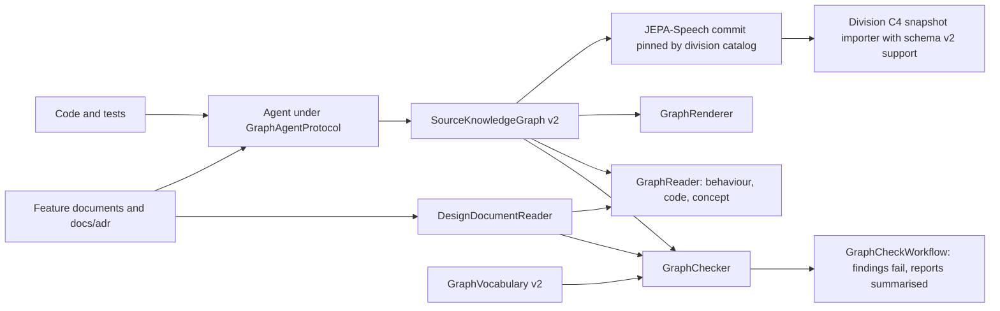

# Source graph links to feature documents

## Product owner: vision

### Problem

A feature's design lives in its documents: the analyst's behaviours, the architect's components and ADRs. The code that results lives in the `SourceKnowledgeGraph`. Nothing connects the two. When pushback changes a behaviour, nobody can ask "what code and tests does this affect?". When an agent or reviewer reads a class, they cannot find which behaviour it serves or which ADR shaped it. A division ontology cannot assemble a feature → behaviour → code view. The only link today is the architect's traceability table, which stops at components that may not exist yet. So people and agents rediscover these connections by hand, or guess.

### Users

- Developers in repositories with the kit and the source graph installed, who run features through the persona skills, read the graph, and want to know why code exists and what a behaviour change touches. JEPA-Speech's maintainer is the first.
- The agents those developers direct, in persona-skill runs and in pencils-down runs, which write the links as they build and use them when an amendment arrives.
- Maintainers reviewing pull requests, who judge whether a link such as "this symbol implements `<slug>#B3`" is true.
- Division ontology repositories, which import each repository's graph at a pinned commit and want to traverse from features through behaviours to code across repositories.

### Outcomes and measures

Success is the owner's own judgement in a trial on JEPA-Speech, after reinstalling the kit and refreshing its persona skills from claude-plugins. No numeric targets are set.

1. **"What does this behaviour touch?" has an answer.** Starting from `<slug>#B3`, a developer or agent finds the components, code and tests linked to it, at a recorded revision. Measure: the owner asks for several behaviours and checks the answers against source.
2. **"Why does this code exist?" has an answer.** Starting from a symbol or component, a developer or agent finds the behaviours it serves and the ADRs that shaped it. Measure: the owner picks several symbols and judges whether the answers are right and useful.
3. **Agents record the links as they build.** In a persona-skill run, links are added in the same change as the code or test they describe, and every link cites evidence that exists. Measure: the owner reviews the trial pull requests and judges the links complete, well formed and not noisy.
4. **Links stay true through amendments.** When pushback changes or retires a behaviour, a deterministic check reports every link to a retired or missing behaviour, and the amendment's handoff can list the code and tests it affects. Measure: in the trial, the owner amends one behaviour and confirms that the affected links are reported.
5. **A division can follow the links.** Behaviours, decisions and their links use core graph kinds and relationships that a downstream consumer can rely on across repositories, and a division import keeps them. Measure: the owner judges that a division import of the trial graph can be traversed from a feature's behaviours to its code. Building a dedicated division view is not part of this measure.

### Scope

- Core graph support for behaviours and decisions (ADRs) as node kinds a division consumer can rely on. A behaviour node has a stable identity derived from `<slug>#B<n>` and cites its declaration in the feature's behaviours document; a retired behaviour stays visible as retired.
- Direct links only: a behaviour to its acceptance test; a component to the code it contains; a component or symbol to the ADR that shaped it; a component to the behaviours the traceability table gives it, once its code exists; and a symbol to a behaviour only where one symbol carries out the use case.
- Lookups both ways in the `GraphReader`: from a behaviour to its components, code and tests, and from a symbol or component to its behaviours and ADRs.
- A deterministic, offline check that reports links to retired or missing behaviours, with no model call.
- A stronger `GraphAgentProtocol` in `AGENTS.md` saying when an agent writes each link, so it reaches every workflow.
- Feature documents and ADRs as eligible evidence under the selected-document role.
- A trial on JEPA-Speech.

### Out of scope

- Nodes for vision outcomes; they are reachable through behaviours.
- Planned components that have no code yet.
- Symbol → behaviour links that could only be inferred from a flow across several symbols.
- Behaviour ids in code comments or commit trailers.
- Retrofitting links for features built before this one, except as an "add or refine" request.
- Changes to the claude-plugins persona skills or to superpowers. Phase-specific hooks would be a separate claude-plugins change.
- A model check of whether a link is true; maintainers judge that, and the graph naming review stays limited to names.
- Cross-repository search, the division runtime, and a dedicated division view of features.

### Research

- **The vocabulary half-expects behaviours.** Schema version 1 of the [graph vocabulary](../../../templates/source-graph/graph-schema.ttl) has nine kinds and no behaviour or decision kind, but `kit:implements` is already defined as realising "the named concept or behaviour", and `kit:document` with `kit:documented-by` can already hold an ADR. The [graph checker](../../../templates/scripts/check-source-graph.mjs) enforces no endpoint kinds and requires `kit:denotes` only on concept nodes, so a repository could model behaviours today as local kinds. [ADR 0008](../../adr/0008-source-graph-vocabulary.md) makes local kinds opaque to cross-repository consumers, so outcome 5 needs them in the core, which is a schema version decision.
- **Lookups are concept-only.** The [graph reader](../../../templates/scripts/query-source-graph.mjs) `concept` command follows `kit:denotes` and `kit:implements` from an ontology term; nothing starts from a behaviour, and reverse lookup is only the generic neighbours command. The installed [graph protocol](../../../templates/protocol/source-graph-protocol.md) already says never to record a planned or designed component.
- **Behaviour ids are written three ways.** Every feature here and in JEPA-Speech starts a behaviour with a bold `B<n>`, but as `**B1 — Title.**`, `- **B1 Title.**` or `**B1. Title.**`, in `02-behaviours.md` (full mode) or `feature.md` (lite mode). No feature has a retired behaviour yet. A deterministic check that a cited line declares `B<n>` has to accept these forms or rely on one fixed form. The claude-plugins analyst skill now makes ids permanent, never reused, and names them `<slug>#B<n>` outside their feature (claude-plugins PR 10, merged).
- **The JEPA-Speech trial ground.** At `main` commit `71f8a2b`, it has one feature (`zener-shape-tracing-motor-test`, full mode, behaviours B1 onwards in `02-behaviours.md`) and six ADRs in `docs/adr/`. Its graph holds 3 component, 4 concept, 3 source-file, 2 test, 2 dependency and 1 document nodes, with `kit:implements`, `kit:tested-by`, `kit:documented-by` and `kit:depends-on` assertions. `docs/adr/**` is configured as selected-document evidence; `docs/features/**` is not. Its persona skills predate stable behaviour ids and need refreshing from claude-plugins before the trial.
- **The division import is generic.** division-ontology's [C4 graph reader](https://github.com/jamiemitchellconsultants/division-ontology/blob/main/src/c4/graph.mjs) reads every `GraphNode`'s kind, label and `kit:denotes`, and every `GraphAssertion`'s subject, relationship, object, basis and evidence, without a fixed list of kinds. New core kinds should survive import; a view that uses them would be division work.
- **Prior art for requirement links.** The [OSLC Requirements Management vocabulary](https://docs.oasis-open.org/oslc-domains/oslc-rm/v2.1/cs01/part2-requirements-management-vocab/oslc-rm-v2.1-cs01-part2-requirements-management-vocab.html) gives a requirement `implementedBy` and `validatedBy` links, the latter to tests, which match `kit:implements` (inverted) and `kit:tested-by`. There is no established RDF vocabulary for ADRs: [e-adr](https://github.com/adr/e-adr) embeds decisions as Java annotations in code. Research on decision traceability ([Gerdes et al., ECSA 2014](https://www.inf.uni-hamburg.de/en/inst/ab/swk/research/publications/pdf/2014-08-25-ecsa2014-wien-gerdes-lehnert-riebisch-paper.pdf)) argues that fine-grained links from decisions to code enable change impact analysis, and [a WICSA 2014 paper](https://swc.rwth-aachen.de/docs/publications/2014_WICSA_DLB_SWC.pdf) notes that architects prefer lightweight links over heavy cross-repository integration, which supports keeping links few and direct.

## Analyst: behaviours

These behaviours add two node kinds to the `SourceKnowledgeGraph`, for a `FeatureBehaviour` and a `DesignDecision`, and two lookups, `FindBehaviourLinks` and `FindCodeDesignLinks`. "The agent" is any agent following the `AgentInstructionFile` of a repository with the source graph enabled. The [#35 behaviours](../source-knowledge-graph/02-behaviours.md) and the [agent-maintained graph behaviours](../agent-maintained-knowledge-graph/feature.md) still hold. Behaviour ids here follow the stable-id rules: once published, an id is never renumbered or reused.

### Outcome 1: "what does this behaviour touch?" has an answer

- **B1 Behaviour node.** Given a feature document declares a behaviour on a line, or list item, whose first bold text starts with `B<n>` (in any of the forms `**B1 — Title.**`, `- **B1 Title.**` or `**B1. Title.**`), when the agent records it, then the graph holds one `GraphNode` of the core behaviour kind whose IRI is derived only from the feature's slug and the id (for example `:behaviour-<slug>-B3`), whose label is the `BehaviourReference` followed by the title as written (`<slug>#B3 Title`), and whose `GraphEvidence` cites the declaration with the selected-document role.
- **B2 One behaviours file per feature.** Given a feature folder, when a behaviour is read, then it comes from `02-behaviours.md` in full mode or from `feature.md` in lite mode. If both files declare behaviours for the same slug at one revision, `GraphChecker` fails and names both files. When a lite feature is promoted, every behaviour node keeps its IRI and only its evidence moves to `02-behaviours.md`, in the same pull request.
- **B3 Behaviour lookup.** Given a `BehaviourReference`, when a developer or agent runs `FindBehaviourLinks` in the `GraphReader`, then it returns, at the graph revision, the behaviour node with its `BehaviourStatus` and any replacement, and every assertion linking it, grouped as components, symbols and tests, each with its subject or object node, basis, evidence and evidence status, in the reader's text and `--json` forms. Inferred assertions are marked tentative and a stale revision is marked `STALE`. It follows one hop; longer chains use `path`.
- **B4 Nothing linked, or nothing known.** Given the behaviour node exists but no assertion links it, when the lookup runs, then it says so and prints the coverage inventory, and never says the behaviour is unimplemented or untested. Given no node exists for the reference, then it says the graph has no node for it and says whether the feature document at that revision declares that id.

### Outcome 2: "why does this code exist?" has an answer

- **B5 Decision node.** Given a file under `docs/adr/` named `NNNN-<title>.md`, when the agent records it, then the graph holds one `GraphNode` of the core decision kind whose IRI is derived only from the number (for example `:decision-0008`), whose label is `ADR NNNN` followed by the title as written, and whose evidence cites the title and Status lines with the selected-document role. Its `DecisionStatus` is taken from the first word of the Status line; "amended by" leaves it current. Other design documents stay `kit:document` nodes.
- **B6 Code lookup.** Given a source symbol, source file or component node, when a developer or agent runs `FindCodeDesignLinks`, then it returns the behaviours the node implements and the decisions it is documented by, with basis, evidence and status, and also those of the component that contains it through one `kit:contains` assertion, labelled "via component" and that component's label. Text and `--json` forms, tentative and `STALE` marks are as for B3.
- **B7 Code with no design links.** Given the node has no behaviour or decision link, directly or via its containing component, when the lookup runs, then it says so and prints the coverage that applies to the node's path; it does not say the code has no reason to exist.

### Outcome 3: agents record the links as they build

- **B8 Same change.** Given the source graph is enabled, when a change adds, rewords or retires a behaviour, adds an ADR or changes its status, first adds a component's code, adds a symbol that alone carries out a use case, or adds a test written to prove a behaviour, then the same change adds or updates the matching nodes and assertions (B1, B5, B9–B12) and the `GraphRefreshRecord`s the protocol already requires, whichever persona or workflow makes the change.
- **B9 Component serves behaviours.** Given a component's code is first added and the feature's traceability table gives it behaviours, when the agent records the component, then it asserts `kit:implements` from the component to each of those behaviour nodes with basis `kit:direct` and two `GraphEvidence` items: the traceability row (selected-document role) and the component's code (implementation role).
- **B10 Code shaped by a decision.** Given an ADR names a component or symbol as shaped by its decision, when the agent records that component or symbol, then it asserts `kit:documented-by` from it to the decision node, citing the ADR lines that name it and the code.
- **B11 One symbol, one use case.** Given one named symbol carries out a behaviour's use case on its own, when the agent records the symbol, then it asserts `kit:implements` from the symbol to the behaviour node, citing the symbol's declaration and the behaviour's declaration. A behaviour carried out across several symbols gets no symbol link; its component link (B9) serves.
- **B12 Test proves behaviour.** Given a test is written to prove a behaviour, when the agent adds it, then it asserts `kit:tested-by` from the behaviour node to the test node, citing the test and the behaviour's declaration.
- **B13 Only what exists.** Given a component or symbol is designed but has no code at the change's revision, when the agent maintains the graph, then it records no link for it. Behaviour and decision nodes are recorded as soon as their documents exist, because their evidence is the document.
- **B14 Narrow opt-in coverage.** Given a feature document or ADR is outside declared coverage, when the agent first needs it as evidence, then it proposes, in the same change, covered `GraphCoverage` and selected-document selectors in `OntologyConfig` for only the files that hold the evidence (the behaviours file, `03-architecture.md` and `docs/adr/**`), never `docs/features/**`, following the existing widening and exclusion rules.
- **B15 Visible in the pull request.** Given the change adds, changes or retires behaviour or decision nodes or their links, when the agent opens or updates the pull request, then the body lists each such node and link, in the way the agent-maintained graph already lists concept links.
- **B16 Reach through the protocol.** Given the kit is installed or upgraded with the source graph, when any agent reads the `AgentInstructionFile`, then the `GraphAgentProtocol` block carries B8–B15 and B20, with no change to the persona skills or superpowers.

### Outcome 4: links stay true through amendments

- **B17 Retired behaviour.** Given a behaviour is moved to the feature's Retired behaviours section, when the agent records the change, then its node keeps its IRI and last title, its `BehaviourStatus` becomes retired, its evidence cites the Retired behaviours entry, and, where the entry names a replacement, it links to the replacement's node.
- **B18 Superseded decision.** Given an ADR's Status line becomes superseded or deprecated, when the agent records the change, then its node keeps its IRI, its `DecisionStatus` follows the Status line, and, where the line names a successor ADR, it links to the successor's node.
- **B19 Missing behaviour fails.** Given a behaviour node's cited lines no longer declare its id and no Retired behaviours entry lists it, or a declaration reuses an id that the Retired behaviours section lists, when `GraphChecker` runs, then it fails with the node, the id and the document.
- **B20 Retired links are reported, not failed.** Given an assertion links a retired behaviour or a superseded or deprecated decision, when `GraphChecker` runs, then it lists each such `RetiredDesignLink` with its subject, its object and any replacement or successor, and passes. The agent copies that list into the pull request body and, in an amendment, into the handoff.
- **B21 Rewording keeps identity.** Given a behaviour's title or scenario is reworded with its meaning unchanged, when the agent records the change, then the node's label changes and its IRI and links stay as they are.

### Outcome 5: a division can follow the links

- **B22 Core vocabulary.** Given the kit's `GraphVocabulary`, then the behaviour and decision kinds, their statuses and the replacement and successor links are core values in a new schema version, so a downstream consumer can rely on them across repositories; they are not adopter-local extensions.
- **B23 The import keeps them.** Given a division importer that supports graph schema version 2 and a pinned JEPA-Speech commit containing the trial graph, when the division imports that commit, then the imported behaviour and decision nodes retain their IRIs, kinds, labels, statuses and evidence, and their assertions retain their IRIs, endpoints, relationships, basis and evidence. Starting from a feature's behaviour with linked code, a maintainer can follow the imported assertions to a source file or symbol.
- **B24 Offline.** Given any lookup or check in this feature runs, then it reads only local Git objects, the graph, the ontology and the feature documents; it makes no model call and needs no network or secret.

### Uncertainties

- **U1 Id formats.** Decided: a declaration is a line or list item whose first bold text starts with `B<n>`, so all three existing forms are accepted and the persona skills need no change (B1).
- **U2 Behaviour identity.** Decided: the IRI is derived only from the slug and id, the label is `<slug>#B<n>` plus the title, and a feature's slug is permanent (B1, B21). An IRI that includes the title was rejected, because every rewording would look like a new behaviour.
- **U3 Retired behaviours.** Decided: the node stays, marked retired, with a link to any replacement (B17). Deleting the node was rejected, because links to it would break without explanation.
- **U4 Decisions.** Decided: one node per ADR number, status from the first word of the Status line, superseded and deprecated handled like retired behaviours (B5, B18). Files outside `docs/adr/NNNN-*.md` stay ordinary documents.
- **U5 When links are written.** Decided: in the same change as the thing they describe, by whichever agent makes it, under the `GraphAgentProtocol` (B8, B16). The phase that usually makes each change is typical, not a gate.
- **U6 Component → behaviour evidence.** Decided: cite both the traceability row and the component's code, basis direct (B9). Citing only the code as an inference was rejected as weaker.
- **U7 Lookups.** Decided: one hop, grouped results, honest empty answers, and the code lookup follows one `kit:contains` up to its component (B3, B4, B6, B7).
- **U8 Stale links.** Decided: a missing or reused behaviour id fails the check; a link to a retired behaviour or superseded decision is reported and passes (B19, B20), so an analyst's amendment is never blocked by code it may not yet change.
- **U9 Evidence eligibility.** Decided: opt in per repository through the existing widening rule, with the narrowest selectors (B14). A default covering all of `docs/features/**` was rejected as noisy.
- **U10 Behaviours file.** Decided: `02-behaviours.md` in full mode, `feature.md` in lite mode, both at once an error, and nodes kept through promotion (B2).
- **U11 Kind and relationship names.** Deferred to the architect: the IRIs of the new kinds, statuses and links, and the schema version number.
- **U12 Division import compatibility.** B23 acceptance requires a compatible division-ontology revision. The [existing import rejects schema version 2](https://github.com/jamiemitchellconsultants/InternalOntology/issues/185#issuecomment-7113634323). Delivering importer compatibility belongs to division-ontology as a separate prerequisite. Record the importer revision and the pinned trial graph commit when running acceptance. Keep B23 pending until the compatible importer is available.

### Terms

`FeatureBehaviour`, `BehaviourReference`, `BehaviourStatus`, `DesignDecision`, `DecisionStatus`, `RetiredDesignLink`, `FindBehaviourLinks` and `FindCodeDesignLinks`, added to [the ontology](../../ontology.md).

## Architect: structure

Behaviours and decisions join the `SourceKnowledgeGraph` as core kinds in schema version 2. A new kit-owned `DesignDocumentReader` reads feature documents and ADRs, so `GraphChecker` can hold behaviour and decision nodes to their documents and `GraphReader` can answer the two new lookups. Everything stays offline and deterministic; agents write the entries under the `GraphAgentProtocol`, and maintainers judge whether each link is true.

### Components

| Component | Responsibility | Behaviours |
| --- | --- | --- |
| `GraphVocabulary` (`CORE` in `source-graph-model.mjs`, rendered as `graph-schema.ttl`) | Schema version 2: kinds `kit:behaviour` and `kit:decision`; node predicate `kit:designStatus` with `BehaviourStatus` and `DecisionStatus` values; relationships `kit:replaced-by` and `kit:superseded-by`. Each core value is tagged with the version that introduced it ([ADR 0041](../../adr/0041-behaviour-and-decision-kinds-in-schema-version-2.md), [ADR 0042](../../adr/0042-accept-older-graph-manifests.md)). | B1, B5, B17, B18, B22 |
| `DesignDocumentReader` (new kit-owned script) | From a Git tree: finds a feature's behaviours file by mode; finds behaviour declarations in the three bold `B<n>` forms and under a Retired behaviours heading; reads an ADR's title and the first word of its Status line; maps node IRIs to a `BehaviourReference` or ADR number and back ([ADR 0043](../../adr/0043-check-design-nodes-against-their-documents.md)). | B1, B2, B4, B5, B17, B18, B19, B21 |
| `GraphChecker` | Accepts manifests from version 1 to the core version and fails a value newer than the manifest; validates `kit:designStatus` on the two kinds; through the `DesignDocumentReader`, fails missing, reused or mislabelled ids, a status that differs from its document, and two behaviours files for one feature; lists each `RetiredDesignLink` in a non-failing `reports` list ([ADR 0044](../../adr/0044-report-retired-design-links-without-failing.md)). | B2, B5, B17, B18, B19, B20, B21, B22, B24 |
| `GraphCheckWorkflow` | Appends the checker's reports to the job's step summary; still read-only, with no model or secret. | B20, B24 |
| `GraphReader` | New commands `behaviour <slug>#B<n>` (`FindBehaviourLinks`) and `code <node>` (`FindCodeDesignLinks`) beside `concept`, with the existing text, `--json`, tentative and `STALE` conventions and coverage output on empty answers; `code` follows one `kit:contains` up to the containing component. | B3, B4, B6, B7, B24 |
| `GraphRenderer` | Readable phrases for `kit:replaced-by` and `kit:superseded-by`, and each behaviour or decision node's status beside its label. | B17, B18, B22 |
| `GraphAgentProtocol` | One added paragraph: write each node and link in the same change as what it describes, with the evidence rules of B9–B12; record only what exists; propose narrow coverage; raise the manifest version with the first version 2 value; list design links and reports in the pull request body. | B8, B9, B10, B11, B12, B13, B14, B15, B16, B20, B21 |
| `Installer` | Installs the new script and the version 2 schema as kit-owned files; never edits the adopter's manifest or `OntologyConfig`. | B16, B22 |
| `OntologyConfig` and `GraphCoverage` (adopter data) | Hold the narrow selected-document selectors and covered entries an agent proposes for the files that carry design evidence. | B14 |
| Division C4 snapshot importer (division-ontology) | Reads the trial graph and evidence at the source commit named in the catalog. The compatible importer preserves the design nodes and their assertions for traversal to code ([ADR 0045](../../adr/0045-require-a-compatible-division-importer.md)). | B23 |

### Structure

A behaviour node is `:behaviour-<slug>-B<n>`, of kind `kit:behaviour`, labelled `<slug>#B<n> Title`, with `kit:designStatus` and one `GraphEvidence` on its declaration (or its Retired behaviours entry). A decision node is `:decision-<NNNN>`, of kind `kit:decision`, labelled `ADR NNNN Title`, with `kit:designStatus` and evidence on its title and Status lines. Links reuse the core relationships: component or symbol `kit:implements` behaviour, behaviour `kit:tested-by` test, component or symbol `kit:documented-by` decision, plus the new `kit:replaced-by` and `kit:superseded-by`. A component's `kit:implements` cites the traceability row and the component's code; the checker confirms both exist and does not parse the row.

Division acceptance calls the C4 snapshot loader, `loadSnapshot` in `src/c4/snapshot.mjs`, at a verified compatible division-ontology revision. Its input is a catalog commit and clean source checkouts. Inspect the imported graph for JEPA-Speech against the canonical Turtle and evidence at the catalog's pinned source commit. Follow an incoming `kit:implements` assertion from a behaviour to a source symbol or to a component, then follow that component's `kit:contains` assertion to a source file or symbol.

### Deployment and runtime

- Kit upgrade: the installer replaces the kit-owned scripts, workflow and `graph-schema.ttl` (version 2) and adds `DesignDocumentReader`. No adopter file changes, and an existing version 1 graph keeps passing because older manifests are accepted.
- First use in a repository: the agent's change that records the first behaviour or decision node also raises the manifest's `kit:schemaVersion` to 2 and proposes the narrow coverage and evidence selectors; the maintainer reviews both in that pull request.
- Runtime: Node.js and Git only, as today. The checker and reader read local Git objects, the graph, the ontology and the feature documents; no model call, network or secret. The check workflow keeps `contents: read` and adds only a step-summary write, which needs no permission.
- Trial: reinstall the kit in JEPA-Speech, refresh its persona skills from claude-plugins, then record its `zener-shape-tracing-motor-test` behaviours and its ADRs and follow outcomes 1–5. For B23, use a division catalog that pins the trial graph commit. Record the JEPA-Speech commit, the division catalog commit and the compatible importer revision in acceptance. B23 remains pending until division-ontology delivers the compatible importer. The kit checks and lookups can run independently.

### Traceability

| Behaviour | Components |
| --- | --- |
| B1 | `GraphVocabulary`, `DesignDocumentReader`, `GraphChecker` |
| B2 | `DesignDocumentReader`, `GraphChecker` |
| B3 | `GraphReader` |
| B4 | `GraphReader`, `DesignDocumentReader` |
| B5 | `GraphVocabulary`, `DesignDocumentReader`, `GraphChecker` |
| B6 | `GraphReader` |
| B7 | `GraphReader` |
| B8 | `GraphAgentProtocol` |
| B9 | `GraphAgentProtocol`, `GraphChecker` (evidence exists) |
| B10 | `GraphAgentProtocol` |
| B11 | `GraphAgentProtocol` |
| B12 | `GraphAgentProtocol` |
| B13 | `GraphAgentProtocol` |
| B14 | `GraphAgentProtocol`, `OntologyConfig` and `GraphCoverage` |
| B15 | `GraphAgentProtocol` |
| B16 | `GraphAgentProtocol`, `Installer` |
| B17 | `GraphVocabulary`, `DesignDocumentReader`, `GraphChecker`, `GraphRenderer`, `GraphAgentProtocol` |
| B18 | `GraphVocabulary`, `DesignDocumentReader`, `GraphChecker`, `GraphRenderer` |
| B19 | `DesignDocumentReader`, `GraphChecker` |
| B20 | `GraphChecker`, `GraphCheckWorkflow`, `GraphAgentProtocol` |
| B21 | `DesignDocumentReader`, `GraphChecker`, `GraphAgentProtocol` |
| B22 | `GraphVocabulary`, `GraphChecker`, `GraphRenderer`, `Installer` |
| B23 | `GraphVocabulary` (schema 2 contract), division C4 snapshot importer (preservation and traversal) |
| B24 | `GraphChecker`, `GraphCheckWorkflow`, `GraphReader` |

### Decisions

- [ADR 0041](../../adr/0041-behaviour-and-decision-kinds-in-schema-version-2.md) — add behaviour and decision kinds in graph schema version 2 (answers U11).
- [ADR 0042](../../adr/0042-accept-older-graph-manifests.md) — accept graph manifests at an older schema version.
- [ADR 0043](../../adr/0043-check-design-nodes-against-their-documents.md) — check behaviour and decision nodes against their documents, without parsing traceability rows.
- [ADR 0044](../../adr/0044-report-retired-design-links-without-failing.md) — report retired design links without failing the check.
- [ADR 0045](../../adr/0045-require-a-compatible-division-importer.md) — require a compatible division importer for pinned design-link acceptance (answers U12).
