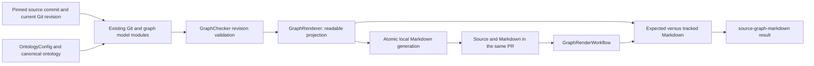

# Human-readable source knowledge graph — architecture

This design serves the [accepted behaviours](02-behaviours.md). The owner chose to keep generated Markdown in the repository and include it in the same PR as graph changes, with CI checking freshness. The owner accepted the component boundaries, default output path, revision representation and rendering conventions below.

## Components

| Component | Responsibility | Behaviours |
| --- | --- | --- |
| `GraphRenderer` | A dependency-free `scripts/render-source-graph.mjs` command selects a committed source snapshot, validates it, projects the complete graph into ordered readable Markdown, and atomically replaces the generated file or compares expected bytes. It also verifies that the input projection matches the revision being checked. Formatting is pure within this component. | B1–B14 |
| Existing graph Git and model modules | The installed `source-graph-git.mjs`, `source-graph-turtle.mjs` and `source-graph-model.mjs` supply immutable tree/index reads, all configured Turtle shards, resource locations, vocabulary and coverage precedence. They remain shared with `GraphReader` and `GraphChecker`; rendering adds no second parser. | B1–B4, B6–B9, B11, B14 |
| `GraphChecker` | Validate structure, references, ontology denotations, evidence locations/blob currency, coverage and current review records before rendering. Existing PR validation additionally retains its base/proposed comparison and configuration protections. | B1, B4–B6, B8–B10, B13–B14 |
| `GraphRenderWorkflow` | A separate installed workflow regenerates expected Markdown on PRs and default-branch pushes, comparing the document in the same Git tree as its graph. It publishes the stable `source-graph-markdown` result and reports missing/stale output or invalid input. | B6, B10–B14 |
| `Installer`, `OntologyConfig` and `GraphAgentProtocol` | Ship/configure the renderer and workflow with the existing source-graph option, and guide authors through a canonical source commit followed by generation and a document commit in the same PR. Repository variation remains configuration. | B7, B10–B14 |

The new named subsystems are `GraphRenderer` and `GraphRenderWorkflow`, recorded in the ontology. Snapshot projection, formatting and atomic output remain responsibilities inside `GraphRenderer`, rather than new services or stores.

## Structure

### Data and location

Canonical data remains the adopter's Turtle graph and ontology. The derived document defaults to `<sourceGraph.root>/README.md`, making it discoverable in the graph folder. The existing Kit operating guide, normally `docs/source-knowledge-graph.md`, remains separate. There is no new graph store, model service or extraction stage.

Add optional `sourceGraph.markdownPath` to `OntologyConfig`, defaulting to that README path. Validate a normalized repository-relative `.md` path strictly inside the graph root, with no collision with the ontology or canonical graph files. The root's exclusion is already checked: the derived view must not become its own evidence or require a refresh record. The override lets an adopter retain an authored README without editing a shipped script.

Add `sourceGraph.repositoryUrl` for the repository's HTTPS browser URL, supporting GitHub Enterprise hosts. It is optional for existing graph-only operations but required by the renderer. Reject credentials, query/fragment components and invalid browser-base paths. Construct commit-pinned file links from this configured base rather than baking in a repository or discovering an unrelated remote. A fork uses a source commit available in the configured repository's PR history before publishing its links.

The installer supplies tooling, not placeholder graph content. First generation follows a commit of canonical source/configuration/graph input. An existing unmarked output file is a collision: preserve it and ask the author to move it or choose another configured path. A generated marker identifies subsequent renderer-owned output. Canonical adopter-owned Turtle and configuration retain their existing upgrade ownership.

### Snapshot identity and source links

The author first commits canonical graph, source, configuration and ontology changes as source revision S, then generates Markdown from S and commits the document as D in the same PR. S already exists when D is generated, so the document records S's full commit ID without referring to its own future containing hash. Same PR does not require the same commit. The graph's own effective revision convention is unchanged: the document records the earlier input snapshot used for its view and proves that relevant input remains identical at D and at the checked PR/default-branch revision.

Evidence and Turtle links use the configured browser URL, S's full commit ID, an encoded repository-relative path and numeric line anchors. They never follow a branch or relative viewing ref. Primary labels show the source path/line range; a readable Turtle reference locates the assertion's resource block using the model's file/start-line location. Shared labels are disambiguated by source references and stable identity-derived anchors, keeping full IRIs out of the main text. Advancing a branch after a reader opens the document cannot change its destinations. GitHub documents this [commit-based permalink mechanism](https://docs.github.com/en/repositories/working-with-files/using-files/getting-permanent-links-to-files).

Record S and a deterministic input fingerprint in bounded generated provenance. Check mode validates S and the current revision, compares their complete rendering-input projections, and regenerates expected bytes from S. Reject mismatches even when assertions are unchanged: relevant source, evidence and configuration must still agree. When an existing valid document's projection still matches HEAD, reuse its recorded S rather than changing links on every document-only commit. An explicit source revision permits recovery or deliberate regeneration.

After squash/rebase or source-branch deletion, S may be absent from a normal full-history clone. During checkout/bootstrap, read only the bounded, strictly validated source SHA from generated provenance and fetch that object from the checkout's fixed repository remote if missing. GitHub stores PR changes for retrieval through its [PR refs](https://docs.github.com/en/pull-requests/how-tos/review-pull-requests/checking-out-pull-requests-locally). Verify source retrieval and permalink availability in squash/rebase acceptance trials. Unavailable S is an explicit failure with instructions to retrieve it or regenerate from an available matching source snapshot; never silently fall back to moving links. The renderer makes no network request and never executes content from S.

The fingerprint covers an unambiguously serialized, sorted path/blob inventory: configuration, configured ontology Markdown/Turtle, graph Turtle shards/schema, and every existing covered source file, plus the rendering format version. File additions/deletions are captured by that inventory and graph review data. Exclude generated Markdown and execution metadata. Changes outside the input projection do not churn the view; validation still examines the complete candidate and discovers newly covered files. A fingerprint aids comparison/provenance, not semantic truth or proof that a remote link is available.

### Readable projection

Use one document with a generated-content notice and correction instructions, a node index, current claims grouped by recorded subject, coverage declarations, used local vocabulary definitions, and secondary source/provenance detail. This layout is the architect's choice accepted with this design. A valid empty graph explicitly has no recorded assertions while still showing nodes and coverage.

Each assertion is an identifiable claim with recorded names, a directed defined relationship, explicit direct or tentative-inference basis, every evidence reference and a Turtle source reference. Object-only and isolated nodes remain in the index. Core relationships use fixed readable phrases with existing definitions; local relationships retain recognizable local names and access to their declared definitions. Do not ask a model to paraphrase claims or guess missing meanings.

Order node/subject groups by label then IRI, assertions by subject, relationship, object and assertion identity, evidence by path, start/end lines, role and identity, coverage by descending priority then selector/identity, and local definitions by identity. Use ordinal comparison, fixed newlines and one source line per prose paragraph or list item. Include no timestamps or run identifiers.

Escape Markdown punctuation and HTML in graph-supplied text. Construct links only from validated repository paths, encoding path segments before adding numeric line anchors. Display names as escaped text rather than automatically backticking source symbols: a legitimate source node need not be an ontology concept, and generation must not create term-check false positives. Full IRIs, blob hashes and the fingerprint belong in secondary references/detail. Do not turn schema triples, prefixes or refresh-record inventories into the main readable content.

### Validation and output boundary

Reuse `loadCheckConfig` and `checkRevision` against the selected immutable tree, including structure, evidence currency and current review records. Loading the model or reusing the reader's stale flag alone is insufficient. The existing `GraphCheckWorkflow` independently retains PR base/proposed freshness and prevents disabling/relocating an enabled graph in the same PR. The Markdown check does not replace or weaken it.

Complete validation and rendering in memory. Local generation writes a temporary sibling then atomically replaces only the configured generated document; failure preserves its previous contents. Reject paths that escape the worktree or traverse symlinks, and preserve unmarked authored files. Require the current index input projection to match the selected committed source and recheck it before replacement; otherwise ask the author to commit source changes first or rerun. Unrelated unstaged files are not generation input. Check mode compares in memory without writing repository content.

## Deployment and runtime

### Installation and upgrade

- Extend the existing `--with-source-graph` plan with the Kit-owned renderer, shipped tests and `source-graph-render.yml` workflow. Reuse the installed graph modules, Node.js and Git; introduce no npm/RDF dependency. Repositories without source-graph installation retain their current checks.
- Extend configuration validation for optional `sourceGraph.markdownPath` and renderer-required `sourceGraph.repositoryUrl`. Existing reader/checker operations remain compatible without the URL, while a renderer adopter configures it and includes the first document in the upgrade PR. The new check reports missing configuration/output rather than claiming a readable view exists.
- Extend the installed graph protocol/guide with the source-commit/generation sequence, correction through canonical Turtle, and the distinction between structural validation and human accuracy review. Ordinary upgrades preserve adopter configuration and graph data.

### Authoring and CI

- Write mode is `node scripts/render-source-graph.mjs`, with optional `--source-rev <commit>`. Commit canonical source/configuration/graph changes first. Reuse a still-valid recorded source snapshot or select HEAD when its relevant projection changed; validate that snapshot and the matching index input, then generate the configured file. Stage Markdown, review the cached diff, validate and commit it as a follow-up in the same PR. The command neither migrates the ontology nor creates/stages commits implicitly. If the previous source object is missing locally, fetch it during preparation or explicitly select an available matching source revision.
- Read-only mode is `node scripts/render-source-graph.mjs --check --rev <commit>`, defaulting to HEAD; `--check --staged` checks an index candidate after staging the generated file. Read provenance from that candidate's document, validate its pinned source and the candidate, require matching projections and compare exact regenerated bytes. Historical checks leave working output alone. Exit 0 on equality, 1 for missing/stale Markdown or a projection mismatch, and 2 for invalid input, unavailable source objects or unusable modes. Explicit rendering for absent/disabled graph configuration is a setup error, not a successful empty view.
- Run `GraphRenderWorkflow` on every PR and default-branch push without fixed source-path filters that would miss configured roots. Use read-only `contents` permission, full-history checkout and the existing Node.js setup pattern. On PRs check the test-merge tree, as the graph workflow does; a base change affecting rendered input requires an updated source snapshot/view. The existing graph workflow runs its PR comparison separately. The [event documentation](https://docs.github.com/en/actions/reference/workflows-and-actions/events-that-trigger-workflows#pull_request) describes the merge ref, and [checkout documentation](https://github.com/actions/checkout) describes full-history checkout.
- During checkout/bootstrap, fetch a missing pinned source object, taking only a validated commit SHA from bounded provenance and using the fixed repository remote. CI then regenerates expected Markdown locally, checks tracked output and publishes `source-graph-markdown`. It never commits, pushes or opens an update PR. Rendering afterward uses local Git objects with no model, secret, hosted graph service or network request.
- Require `source-graph-markdown` alongside `source-graph` once the adopter's upgrade and initial document are merged. Failures identify invalid input or missing/stale output and give the regeneration command. They never claim an earlier view was refreshed. Recovery is to correct and commit canonical input/configuration, retrieve or select its source snapshot, regenerate, stage and rerun validation.

This Kit repository remains the template source; implementing this feature does not itself enable a local source graph. Installed-repository tests and the JEPA-Speech trial exercise the shipped generator, workflow and readable output.

## Traceability

| Behaviour | Components and responsibility |
| --- | --- |
| B1 | `GraphRenderer` projects every assertion from the complete model; `GraphChecker` validates input. |
| B2 | `GraphRenderer` uses recorded names, core/local definitions, text escaping and stable ordering. |
| B3 | `GraphRenderer` includes isolated nodes and explicit empty-graph content. |
| B4 | `GraphRenderer` links every evidence reference; `GraphChecker` validates its source and currency. |
| B5 | `GraphRenderer` preserves basis and the human-review notice; `GraphChecker` requires valid evidence/basis. |
| B6 | `GraphRenderer` records a pinned source commit and verifies matching current input; `GraphRenderWorkflow` retrieves/checks that snapshot. |
| B7 | `GraphRenderer` exposes Turtle resource references from model locations; `GraphAgentProtocol` explains investigation. |
| B8 | `GraphRenderer` presents scope, reasons and priority from the model; `GraphChecker` validates declarations. |
| B9 | `GraphRenderer` distinguishes missing knowledge from negative facts and preserves unknown/excluded scope. |
| B10 | `GraphRenderer`, `GraphRenderWorkflow`, `Installer` and `GraphAgentProtocol` generate/check the tracked derived view. |
| B11 | `GraphRenderer` orders every projection and uses provenance excluding output and execution metadata. |
| B12 | `GraphRenderer` rebuilds current state; `GraphRenderWorkflow` rejects superseded tracked output. |
| B13 | `GraphChecker` validates; `GraphRenderer` atomically replaces local output; `GraphRenderWorkflow` fails without publication. |
| B14 | `Installer` ships identical tools; `OntologyConfig` locates graph/output and repository browser URL; `GraphRenderer` constructs pinned references. |

## Decisions

- [ADR 0009 — Keep generated graph Markdown with its source PR](../../adr/0009-source-graph-markdown-in-source-pr.md): owner-selected repository storage and same-PR publication; read-only CI.
- [ADR 0010 — Pin the readable graph to a committed source snapshot](../../adr/0010-source-graph-markdown-revision-context.md): source and document commits share one PR; immutable links and matching projections avoid self-reference and moving evidence.
- [ADR 0011 — Reuse validated graph inputs for deterministic rendering](../../adr/0011-source-graph-markdown-renderer.md): shared validation/model, one renderer, readable projection and atomic output.
