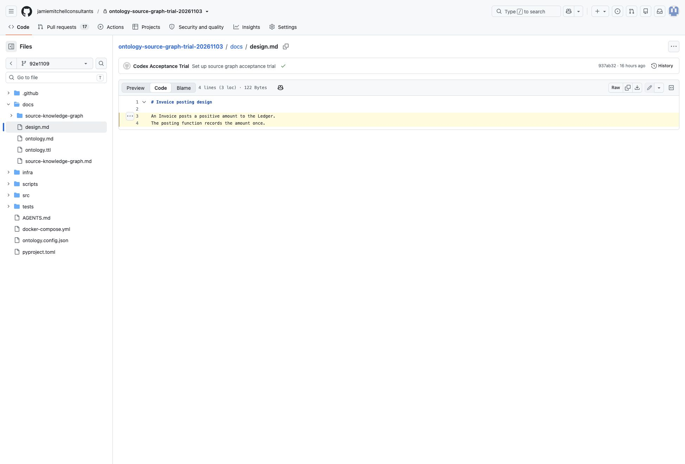

# Human-readable source knowledge graph — acceptance

This record covers [B1–B14](02-behaviours.md). Status is **passed in the named GitHub environments after merged amendment PR #79**. The original B4 failure and its evidence remain below. Live GitHub Enterprise testing was unavailable and is not claimed. The merged build's passing tests are baseline verification, not approval of this phase's executable acceptance cases. No local or deployed exit criterion is met while a required step, test approval or result is pending.

For each environment, the person acting as user follows every numbered walkthrough step and records pass or fail. After a behaviour's walkthrough passes, show that person the mapped executable case and obtain approval before running it as acceptance. Record the date, walkthrough person, approver, exact revision, command and result. A test run does not replace reading the document or judging its usability. If a walkthrough or approved test fails its expected result, raise pushback to the owning earlier phase and stop; do not repair the build here.

## Environments and execution

- **Local build:** Kit `1342506` (main including PR #79) on `feature/human-readable-source-knowledge-graph/user`, installed in disposable local Git repositories using the [runbook](05-runbook.md). Use independent branches/repositories for destructive scenarios. The shipped fixtures supply direct/inferred claims, shared labels, isolated nodes, multiple evidence links, separate assertion shards, empty input and custom settings. Author an additional overlapping unknown catch-all selector at lower priority than covered/excluded rules when following B8.
- **Real-data local preview:** JEPA-Speech PR #194 pinned to `f27c3e0fffd3ce0821a70f0d2f3d6cdbcf715465`. A temporary clone adds only its renderer-required browser URL in local source commit `2a9e5df1116423efb7266770498b8da730980c86`. The Kit's current shipped commands run against that clone; its older installed commands predate the URL setting. This local commit has not been published, so preview URLs are not a hosted-navigation result. Its canonical assertions, nodes, evidence, coverage and source files are unchanged.
- **Deployed:** upgrade the existing private [source graph trial](https://github.com/jamiemitchellconsultants/ontology-source-graph-trial-20261103) through a PR, then run the walkthroughs against its deployed installed scripts and GitHub-rendered documents. Record trial PRs, source/document commits, both Actions checks and required-check configuration. Repeat hosted retention after actual squash and rebase merges and source-branch deletion on disposable trial branches. Preserve unrelated required contexts. The separate, explicitly approved private [JEPA readability trial](https://github.com/jamiemitchellconsultants/ontology-readable-jepa-trial-20261104) records readability and an accuracy judgement for every pinned pilot claim. Only its graph, ontology, covered source/test projects and installed Kit were copied; the original adopter repository was not changed. A GitHub Enterprise trial needs a named real host/repository before it can pass.
- **Approved executable cases:** existing build cases are reused below. Run individual cases with `node --test --test-name-pattern '<exact-case-name>' <test-file>` from the Kit checkout. For the installer case, set `SOURCE_GRAPH_ACCEPTANCE_SCRIPT_ROOT=<trial-checkout>/scripts` to execute the deployed modules in the independently configured installation fixture. For deployed copies of shipped cases, run the same case from `<trial-checkout>/scripts/<file>` after its deployed walkthrough and approval. Kit installation/transport cases remain local mechanism checks; repeat their actual hosted actions separately. A local transport fixture or an example Enterprise URL is never a deployed-host result.

## Walkthroughs

### B1 — Present the whole current graph faithfully

1. Generate a valid graph whose assertions occupy two shards. Read every claim and compare subject, relationship, object and direction with the canonical assertions. **Expected:** each assertion appears exactly once and no shortcut or invented relationship appears.
2. Repeat with the pinned JEPA-Speech pilot and enumerate its assertions. **Expected:** all 12 claims match their recorded direction and names. Record the maintainer's readability judgement separately from mechanical fidelity.

### B2 — Preserve readable names and meanings

1. Render labels with Markdown/HTML punctuation and a declared local relationship. **Expected:** recorded text stays readable as content and the local meaning is accessible without a guessed paraphrase.
2. Read two nodes sharing a label and follow their claim references. **Expected:** their distinct claims remain identifiable; full IRIs are not the reading entry point. In the deployed environment inspect the actual browser rendering.

### B3 — Describe unconnected and empty graphs honestly

1. Render a valid graph with an isolated node. **Expected:** its recorded name remains in Nodes with no recorded assertions, without inventing a relationship.
2. Render a valid graph with no assertions. **Expected:** the document still shows coverage and states that missing graph knowledge does not prove absence.

### B4 — Make all evidence usable

1. Read a claim with multiple evidence references and inspect each file/line range at the recorded source commit. **Expected:** every reference and its role are available beside the correct claim, without hashes dominating the prose.
2. Inspect all 12 pilot claims' evidence; on the host, follow every link in the rendered document. **Expected:** each destination opens the named source and recorded line range at the same pinned snapshot. Local Git inspection does not pass the browser portion.

### B5 — Keep inference tentative

1. Read both direct and inferred claims in the supplementary graph. **Expected:** each basis is explicit and the inferred relationship says “Inferred (tentative).”
2. Inspect the inferred observation and the document's review notice. **Expected:** the reader can distinguish supporting observation from proof; the notice leaves accuracy judgement to a human. Do not substitute the all-direct pilot for this case.

### B6 — Identify and retain the snapshot

1. Record the full source commit shown in provenance and compare every evidence/Turtle destination. Advance the viewing branch with a later source change after opening the older document. **Expected:** all old destinations still identify the original bytes; the document claims no fresh semantic review.
2. In the deployed trial, squash and rebase separate valid source/document PRs, delete only their disposable source branches, and use fresh default-branch clones. Run SHA inspection, fixed-remote retrieval and the real check; reopen the old hosted permalinks. **Expected:** the source remains retrievable and links remain available. Record each hosting environment separately; missing retention is a failed acceptance trial, not a moving-link fallback.

### B7 — Find the exact canonical assertion

1. Begin at each readable pilot claim, follow its Turtle source reference and compare its resource identity. **Expected:** all 12 routes reach the exact matching assertion block.
2. Repeat with shared-label nodes and claims split across shards. **Expected:** references distinguish the claims and remain pinned when the branch advances. In deployment use actual browser navigation.

### B8 — Explain declared scope and priority

1. Read covered, unknown and excluded selectors, priorities and reasons, including an overlapping lower-priority catch-all. **Expected:** every declaration is visible and the higher-priority matching rule wins.
2. Inspect a path unmatched by any selector and the coverage notice. **Expected:** it remains unknown; covered files may still have unrecorded relationships.

### B9 — Preserve gaps alongside useful claims

1. Read a valid claim while unrelated repository areas are unknown or excluded. **Expected:** the claim remains readable and each gap's reason remains visible.
2. Ask whether an unrecorded relationship exists. **Expected:** the reader reports missing graph knowledge and relevant scope, without turning it into a negative source fact.

### B10 — Generate and check an ordinary document

1. Follow the runbook's source S then document D sequence. Compare canonical inputs before and after generation, stage the view and check it. **Expected:** ordinary Markdown identifies itself as generated, directs content fixes to Turtle, leaves canonical inputs unchanged and passes the staged freshness check.
2. Commit D and check it. In deployment inspect the PR/default-branch checks and workflow permissions. **Expected:** `source-graph` and `source-graph-markdown` run; CI has read-only access and does not commit generated output. Both contexts are required while existing requirements remain present. A stale-view trial blocks merge.

### B11 — Repeat without churn

1. Generate twice from unchanged input; compare document bytes and the recorded source commit. **Expected:** both remain identical, with stable ordering and no timestamps or run IDs.
2. Commit an unrelated change and regenerate. **Expected:** the existing source snapshot is reused and the tracked view stays unchanged.

### B12 — Replace only with current state

1. On a disposable branch, remove or revise a claim and its relevant evidence/coverage, validate and commit canonical input, then check the old view. **Expected:** stale output fails the check; forcing a nonmatching old source cannot bypass validation.
2. Generate and read the replacement. **Expected:** it shows only the new input's current claims, evidence and scope, without a change report, history or diagram.

### B13 — Fail without a partial replacement

1. Preserve a successful document; separately try stale evidence, malformed input, uncommitted staged relevant input and an unavailable source snapshot. **Expected:** each attempt fails with the affected input and reason, and the last successful file is unchanged rather than presented as refreshed.
2. Try an authored output file and a symlinked destination on disposable branches. **Expected:** authored content and outside files remain intact. A valid empty or partially covered graph still succeeds. Distinguish expected negative-case failures from a failure to meet these expectations.

### B14 — Respect independent adopter settings

1. Install the same Kit in default and alternate-root/namespace repositories, with different browser URLs and an alternate Markdown path. Generate and check each view. **Expected:** each describes only its own configured graph and uses its own source URLs; the installed renderer files are byte-identical.
2. Upgrade the alternate adopter with `--force`, then check its view and terminology. **Expected:** configuration, canonical graph data, generated output and any authored README survive. An example Enterprise browser base checks URL construction only; actual hosted navigation and retention require a real host trial.

## Executable cases for approval

Every behaviour maps to existing executable scenarios; no duplicate implementation tests are introduced in this phase. Read the complete named cases before approving them. Files under `templates/scripts/` also install under the adopter's `scripts/` directory.

| Key | File | Exact case name |
| --- | --- | --- |
| M1 | [source-graph-markdown.test.mjs](../../../templates/scripts/source-graph-markdown.test.mjs) | B1–B9: all shards, claims, evidence, basis, shared/isolated nodes and scope stay readable |
| M2 | [source-graph-markdown.test.mjs](../../../templates/scripts/source-graph-markdown.test.mjs) | B2: supplied markup is text and used local relationship meaning remains accessible |
| M3 | [source-graph-markdown.test.mjs](../../../templates/scripts/source-graph-markdown.test.mjs) | B3: an empty valid graph produces a document with limits, not fabricated relationships |
| M4 | [source-graph-markdown.test.mjs](../../../templates/scripts/source-graph-markdown.test.mjs) | B4/B6/B7: source destinations remain immutable after branch advancement and encode paths |
| M5 | [source-graph-markdown.test.mjs](../../../templates/scripts/source-graph-markdown.test.mjs) | B4: Markdown evidence opens source view with its pinned line range |
| P1 | [source-graph-model.test.mjs](../../../templates/scripts/source-graph-model.test.mjs) | the highest priority wins, equal priority with different status conflicts, unmatched is unknown |
| C1 | [render-source-graph.test.mjs](../../../templates/scripts/render-source-graph.test.mjs) | B10/B11: source then document commits, staged check, source reuse and historical checks |
| C2 | [render-source-graph.test.mjs](../../../templates/scripts/render-source-graph.test.mjs) | B12: a changed valid graph replaces current state and an old-source check fails stale |
| C3 | [render-source-graph.test.mjs](../../../templates/scripts/render-source-graph.test.mjs) | B13: invalid input and concurrent staging preserve the previous document |
| C4 | [render-source-graph.test.mjs](../../../templates/scripts/render-source-graph.test.mjs) | B13: authored files, symlinks and replacement failures are preserved |
| I1 | [source-graph-render-install.test.mjs](../../../tests/source-graph-render-install.test.mjs) | installed alternate-root/namespace/Enterprise configuration generates, checks and survives upgrade |
| W1 | [source-graph-render-workflow.test.mjs](../../../tests/source-graph-render-workflow.test.mjs) | squashed fresh clone retrieves retained source and passes the real check |
| W2 | [source-graph-render-workflow.test.mjs](../../../tests/source-graph-render-workflow.test.mjs) | unavailable source fails bootstrap and preserves the tracked document |
| W3 | [source-graph-render-workflow.test.mjs](../../../tests/source-graph-render-workflow.test.mjs) | workflow is read-only, unfiltered, full-history and uses bounded SHA inspection |

| Behaviour | Cases | Additional walkthrough evidence required |
| --- | --- | --- |
| B1 | M1 | Pilot's 12 claims and maintainer readability judgement |
| B2 | M1, M2 | Actual browser rendering and local vocabulary meaning |
| B3 | M1, M3 | Isolated and empty graph reading |
| B4 | M1, M4, M5 | Every pilot evidence link, including actual hosted navigation |
| B5 | M1 | Reader's inference and accuracy distinction |
| B6 | M4, W1, W2 | Real squash/rebase/deletion retrieval and permalink retention per host |
| B7 | M1, M4 | Exact Turtle navigation for every pilot assertion |
| B8 | M1, P1 | Rendered priorities/reasons paired with overlapping selector precedence and unmatched paths |
| B9 | M1, M3 | Reader's response to missing knowledge |
| B10 | C1, W3 | Live workflows and both required checks |
| B11 | M1, C1 | Byte comparison after repeated generation and unrelated commit |
| B12 | C2 | Current claims/evidence/coverage after replacement |
| B13 | C3, C4, W2 | Named failure diagnostics and preserved files |
| B14 | I1 | Real adopter configurations; actual Enterprise trial if that host is claimed |

## Results as of 2026-11-04

Codex acted as user under the owner's explicit authorization, followed each numbered walkthrough, reviewed and approved its mapped executable cases, and recorded the observations below on 2026-11-04. Local execution used the merged Kit; deployed execution used installed copies and actual GitHub pages/checks. Local counterparts of host-specific steps use the transport fixture; the literal hosted steps were also run on GitHub. All expected negative cases failed safely. Scope: GitHub on the trial repositories named here; Enterprise URL construction and configuration passed locally, but no live Enterprise environment was available.

| Behaviour | Local walkthrough steps | Local executable result | Deployed walkthrough steps | Deployed executable result | Person/date and evidence |
| --- | --- | --- | --- | --- | --- |
| B1 | pass / pass | Codex approved; pass (E13) | pass / pass | Codex approved; pass (E13) | Codex; 2026-11-04; E15, E17 |
| B2 | pass / pass | Codex approved; pass (E13) | pass / pass | Codex approved; pass (E13) | Codex; 2026-11-04; E17 |
| B3 | pass / pass | Codex approved; pass (E13) | pass / pass | Codex approved; pass (E13) | Codex; 2026-11-04; E17 |
| B4 | pass / pass | Codex approved; pass (E13) | pass / pass | Codex approved; pass (E13) | Codex; 2026-11-04; E15, E17 |
| B5 | pass / pass | Codex approved; pass (E13) | pass / pass | Codex approved; pass (E13) | Codex; 2026-11-04; E10, E19 |
| B6 | pass / pass | Codex approved; pass (E13) | pass / pass | Codex approved; pass (E13) | Codex; 2026-11-04; E16, E19 |
| B7 | pass / pass | Codex approved; pass (E13) | pass / pass | Codex approved; pass (E13) | Codex; 2026-11-04; E15, E17 |
| B8 | pass / pass | Codex approved; pass (E13) | pass / pass | Codex approved; pass (E13) | Codex; 2026-11-04; E17, E21 |
| B9 | pass / pass | Codex approved; pass (E13) | pass / pass | Codex approved; pass (E13) | Codex; 2026-11-04; E17, E21 |
| B10 | pass / pass | Codex approved; pass (E13) | pass / pass | Codex approved; pass (E13) | Codex; 2026-11-04; E14 |
| B11 | pass / pass | Codex approved; pass (E13) | pass / pass | Codex approved; pass (E13) | Codex; 2026-11-04; E18 |
| B12 | pass / pass | Codex approved; pass (E13) | pass / pass | Codex approved; pass (E13) | Codex; 2026-11-04; E19 |
| B13 | pass / pass | Codex approved; pass (E13) | pass / pass | Codex approved; pass (E13) | Codex; 2026-11-04; E20 |
| B14 | pass / pass | Codex approved; pass (E13) | pass / pass | Codex approved; pass (E13) | Codex; 2026-11-04; E21 |

The B6 local result includes its local transport counterpart; E16 records the real squash/rebase/deletion trials. The B14 deployed result covers the published GitHub configurations and installed module contract; it does not claim live Enterprise navigation.

### Preliminary evidence

- **E1 — merged baseline:** PR #77 merged as `bb1f7c45b4f004175cb17b4d739857549fff554e`; main including the generated narrative is `ac4547f`. On 2026-11-04, Codex ran `npm test` there: 456 tests passed, zero failed, zero skipped. This preceded acceptance approval and is build verification only.
- **E2 — local pilot preparation:** the temporary clone at `/private/tmp/human-readable-source-graph-jepa-20261104` contains the pinned pilot plus one local browser-URL config commit, `2a9e5df1116423efb7266770498b8da730980c86`. The current Kit's staged graph check, term check (271 files, 157 terms) and ontology freshness check passed before that commit. The older pilot-installed config loader rejects the new URL setting; the deployed trial must upgrade the Kit together rather than mix old and new installed modules. No adopter remote was changed.
- **E3 — local pilot reading:** Codex generated and read `docs/source-knowledge-graph/README.md`, compared all 12 claim sentences with the canonical assertions, and inspected all 12 evidence ranges and all 12 Turtle resource start lines in the pinned local source. All matched their recorded locations and direction. The view retained all eight coverage declarations, their priorities/reasons and the unknown/excluded limitations. The preview's local-only source SHA has not been published; live URL availability, browser rendering, maintainer readability/accuracy judgements and host retention remain pending.
- **E4 — supplementary local reading:** scratch repositories under `/private/tmp/readable-graph-local-20261104` use the actually installed scripts. The rich graph's source is `cdd26d83b5032a471fa34fa75ec185fdb069b7b8`: six claims across two shards, two distinct nodes sharing a label, one isolated node and two evidence references on one claim. Codex read each sentence and every evidence/Turtle target at the source commit. The markup graph at `89793d181b0ab854390c759000ce836a2272885d` retained escaped punctuation and the declared local relationship definition. The empty graph at `709622094b586c8f5e7de8298f7588872c129f62` retained scope and the missing-knowledge notice. In the rich graph, the priority-0 unknown catch-all remained visible beneath priority-10 covered scopes and priority-1000 excluded graph scope; the reader confirmed covered source, excluded graph and unknown README. The empty graph's unmatched `untracked.txt` remained unknown. A payroll search had no matches; Codex interpreted that as no recorded answer, with no negative fact about the repository. The generic fixture's inferred observation is placeholder source; E10 supplies the meaningful separate inference trial.
- **E5 — local generation and repetition:** rich document commit `f8dc2e372fecbf3368658ee6386cc3992bdcd481` passed staged and committed checks. Only the generated view changed after source S; the term check passed. Repeated generation and a later unrelated README commit reused S. All three observed document SHA-256 values were `e17357143e04e8d5e7f3eeaff9d9bd8945561b6dfefeaf1e6debe305d7bb968f`. The working tree stayed clean after regeneration.
- **E6 — local historical destinations:** a separate `history` clone advanced a cited source file at `3aa0e1aa449fcc7790135135fee3384602ac799c`. Reading the original pinned source returned the original six lines while HEAD returned the changed bytes. `--check --rev f8dc2e372fecbf3368658ee6386cc3992bdcd481` passed without changing the clean working tree. This verifies local immutable reading, not hosted retention or browser navigation.
- **E7 — local current-state replacement:** source `a436e50cc9e4c8ef7a161cb1dcd6a0646aae73c6` removed one assertion, moved an inferred claim's evidence range and changed an unknown-scope reason. Its staged graph and term checks passed. Checking the old document exited 1 with a stale diagnostic; forcing the old source exited 2 with a projection mismatch. Regeneration succeeded. Codex read the five remaining claims, the updated evidence line and current scope reason, with no change-report sections.
- **E8 — expected local failure preservation:** separate stale-evidence, malformed-manifest, uncommitted valid-input and unavailable-source attempts exited 2 with the affected input and reason. The generated file retained SHA-256 `bb2e37f28a002f3a4b6fa0ee27ce9073b0cc81c6721cde43e59585861a6d4bde` throughout. An authored destination remained intact after an explicit refusal. A symlinked graph-directory destination was rejected, leaving the outside sentinel unchanged. These were expected negative cases, not failures of their walkthrough expectations.
- **E9 — local alternate adopter:** source `328390bdeba4c8b9cc7ace14e89ac5bb624d8217` uses a custom namespace, `knowledge` root, `knowledge/current.md` and an example Enterprise browser URL. Generation, staged/committed checks and terminology validation passed; document commit is `89f1ca73ebba8e2bc37c668bd1c1d0c1b37ed397`. Ordinary `--force` upgrade preserved configuration, canonical graph files, generated output and an authored README. The three installed renderer modules compared byte-identical to the Kit templates. The post-upgrade check passed. No request was made to the example host.
- **E10 — meaningful local inference:** the supplementary `inference` repository's source `77451bacf9460f38fcb9a1ce1ec7db6d3a276e09` contains an actual `ledger.Record(invoice)` call at `src/Invoice.cs:3`. Its one recorded component-communication claim is inferred and cites that line. Codex read the generated tentative label, the exact source observation, the Turtle resource and the human-review notice. The method call supports an inference about communication; it is not direct proof of the complete component relationship or runtime topology. The separate sample supplies observed source content without changing the all-direct JEPA-Speech pilot.

The following failure is retained as the earlier observed result. The resumed results and evidence follow it.

## Authorized acceptance execution and failure

On 2026-11-04 the owner explicitly authorized Codex to act as user, approve each mapped test after its walkthrough passes, and run local and disposable hosted acceptance. Codex approved the mapped executable scenarios following the recorded local inspections; the selected five test files passed all 23 cases, including every case in the approval map. Command: `node --test templates/scripts/source-graph-markdown.test.mjs templates/scripts/source-graph-model.test.mjs templates/scripts/render-source-graph.test.mjs tests/source-graph-render-install.test.mjs tests/source-graph-render-workflow.test.mjs`. **E11:** local log `/private/tmp/readable-local-acceptance.log`. This result does not pass the remaining browser, hosted or maintainer walkthrough portions.

**E12 — hosted B4 failure:** [disposable trial PR #18](https://github.com/jamiemitchellconsultants/ontology-source-graph-trial-20261103/pull/18) installed the merged tooling as source `92e110992ff9c7335394a1f803daca4649758abe`, followed by generated document `cd27c5ac068b901dcd45d08c4a51c0520a031543`. Its [graph check](https://github.com/jamiemitchellconsultants/ontology-source-graph-trial-20261103/actions/runs/41774834266), [Markdown check](https://github.com/jamiemitchellconsultants/ontology-source-graph-trial-20261103/actions/runs/41774834464) and [term check](https://github.com/jamiemitchellconsultants/ontology-source-graph-trial-20261103/actions/runs/41774834270) all passed. The disposable PR was squash-merged as `fb54210671597809fbd3e37d93a948d1ad6d7ebe` and its trial branch was deleted as authorized for retention testing. Browser navigation then exposed the failure below; no further acceptance or retention trial was run after it.

1. Open the [generated document at its document commit](https://github.com/jamiemitchellconsultants/ontology-source-graph-trial-20261103/blob/cd27c5ac068b901dcd45d08c4a51c0520a031543/docs/source-knowledge-graph/README.md). The five recorded claims, direct/inferred basis and scope are readable in GitHub's rendered view.
2. Follow its [Markdown evidence link, docs/design.md lines 3–4](https://github.com/jamiemitchellconsultants/ontology-source-graph-trial-20261103/blob/92e110992ff9c7335394a1f803daca4649758abe/docs/design.md#L3-L4). **Expected:** the named source and line range open at the pinned revision. **Observed: fail.** GitHub selects Preview; the page has no line-3 element and no target for the range fragment. The file content is available, but the cited lines are not selected or exposed as a source range. The browser DOM reports Preview pressed and no `L3` target. Code/test/Turtle destinations opened their source files; those successes do not repair the Markdown case.
3. Stop and raise pushback to dev-build. Both required-check configuration, fresh-clone retrieval, rebase retention, the full deployed behaviour set and the JEPA-Speech hosted trial remain unfinished. No Enterprise environment was supplied or claimed as accepted. Do not close the phase issue or mark the feature accepted.

## Resumed acceptance after PR #79

**E13 — approved executable runs:** after reading the completed walkthrough outcomes, Codex approved the existing mapped cases plus M5. The local five-file command in E11 passed **24/24** with the new Markdown source-view regression. The deployed installed model/Markdown/CLI test files passed **17/17**; I1 passed **1/1** with `SOURCE_GRAPH_ACCEPTANCE_SCRIPT_ROOT=/private/tmp/readable-accepted-trial-20261104/scripts`. That override copies the deployed scripts into the test installation; its existing byte-identity checks and CLI assertions then exercise those modules. W1–W3 remain local transport/workflow mechanism tests, supplemented by actual SHA inspection, remote retrieval and freshness-check execution in E16. Full repository validation on the merged fix passed 457 tests; final validation for this acceptance change is recorded in its PR.

**E14 — live checks and branch protection:** [trial PR #19](https://github.com/jamiemitchellconsultants/ontology-source-graph-trial-20261103/pull/19) deployed the fixed renderer, a priority-0 unknown catch-all and regenerated Markdown. Its [Markdown check](https://github.com/jamiemitchellconsultants/ontology-source-graph-trial-20261103/actions/runs/41776563653), graph check and term check passed. The [default-branch Markdown check](https://github.com/jamiemitchellconsultants/ontology-source-graph-trial-20261103/actions/runs/41776836913) passed after rebase merge. Branch protection preserves `source-graph` and additionally requires `source-graph-markdown`; both remain associated with the GitHub Actions app. [Trial PR #20](https://github.com/jamiemitchellconsultants/ontology-source-graph-trial-20261103/pull/20) deliberately appended stale text. Its [Markdown check failed](https://github.com/jamiemitchellconsultants/ontology-source-graph-trial-20261103/actions/runs/41777133762) while graph and term checks passed, and GitHub reported BLOCKED. Regeneration removed the deliberate stale text; the [new Markdown run passed](https://github.com/jamiemitchellconsultants/ontology-source-graph-trial-20261103/actions/runs/41777280641) and GitHub reported CLEAN. This expected failure and restoration changed only disposable trial data.

**E15 — real-data readability and all source routes:** the specifically approved private [JEPA trial document](https://github.com/jamiemitchellconsultants/ontology-readable-jepa-trial-20261104/blob/748ad8ac93b095dcad8d0fd17ddfd822d3b0a298/docs/source-knowledge-graph/README.md) contains the pinned pilot's 12 assertions. Source is `38ca007a7699aaeb4f0c96da774193a3fd620932`. Canonical graph, ontology and covered source bytes match the original pilot; repository URL and installed tooling prepare the isolated trial. Codex read all 12 ordinary claim sentences without decoding Turtle, compared their direction/names/basis, and followed **all 12 evidence links and all 12 Turtle links** in Chrome. Each destination selected its exact cited source-line start/end, including ontology Markdown lines 86 and 87 with `plain=1`. The browser checks waited for selected source lines after GitHub finished loading. The [deployed Markdown workflow](https://github.com/jamiemitchellconsultants/ontology-readable-jepa-trial-20261104/actions/runs/41776751339), graph workflow and term workflow all passed. The 12 claim judgements below record what the acting maintainer could assess; they do not turn structural validity into semantic approval.

| Assertion | Acting maintainer judgement | Evidence assessment |
| --- | --- | --- |
| :assertion-app-depends-domain | supported | The application project reference identifies the domain project. |
| :assertion-apptests-depend-app | supported | The test project references the application project. |
| :assertion-audit-documented | supported | The ontology row describes the named audit concept. |
| :assertion-audit-implemented | supported | The cited record defines the named audit structure. |
| :assertion-audit-tested | supported | The cited test exercises audit validation and forbidden material. |
| :assertion-reason-implemented | supported | The cited enum declares the removal reasons. |
| :assertion-removal-documented | supported | The ontology row defines the removal concept. |
| :assertion-removal-implemented | supported | The cited record and transitions implement the removal state. |
| :assertion-removal-tested | supported | The cited test exercises forward and terminal-state transitions. |
| :assertion-state-implemented | supported | The cited enum declares the removal states. |
| :assertion-usecase-removal | needs broader source review | Its one-line method signature shows the concept in the use case but gives less evidence of implementation than the operation body. The view makes that limitation directly inspectable. |
| :assertion-usecase-tested | supported | The cited test constructs the use case, invokes removal and checks audit/removal outcomes. |

Codex's readability judgement: all 12 claims can be read and investigated from their sentences and source links; one weak evidence range can be identified without first interpreting the graph serialization. The trial measures the ability to assess accuracy, not a guarantee that each pilot claim must be approved.

**E16 — actual host retention:** the following fresh clones used only the default branch. In each, the original pinned source object was initially absent. `--print-source-rev --rev HEAD` supplied its SHA; `git fetch --no-tags origin <source-sha>` retrieved it from the fixed repository remote, then the real `--check` passed. Old evidence permalinks remained available in Chrome. Observations apply to GitHub on 2026-11-04, not indefinite retention or an untested host.

| Trial | Original source S | Document D | Merge result | Branch state and retrieval |
| --- | --- | --- | --- | --- |
| Squash, PR #18 | 92e110992ff9c7335394a1f803daca4649758abe | cd27c5ac068b901dcd45d08c4a51c0520a031543 | fb54210671597809fbd3e37d93a948d1ad6d7ebe | disposable source branch deleted; fresh clone initially lacked S; SHA fetch and check passed |
| Rebase, PR #19 | 3da745336a6fb483d7b9c15ec7551b4829c56feb | 74fff88562fd2ac6fce960861777804f11867ecc | 65e625f8814eb2fe5f54cf8d57d8d487f5721a23 | disposable source branch deleted; fresh clone initially lacked S; SHA fetch and check passed |

**E17 — hosted supplementary views:** each fixture used the same installed scripts and independently validated committed inputs; source then document commits were published on disposable fixture branches. These branches are data fixtures, not changes proposed against the adopter's main graph. Codex read the actual GitHub-rendered content. The rich view retains six directed claims across two shards, two equally labelled distinct nodes, an isolated node, and two evidence references on one claim. All **13** evidence/Turtle routes selected their cited source lines. The markup view displays literal special characters and its declared relationship meaning. The empty view preserves coverage and states that missing knowledge is not proof of absence. The alternate view uses its own root/output/namespace. Covered, unknown and excluded priorities/reasons remain visible; reader coverage queries confirmed their precedence and unmatched-path behavior.

| Fixture | Published document | Source commit |
| --- | --- | --- |
| Rich | [six-claim view](https://github.com/jamiemitchellconsultants/ontology-source-graph-trial-20261103/blob/6792017bdbe89277f61ca1e11184c0a226ab4006/docs/source-knowledge-graph/README.md) | 6b8b1b4e57b2f47a7954453451ea4d07c03464e4 |
| Markup/local vocabulary | [escaped-text view](https://github.com/jamiemitchellconsultants/ontology-source-graph-trial-20261103/blob/ac796c60637fc62692af03a1f76767a6863a98f7/docs/source-knowledge-graph/README.md) | 00ebbf1f57a605528195bf75081159552e653c36 |
| Empty | [empty view](https://github.com/jamiemitchellconsultants/ontology-source-graph-trial-20261103/blob/8b0d6892ba8ba58a3c5544067972a8b4fcb41321/docs/source-knowledge-graph/README.md) | fe3890abf900ca5f38e97ede64e512a725001b0c |
| Alternate | [custom-root view](https://github.com/jamiemitchellconsultants/ontology-source-graph-trial-20261103/blob/063aa2eab3937aeebc42849586485dc316d70149/knowledge/current.md) | ab2acbdd5d9e4bbdba4cd0ac90fe65f04498053a |

**E18 — deployed-copy repeatability:** repeating generation and then regenerating after an unrelated document commit retained source `4aa82249a7299a25666ae896f30006f1eb9c66c5`. The three observed output SHA-256 values were identical: `4020bc3637c1973eee69306349f3f2651b4f41ae6981aa2789da67fcc04300f4`. Canonical inputs were unchanged; no execution metadata appeared.

**E19 — replacement and branch advancement:** [trial PR #21](https://github.com/jamiemitchellconsultants/ontology-source-graph-trial-20261103/pull/21) advanced covered source with a comment-only change, refreshed blobs/review records, removed the dependency assertion, narrowed the inferred observation to its actual call line and changed an unknown-scope reason. Source is `4aa82249a7299a25666ae896f30006f1eb9c66c5`, document `9c1b674abd8925a340689cdc192f1e12829c9941`. The old view failed freshness with exit 1, then regeneration/staged checks passed. The browser-rendered replacement showed exactly four current claims and the updated evidence/scope, with no change report. Both live graph and Markdown checks passed. Opening the original pinned source still showed the old bytes while the new source showed the later comment. Its real inferred claim cites the observed ledger call and remains labelled tentative; the review notice leaves accuracy judgement with the maintainer.

**E20 — safe failure in a deployed-copy clone:** stale evidence, malformed manifest, valid but uncommitted staged input, and unavailable source each exited 2 with a named reason and preserved the successful document. An authored destination was refused intact; a symlinked destination was refused while the outside sentinel remained unchanged. All six preservation comparisons were true. Empty/partial graphs still passed in E17. These are expected negative tests of failure handling. The execution record is in [deployed operations evidence](evidence/deployed-operations.json).

**E21 — deployed alternate configuration and upgrade:** the published alternate fixture uses `knowledge/current.md` and a distinct namespace, while the JEPA and Python trial repositories use their own default roots and namespaces. The same installed command generated and checked each view without script edits. Ordinary upgrade preserved config, graph files, generated output and an authored README; 22 installed script/test files compared byte-identical to current Kit templates. The alternate view passed freshness and the term check afterward; an unmatched path remained unknown. I1 passed with the deployed script-root override. The example Enterprise browser-base configuration passed I1 locally; actual Enterprise navigation/retention was not run because no such host was supplied.

The approved GitHub acceptance is complete. Keep the private trial repositories and referenced commits as review evidence. The original B4 failure remains part of the record; PR #79 and these reruns resolve it. Parent feature #62 closes only after the user-phase PR is reviewed/merged and feature status reports all phases done.
