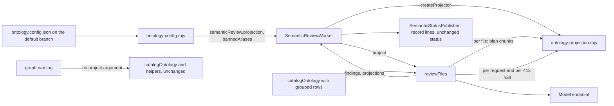

# Matched ontology projection

## Product owner: vision

### Problem

Every model request the `SemanticReviewWorker` makes carries the whole ontology projection, whatever
the Markdown chunk is about. JEPA-Speech's 202 entries come to 64,394 characters, sent again with
every chunk of every changed file. That causes three problems. As an ontology grows it hits the
`RequestBudget` and the review stops with `too-large`. The only fix today is to raise
`ONTOLOGY_MAX_REQUEST_CHARS`, which moves the limit (about 600 entries at the 200,000-character
default) without removing it. Runs are slow and expensive, which matters most on the home-lab model.
And the model has to hunt for the few relevant rows among hundreds, which risks noisy or missed
findings. Maintainers want each request to carry only the part of the ontology the chunk could be
talking about, chosen deterministically so that the same input always gives the same request. That
choice must not quietly lose the paraphrases the reviewer exists to catch.

### Users

- Maintainers of adopting repositories with large ontologies (JEPA-Speech today, Grooveloom next),
  who have had to raise the budget to keep semantic review running.
- Maintainers running the reviewer on a home-lab or metered model, who pay for every resent
  ontology in time or tokens.
- Pull request authors, who read the semantic status and its pull request record and need to know
  what their Markdown was actually checked against.
- The kit maintainer, who ships the byte-identical reviewer and needs a regression guard that the
  smaller requests still find what the full projection found.

### Outcomes and measures

These outcomes are judged by the maintainer. The figures show what to look at, not targets.

1. **Each request carries only the ontology its chunk needs.** Measure: the pull request record shows,
   for each reviewed file, how many entries were sent and how many characters they took, next to the
   size of the full projection.
2. **Matching keeps the findings the full projection found.** Measure: replaying the ten recorded
   JEPA-Speech findings (pull requests #210 and #217) under the matched projection, the evidence entry
   each one cites is in the projection sent for its file. The replay is kept as a regression test.
3. **A chunk that matches nothing is still reviewed.** Measure: a chunk with no matched entry is sent
   with a small fixed core set of the ontology instead of being skipped, and the record says so.
4. **Reduced coverage is visible, not silent.** Measure: the pull request record says when a file was
   reviewed against a matched or core-set projection rather than the full one. A finding can cite
   only an entry that was sent, and the evidence-key list in each request lists only those entries.
5. **Adopters get it by default and can switch back.** Measure: after a kit update, a repository's
   reviewer uses the matched projection with no configuration change. One `OntologyConfig` setting
   restores the full projection, and no script is edited.

### Decisions to settle

Left to the analyst and architect, with the research below as evidence:

- **The matching rule.** Matching exact entry names finds none of the recorded findings, and matching
  the words of a name finds all ten but sends much more. Somewhere between them is a precision and
  recall trade-off to choose deliberately.
- **What "directly related" means.** Adding every entry a matched row mentions sends most of the
  ontology. Adding only the relationship rows that touch a matched entry costs almost nothing.
- **What the core set is,** and whether it is also sent with matched chunks.
- **Whether matching runs per chunk or per file,** and how it interacts with chunking against the
  `RequestBudget`.

### Scope

- A deterministic selection, per request, of the ontology entries matched to the Markdown being
  reviewed, plus their directly related entries, with the evidence-key list restricted to those
  entries.
- A small core set for chunks that match nothing.
- Making the matched projection the default, with an `OntologyConfig` setting that restores the full
  projection.
- Recording in the `SemanticReviewRun` record and the pull request record what each file was reviewed
  against.
- Unit tests, a replay of the recorded JEPA-Speech findings as a regression test, and updates to the
  runbook `templates/docs/ontology-semantic-review.md` and the README.

### Out of scope

- Embedding-based or other model-based retrieval. That is a later feature, and this one must not
  close it off.
- Changing the system prompt, how a `SemanticFinding` is judged, or the dismissal flow.
- The drift reviewer and the graph naming reviewer, which build their own requests.
- Adding banned aliases or alternative labels to adopters' ontologies, and editing any consumer
  repository.
- Changing the `RequestBudget` defaults or the `too-large` outcome, other than its now applying to the
  matched projection.

### Research

All measurements use the shipped `catalogOntology` from `templates/scripts/semantic-review-model.mjs`
against each repository's configured sections. The scratch scripts are not committed.

1. **The full projection's size today.** JEPA-Speech: 202 entries, 64,394 characters. InternalOntology:
   130 entries, 32,281. LocalOntologySetup: 105, 25,273. EventBooking: 100, 22,491. Source: each
   repository's `docs/ontology.md` at its current default branch.
2. **Every recorded finding is a paraphrase, so exact names miss them all.** JEPA-Speech's run records
   (the hidden run markers in its pull request comments) hold ten findings. Examples: "AuditRecord"
   for the entity AuditEvent, "RemovalStatus" for the enum SessionRemovalState, and "pending,
   running, done" for that enum's values. Matching whole entry names selected the cited entry for none
   of them. Matching any significant word of a name, plus an enum's value words, selected it for all
   ten, with 21 to 56 entries (8,000 to 19,000 characters, 12% to 30% of the full projection). Matching
   only words shared by three or fewer entry names cut the size to 4 to 17 entries but kept the cited
   entry for only 4 of the 10. Source: JEPA-Speech pull requests #210 and #217, files replayed at
   their recorded revisions.
3. **Savings across real Markdown depend on the rule.** Over each repository's tracked Markdown
   (ontology, narrative and generated graph files excluded), matching name words sent a median of
   38% (JEPA-Speech), 39% (InternalOntology) and 69% (EventBooking) of the full projection, with the
   90th percentile at 66% to 79%. The rare-word rule sent medians of 19%, 15% and 42%. Exact names
   sent little, but matched nothing at all in 87 of JEPA-Speech's 210 files and 52 of EventBooking's
   534. Source: the same repositories at their default branches.
4. **"Directly related" can blow up.** Adding every entry that a matched entry's row mentions by name
   took the selection to 104 to 148 of JEPA-Speech's 202 entries. Adding only the relationship rows
   that touch a matched entry added one entry at most. Source: the replay in finding 2.
5. **There is little alias data to match on.** None of JEPA-Speech, InternalOntology, EventBooking or
   Grooveloom configures banned aliases. In `docs/ontology.ttl`, each entry's `rdfs:label` is the
   same PascalCase name, and there are no alternative labels. Names, their words, enum values and
   descriptions are all there is to match against. Source: each repository's `ontology.config.json`
   and JEPA-Speech's `docs/ontology.ttl`.

## Analyst: behaviours

Unless a behaviour names its own "when", the "when" is: the `SemanticReviewWorker` reviews the pull
request's changed eligible Markdown.

### Terms

New in `docs/ontology.md`: the value object `OntologyProjection` and the enum `ProjectionMode`
(`matched`, `full`). There are also two relationships, an invariant, and additions to the
`OntologyConfig` and `SemanticReviewRun` rows. Words used below:

- **Entry**: an item in the configured ontology sections with an evidence key (`Section:Name`), as
  `catalogOntology` reads them today.
- **Row**: one table line, or one invariant bullet with its continuation lines. Several rows can share
  an evidence key: a Relationships row is keyed by its From name, so JEPA-Speech has three rows under
  `Relationships:Analysis`, and an item can have several invariant bullets.
- **Name index**: the list of every evidence key, in ontology order. It is today's evidence-key list.
- **Selected entries**: the entries whose rows a request carries in `matched` mode, per B2 to B7.
- **Name words**: an entry's name split at case changes and lowercased, with words shorter than four
  letters or on a fixed stop list dropped. For an Enums entry, the same split applies to its values
  as well. SessionRemovalState gives "session", "removal" and "state" unless they are on the stop list.
- **Markdown words**: the chunk's text split at anything that is not a letter or digit and at case
  changes inside a word, then lowercased. "RemovalStatus" gives "removal" and "status".

### Outcome 1: each request carries only the ontology its chunk needs

- **B1 Matched request.** Given `semanticReview.projection` is absent and a chunk of a changed Markdown
  file, when the `SemanticReviewWorker` reviews it, then the system message holds the system prompt,
  the rows of the selected entries under their section headings in ontology order, and the name
  index, and no other rows.
- **B2 Exact name.** Given the chunk contains an entry's name as a whole word with the same case (for
  example AuditEvent), then that entry is selected.
- **B3 Name word.** Given the chunk's Markdown words include one of an entry's name words, or that word
  with "s" or "es" added (for example "audit" in "AuditRecord", or "audits"), then that entry is
  selected.
- **B4 Enum value word.** Given the chunk says "the states requested, removing, removed and failed",
  then the Enums entry whose values include those words (SessionRemovalState in JEPA-Speech) is
  selected.
- **B5 Stop and short words.** Given the only overlap between a chunk and an entry is a word shorter
  than four letters or a word on the stop list, then that entry is not selected through that word.
- **B6 Banned alias.** Given a `BannedAlias` phrase appears in the chunk as whole words, in any case,
  then every entry named in its `nameInstead` is selected.
- **B7 One hop.** Given an entry is selected by B2 to B6, then these are also selected: every entry
  whose name appears in backticks in one of its rows, and every Relationships row whose From or To is
  that entry, together with the entry at the other end. Entries added this way do not add further
  entries.
- **B8 Rows travel together.** Given a selected evidence key has several rows, then every row with that
  key is sent (all three `Relationships:Analysis` rows, not only the last).
- **B9 Deterministic.** Given the same Markdown, ontology, configuration and budget, when the review runs
  twice, then every request body is byte-identical.
- **B10 Projection recorded.** Given a file is reviewed, then its entry in the `SemanticReviewRun`
  record and the pull request record shows:
  - the `ProjectionMode`;
  - the number of entries sent with full rows, counted once across all its chunks, out of the
    ontology's total;
  - the character size of the largest `OntologyProjection` sent for it, next to the size of the full
    projection.

### Outcome 2: matching keeps the findings the full projection found

- **B11 Recorded findings replayed.** Given test fixtures that reproduce the ten recorded JEPA-Speech
  findings, each with its quoted passage and the cited ontology items, then the cited entry is among
  the selected entries for each of them. The fixtures cover "AuditRecord" for AuditEvent,
  "RemovalStatus" for SessionRemovalState, "pending, running, done" for its values, and "tester left,
  test run, bad take or miscellaneous" for RemovalReason.
- **B12 Finding identity unchanged.** Given the same revision, path, quote and evidence key, then a
  `SemanticFinding` has the same identity in `matched` and `full` mode. A `FindingDismissal` recorded
  under one mode still applies after switching to the other on the same revision.

### Outcome 3: a chunk that matches nothing is still reviewed

- **B13 Name index only.** Given no entry is selected for a chunk, then the request is still sent with
  the system prompt and the name index. The file can count as reviewed, and B10 shows zero entries
  sent with full rows.
- **B14 Name-only citation.** Given the model cites an entry that the request carried in the name index
  only, then the finding is accepted like any other: it blocks, it can be dismissed, and its identity
  follows B12.

### Outcome 4: reduced coverage is visible, not silent

- **B15 Visible in the record, not the status.** Given a `matched` review, then the pull request record
  shows B10 for each reviewed file. The status descriptions of every `SemanticOutcome` are unchanged.
- **B16 Unknown keys still rejected.** Given the model cites a key that resolves to no entry in the name
  index, then the chunk is handled exactly as an unknown evidence key is today.
- **B17 Planning against the matched projection.** Given a file, then its chunks are planned against
  the `OntologyProjection` its whole text would select, which is the largest any of its chunks can
  need. Each chunk is then sent with the projection its own text selects, so every planned chunk fits
  the `RequestBudget`.
- **B18 Too large.** Given the budget minus the request overhead, the file path and the file's
  projection (B17) leaves less than one character, then the file is not reviewed. The outcome is
  `too-large` with today's explanation. If even the name index alone does not fit, every file is
  `too-large`.
- **B19 413 split.** Given the endpoint answers 413, then the chunk is split as today, and each half is
  sent with the projection its own text selects.

### Outcome 5: adopters get it by default and can switch back

- **B20 Default after update.** Given a repository updates the kit and changes nothing in
  `ontology.config.json`, then its next semantic review uses `matched`.
- **B21 Switch back.** Given `semanticReview.projection` is `"full"`, then every request carries
  today's full projection, byte for byte, and B10 records `full`.
- **B22 Invalid setting.** Given `semanticReview.projection` is any value other than `"matched"` or
  `"full"`, then the configuration is invalid, with an error naming the key and the value. It is
  handled like any other invalid `semanticReview` setting today. The key is not accepted under
  `sourceGraph.namingReview`.
- **B23 Documented.** Given the runbook `templates/docs/ontology-semantic-review.md` and the README, then
  they describe:
  - the two modes and the matching rules;
  - the B10 fields;
  - that a matched review can miss a paraphrase sharing no name word with its entry;
  - that `"full"` should be set only after updating to a kit version that knows the setting, because
    older scripts reject the unknown key.

### Uncertainties

| # | Question | Decision or deferral |
|---|---|---|
| U1 | Which matching rule? | Decided: exact names, banned aliases, name words and enum value words, with Markdown PascalCase split (B2–B6). It found all ten recorded findings. The rare-word rule found only four and was rejected. |
| U2 | What does "directly related" add? | Decided, by the maintainer: one hop (B7). In the replay this selected 104–148 of JEPA-Speech's 202 entries, so the saving is about 25–45% of the full projection, not the 70–88% of name words alone. The maintainer judges that trade-off in acceptance. |
| U3 | What is the core set, and do matched chunks get it? | Decided: the name index, sent with every request (B1, B13). About 6,100 characters for JEPA-Speech, 3,400 for InternalOntology and 2,300 for EventBooking. |
| U4 | Can a finding cite an entry sent by name only? | Decided: yes, like any other finding (B14). This keeps the vision's rule that a finding cites only an entry that was sent, because the name index sends every entry by name. |
| U5 | Is matching per chunk or per file? | Decided: plan against the file, send per chunk (B17, B19). |
| U6 | Split PascalCase words in the Markdown? | Decided: yes (Markdown words). Without it, "RemovalStatus" matched only through other words in the file. |
| U7 | Do rows sharing an evidence key travel together? | Decided: yes (B8). `rows` in `catalogOntology` keeps only the last row per key today, so the architect must not select by that map as it stands. |
| U8 | What is the setting's name and shape? | Decided: `semanticReview.projection`, `"matched"` (default) or `"full"` (B20–B22). |
| U9 | Does the status description change? | Decided: no. Coverage shows in the pull request record only (B15). |
| U10 | Does finding identity change? | Decided: no. The identity hash takes no projection input (B12). |
| U11 | What is on the stop list? | Deferred to the architect: a fixed list in the script, the same in every repository and not configurable. It must not stop any recorded finding in B11. |
| U12 | How is B11 fixtured without network or JEPA-Speech files? | Decided: synthetic fixtures in the kit's tests reproduce each quoted passage and the cited items. A replay against JEPA-Speech itself belongs to the user phase's acceptance walkthrough. |
| U13 | Embedding retrieval, and keeping it possible later. | Out of scope (vision). Keeping the selection step replaceable is left to the architect. |
| U14 | Does the drift reviewer or the naming reviewer change? | Out of scope (vision). |

## Architect: structure

U11 and U13 are settled in ADRs 0027 and 0026. The maintainer kept B7's one hop after seeing
corrected figures. Measured over each repository's tracked Markdown with the chosen stop list and the
name index included, the median request is about 74% of the full projection for JEPA-Speech, 78% for
InternalOntology and 95% for EventBooking. The analyst's U2 figures also counted reverse references.

### Components

| Component | Responsibility | Serves |
| --- | --- | --- |
| `ontology-projection.mjs` (new, kit-owned, installed with `--with-semantic-review`) | `createProjector({ mode, bannedAliases })`. Provides the stop list and the name-word and Markdown-word splitting, the base match and one hop over grouped rows, and rendering of the matched projection in ontology order with the name index. The `full` mode returns `catalog.projection` unchanged. No I/O. | B1–B9, B13, B21 |
| `semantic-review-model.mjs` | `catalogOntology` gains an additive field grouping every row by evidence key; its existing fields are unchanged. `reviewFiles` takes an optional `project` (default: a built-in full projector) and awaits it per file to plan chunks and per request, so each 413 half is projected again. It returns `projections`, one summary per reviewed file. Evidence-key resolution and finding identity are unchanged. | B1, B8, B10, B12–B14, B16–B19, B21 |
| `ontology-config.mjs` (`OntologyConfig` parsing) | `validateModelReview` accepts `projection` for `semanticReview` only, defaults it to `"matched"`, and rejects any other value, naming the key and the value. | B20–B22 |
| `semantic-review-worker.mjs` (`SemanticReviewWorker`) | Builds the projector from `config.semanticReview.projection` and `config.bannedAliases`, passes it to `reviewFiles`, and copies `projections` into the run record. Outcomes are unchanged. | B6, B10, B12, B15, B18, B20, B21 |
| `semantic-review-ledger.mjs` (`SemanticStatusPublisher`) | `renderRun` prints one projection line per reviewed file. Records without `projections` still parse. `statusFor` is unchanged. | B10, B15 |
| `Installer` (`bin/install-ontology.mjs`) | Plans `scripts/ontology-projection.mjs` and its test with `--with-semantic-review`, but not for graph naming alone. | B20 |
| Runbook `templates/docs/ontology-semantic-review.md`, README | Cover the modes, the matching rules and stop list, the record line, the paraphrase caveat, and updating the kit before setting `"full"`. | B23 |
| Tests | `ontology-projection.test.mjs` is shipped and runs standalone, with inline synthetic fixtures for the ten recorded findings. There are model, config, worker, ledger and installer unit tests beside the scripts, and an acceptance test in `tests/` with a local stand-in for the model. | B1–B22 |
| Ontology | Nothing further: `OntologyProjection` and `ProjectionMode` were added in the analyst phase. | B10, B21 |

### Structure

A request's system message is the unchanged system prompt followed by the projection text. In
`matched` mode, that is the section headings and rows of the selected entries in ontology order, then
`## Evidence keys` with every key. In `full` mode, it is `catalog.projection`. Findings resolve against
the whole catalog, whose keys all appear in the name index, so a name-only citation is accepted
(B14) and an unknown key is rejected as today (B16).

### Deployment and runtime

No new service, workflow or repository variable. Adopters reinstall with `--force`, which adds
`scripts/ontology-projection.mjs` and its test, and the next semantic review uses `matched` (B20).
`semanticReview.projection` is read, like the rest of `semanticReview`, from the trusted default
branch, and is set only after the kit update (ADR 0028). Selection runs in the review job before each
model call. It is deterministic and needs no network.

### Traceability

| Behaviour | Components |
| --- | --- |
| B1 | `ontology-projection.mjs`, `semantic-review-model.mjs` |
| B2 | `ontology-projection.mjs` |
| B3 | `ontology-projection.mjs` |
| B4 | `ontology-projection.mjs` |
| B5 | `ontology-projection.mjs` |
| B6 | `ontology-projection.mjs`, `semantic-review-worker.mjs` |
| B7 | `ontology-projection.mjs` |
| B8 | `semantic-review-model.mjs` (grouped rows), `ontology-projection.mjs` |
| B9 | `ontology-projection.mjs`, tests |
| B10 | `semantic-review-model.mjs`, `semantic-review-worker.mjs`, `semantic-review-ledger.mjs` |
| B11 | `ontology-projection.test.mjs` |
| B12 | `semantic-review-model.mjs` (identity unchanged), `semantic-review-worker.mjs`, tests |
| B13 | `ontology-projection.mjs`, `semantic-review-model.mjs` |
| B14 | `semantic-review-model.mjs` (resolution against the whole catalog) |
| B15 | `semantic-review-ledger.mjs`, `semantic-review-worker.mjs` |
| B16 | `semantic-review-model.mjs` |
| B17 | `semantic-review-model.mjs` |
| B18 | `semantic-review-model.mjs`, `semantic-review-worker.mjs` |
| B19 | `semantic-review-model.mjs` |
| B20 | `ontology-config.mjs`, `semantic-review-worker.mjs`, `Installer` |
| B21 | `ontology-projection.mjs`, `semantic-review-model.mjs`, `semantic-review-worker.mjs` |
| B22 | `ontology-config.mjs` |
| B23 | runbook, README |

### Decisions

- [ADR 0026: matched projection as an injected projector in its own module](../../adr/0026-matched-projection-as-an-injected-projector.md) (U13)
- [ADR 0027: deterministic matching rule, name index and fixed stop list](../../adr/0027-deterministic-matching-rule-and-fixed-stop-list.md) (U1, U2, U3, U11)
- [ADR 0028: the projection setting and the run record summary](../../adr/0028-projection-setting-and-run-record-summary.md) (U8, U9)
