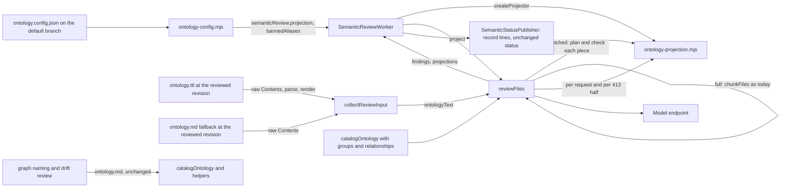

# Matched ontology projection

## Product owner: vision

### Problem

Every model request the `SemanticReviewWorker` makes carries the whole ontology projection, whatever
the Markdown chunk is about. JEPA-Speech's 202 entries come to 64,394 characters, sent again with
every chunk of every changed file. That causes three problems. As an ontology grows it hits the
`RequestBudget` and the review stops with `too-large`. The only fix today is to raise
`ONTOLOGY_MAX_REQUEST_CHARS`, which moves the limit (about 600 entries at the 200,000-character
default) without removing it. Runs are slow and expensive, which matters most on the home-lab model.
And the model has to hunt for the few relevant rows among hundreds, which risks noisy or missed
findings. Maintainers want each request to carry only the part of the ontology the chunk could be
talking about, chosen deterministically so that the same input always gives the same request. That
choice must not quietly lose the paraphrases the reviewer exists to catch.

### Users

- Maintainers of adopting repositories with large ontologies (JEPA-Speech today, Grooveloom next),
  who have had to raise the budget to keep semantic review running.
- Maintainers running the reviewer on a home-lab or metered model, who pay for every resent
  ontology in time or tokens.
- Pull request authors, who read the semantic status and its pull request record and need to know
  what their Markdown was actually checked against.
- The kit maintainer, who ships the byte-identical reviewer and needs a regression guard that the
  smaller requests still find what the full projection found.

### Outcomes and measures

These outcomes are judged by the maintainer. The figures show what to look at, not targets.

1. **Each request carries only the ontology its chunk needs.** Measure: the pull request record shows,
   for each reviewed file, how many entries were sent and how many characters they took, next to the
   size of the full projection.
2. **Matching keeps the findings the full projection found.** Measure: replaying the ten recorded
   JEPA-Speech findings (pull requests #210 and #217) under the matched projection, the evidence entry
   each one cites is in the projection sent for its file. The replay is kept as a regression test.
3. **A chunk that matches nothing is still reviewed.** Measure: a chunk with no matched entry is sent
   with a small fixed core set of the ontology instead of being skipped, and the record says so.
4. **Reduced coverage is visible, not silent.** Measure: the pull request record says when a file was
   reviewed against a matched or core-set projection rather than the full one. A finding can cite
   only an entry that was sent, and the evidence-key list in each request lists only those entries.
5. **Adopters get it by default and can switch back.** Measure: after a kit update, a repository's
   reviewer uses the matched projection with no configuration change. One `OntologyConfig` setting
   restores the full projection, and no script is edited.

### Decisions to settle

Left to the analyst and architect, with the research below as evidence:

- **The matching rule.** Matching exact entry names finds none of the recorded findings, and matching
  the words of a name finds all ten but sends much more. Somewhere between them is a precision and
  recall trade-off to choose deliberately.
- **What "directly related" means.** Adding every entry a matched row mentions sends most of the
  ontology. Adding only the relationship rows that touch a matched entry costs almost nothing.
- **What the core set is,** and whether it is also sent with matched chunks.
- **Whether matching runs per chunk or per file,** and how it interacts with chunking against the
  `RequestBudget`.

### Scope

- A deterministic selection, per request, of the ontology entries matched to the Markdown being
  reviewed, plus their directly related entries, with the evidence-key list restricted to those
  entries.
- A small core set for chunks that match nothing.
- Making the matched projection the default, with an `OntologyConfig` setting that restores the full
  projection.
- Recording in the `SemanticReviewRun` record and the pull request record what each file was reviewed
  against.
- Unit tests, a replay of the recorded JEPA-Speech findings as a regression test, and updates to the
  runbook `templates/docs/ontology-semantic-review.md` and the README.

### Out of scope

- Embedding-based or other model-based retrieval. That is a later feature, and this one must not
  close it off.
- Changing the system prompt, how a `SemanticFinding` is judged, or the dismissal flow.
- The drift reviewer and the graph naming reviewer, which build their own requests.
- Adding banned aliases or alternative labels to adopters' ontologies, and editing any consumer
  repository.
- Changing the `RequestBudget` defaults or the `too-large` outcome, other than its now applying to the
  matched projection.

### Research

All measurements use the shipped `catalogOntology` from `templates/scripts/semantic-review-model.mjs`
against each repository's configured sections. The scratch scripts are not committed.

1. **The full projection's size today.** JEPA-Speech: 202 entries, 64,394 characters. InternalOntology:
   130 entries, 32,281. LocalOntologySetup: 105, 25,273. EventBooking: 100, 22,491. Source: each
   repository's `docs/ontology.md` at its current default branch.
2. **Every recorded finding is a paraphrase, so exact names miss them all.** JEPA-Speech's run records
   (the hidden run markers in its pull request comments) hold ten findings. Examples: "AuditRecord"
   for the entity AuditEvent, "RemovalStatus" for the enum SessionRemovalState, and "pending,
   running, done" for that enum's values. Matching whole entry names selected the cited entry for none
   of them. Matching any significant word of a name, plus an enum's value words, selected it for all
   ten, with 21 to 56 entries (8,000 to 19,000 characters, 12% to 30% of the full projection). Matching
   only words shared by three or fewer entry names cut the size to 4 to 17 entries but kept the cited
   entry for only 4 of the 10. Source: JEPA-Speech pull requests #210 and #217, files replayed at
   their recorded revisions.
3. **Savings across real Markdown depend on the rule.** Over each repository's tracked Markdown
   (ontology, narrative and generated graph files excluded), matching name words sent a median of
   38% (JEPA-Speech), 39% (InternalOntology) and 69% (EventBooking) of the full projection, with the
   90th percentile at 66% to 79%. The rare-word rule sent medians of 19%, 15% and 42%. Exact names
   sent little, but matched nothing at all in 87 of JEPA-Speech's 210 files and 52 of EventBooking's
   534. Source: the same repositories at their default branches.
4. **"Directly related" can blow up.** Adding every entry that a matched entry's row mentions by name
   took the selection to 104 to 148 of JEPA-Speech's 202 entries. Adding only the relationship rows
   that touch a matched entry added one entry at most. Source: the replay in finding 2.
5. **There is little alias data to match on.** None of JEPA-Speech, InternalOntology, EventBooking or
   Grooveloom configures banned aliases. In `docs/ontology.ttl`, each entry's `rdfs:label` is the
   same PascalCase name, and there are no alternative labels. Names, their words, enum values and
   descriptions are all there is to match against. Source: each repository's `ontology.config.json`
   and JEPA-Speech's `docs/ontology.ttl`.

## Analyst: behaviours

Unless a behaviour names its own "when", the "when" is: the `SemanticReviewWorker` reviews the pull
request's changed eligible Markdown.

Amended on 2026-11-20 to answer the user's acceptance pushback on #135 (the matched projection did not scale to large ontologies). Changed: B1, B7, B17, B18 and B23; added B24 and B25; revised U2, U3, U5, U11 and U13; added U15 to U18.

### Terms

New in `docs/ontology.md`: the value object `OntologyProjection` and the enum `ProjectionMode`
(`matched`, `full`). There are also two relationships, an invariant, and additions to the
`OntologyConfig` and `SemanticReviewRun` rows. Words used below:

- **Ontology source**: `ontology.ttl`, the repository's source of truth, from which `ontology.md` is generated. Every adopting repository has it once it is created from, or upgraded to, the current kit.
- **Entry**: an item in the configured ontology sections, read from the ontology source, with the evidence key (`Section:Name`) that `ontology.md` shows for it. The keys are the ones `catalogOntology` reads today.
- **Row**: one table line, or one invariant bullet with its continuation lines, as `ontology.md` renders it. Several rows can share
  an evidence key: a Relationships row is keyed by its From name, so JEPA-Speech has three rows under
  `Relationships:Analysis`, and an item can have several invariant bullets.
- **Relationship**: an `owl:ObjectProperty` in the ontology source, shown as a Relationships row. Its domain is the From entry, its range is the To entry, and its evidence key is `Relationships:<From>`.
- **Name index**: every evidence key, in ontology order. In `matched` mode it is grouped by section (B24). In `full` mode it is today's evidence-key list, one key per line.
- **Selected entries**: the entries whose rows a request carries in `matched` mode: those matched by B2 to B6, plus the relationships B7 adds.
- **Paragraph**: lines of a file separated from the lines after them by at least one blank line.
- **Name words**: an entry's name split at case changes and lowercased, with words shorter than four
  letters or on a fixed stop list dropped. For an Enums entry, the same split applies to its values
  as well. SessionRemovalState gives "session", "removal" and "state" unless they are on the stop list.
- **Markdown words**: the chunk's text split at anything that is not a letter or digit and at case
  changes inside a word, then lowercased. "RemovalStatus" gives "removal" and "status".

### Outcome 1: each request carries only the ontology its chunk needs

- **B1 Matched request.** Given `semanticReview.projection` is absent and a chunk of a changed Markdown
  file, when the `SemanticReviewWorker` reviews it, then the system message holds the system prompt,
  the rows of the selected entries under their section headings in ontology order, and the grouped
  name index (B24), and no other rows.
- **B2 Exact name.** Given the chunk contains an entry's name as a whole word with the same case (for
  example AuditEvent), then that entry is selected.
- **B3 Name word.** Given the chunk's Markdown words include one of an entry's name words, or that word
  with "s" or "es" added (for example "audit" in "AuditRecord", or "audits"), then that entry is
  selected.
- **B4 Enum value word.** Given the chunk says "the states requested, removing, removed and failed",
  then the Enums entry whose values include those words (SessionRemovalState in JEPA-Speech) is
  selected.
- **B5 Stop and short words.** Given the only overlap between a chunk and an entry is a word shorter
  than four letters or a word on the stop list, then that entry is not selected through that word.
- **B6 Banned alias.** Given a `BannedAlias` phrase appears in the chunk as whole words, in any case,
  then every entry named in its `nameInstead` is selected.
- **B7 Relationships of a matched entry.** Given an entry is selected by B2 to B6, then every relationship whose domain or range is that entry is also selected, with every row of its evidence key (B8). The entry at the other end is not selected through the relationship, and a name mentioned in an entry's description selects nothing. For example, in JEPA-Speech a chunk matching AuditEvent carries the row "Analysis writes AuditEvent" and the other `Relationships:Analysis` rows, but not the Analysis entry's own row.
- **B8 Rows travel together.** Given a selected evidence key has several rows, then every row with that
  key is sent (all three `Relationships:Analysis` rows, not only the last).
- **B9 Deterministic.** Given the same Markdown, ontology, configuration and budget, when the review runs
  twice, then every request body is byte-identical.
- **B10 Projection recorded.** Given a file is reviewed, then its entry in the `SemanticReviewRun`
  record and the pull request record shows:
  - the `ProjectionMode`;
  - the number of entries sent with full rows, counted once across all its chunks, out of the
    ontology's total;
  - the character size of the largest `OntologyProjection` sent for it, next to the size of the full
    projection.

### Outcome 2: matching keeps the findings the full projection found

- **B11 Recorded findings replayed.** Given test fixtures that reproduce the ten recorded JEPA-Speech
  findings, each with its quoted passage and the cited ontology items, then the cited entry is among
  the selected entries for each of them. The fixtures cover "AuditRecord" for AuditEvent,
  "RemovalStatus" for SessionRemovalState, "pending, running, done" for its values, and "tester left,
  test run, bad take or miscellaneous" for RemovalReason.
- **B12 Finding identity unchanged.** Given the same revision, path, quote and evidence key, then a
  `SemanticFinding` has the same identity in `matched` and `full` mode. A `FindingDismissal` recorded
  under one mode still applies after switching to the other on the same revision.
- **B25 Same evidence from the ontology source.** Given a repository whose `ontology.md` is current with its `ontology.ttl`, then reading entries and relationships from the ontology source gives exactly the evidence keys, rows and full projection that reading `ontology.md` gives today. A `SemanticFinding` therefore keeps its identity across the change, and `full` mode stays byte for byte (B21).

### Outcome 3: a chunk that matches nothing is still reviewed

- **B13 Name index only.** Given no entry is selected for a chunk, then the request is still sent with
  the system prompt and the name index. The file can count as reviewed, and B10 shows zero entries
  sent with full rows.
- **B14 Name-only citation.** Given the model cites an entry that the request carried in the name index
  only, then the finding is accepted like any other: it blocks, it can be dismissed, and its identity
  follows B12.
- **B24 Grouped name index.** Given `matched` mode, then the name index has one line per section in ontology order: the section name, a colon and a space, then the names of that section's entries in ontology order, separated by a comma and a space. For example: "Entities: AuditEvent, StudySession, SessionRemoval". A finding that cites `Section:Name` for any listed name resolves as in B14, and any other key is handled as in B16.

### Outcome 4: reduced coverage is visible, not silent

- **B15 Visible in the record, not the status.** Given a `matched` review, then the pull request record
  shows B10 for each reviewed file. The status descriptions of every `SemanticOutcome` are unchanged.
- **B16 Unknown keys still rejected.** Given the model cites a key that resolves to no entry in the name
  index, then the chunk is handled exactly as an unknown evidence key is today.
- **B17 Planning by paragraph.** Given `matched` mode and a file, then the file is divided into paragraphs, and any paragraph that cannot fit a request on its own is divided into its lines. Chunks are formed in file order: each takes the next paragraphs or lines for as long as the request still fits the `RequestBudget`, counting the request overhead, the `OntologyProjection` that the chunk's own text selects, the file path and the text. A line whose text alone is too long for the room its own projection leaves is cut into pieces that fit, never inside a UTF-16 surrogate pair. Each chunk is sent with the projection its own text selects, so every request fits the budget. A file whose paragraphs each fit is reviewed, however much of the ontology the whole file selects. For example, a file naming one entry from each of 60 bounded contexts is reviewed in several requests rather than being too-large. In `full` mode, files are planned as today.
- **B18 Too large.** Given `matched` mode, then a file is not reviewed, with outcome `too-large`, in either of two cases. The reason names the cause, and both reasons name `ONTOLOGY_MAX_REQUEST_CHARS`:
  - the request overhead, the file path and the name index alone leave less than one character. Every file is then `too-large`, and the reason says that the ontology's name index does not fit the budget;
  - a line of the file selects a projection that leaves no room for any of its text. The reason gives the line's offset in the file, and says that this line selects too much of the ontology for the budget.

  Status descriptions do not change (B15). In `full` mode, today's rule and reason apply.
- **B19 413 split.** Given the endpoint answers 413, then the chunk is split as today, and each half is
  sent with the projection its own text selects.

### Outcome 5: adopters get it by default and can switch back

- **B20 Default after update.** Given a repository updates the kit and changes nothing in
  `ontology.config.json`, then its next semantic review uses `matched`.
- **B21 Switch back.** Given `semanticReview.projection` is `"full"`, then every request carries
  today's full projection, byte for byte, and B10 records `full`.
- **B22 Invalid setting.** Given `semanticReview.projection` is any value other than `"matched"` or
  `"full"`, then the configuration is invalid, with an error naming the key and the value. It is
  handled like any other invalid `semanticReview` setting today. The key is not accepted under
  `sourceGraph.namingReview`.
- **B23 Documented.** Given the runbook `templates/docs/ontology-semantic-review.md` and the README, then
  they describe:
  - the two modes and the matching rules;
  - that matched selection reads the ontology source, and adds relationships but not the entries at their other end;
  - the grouped name index, planning by paragraph, and the two too-large causes;
  - the B10 fields;
  - that a matched review can miss a paraphrase sharing no name word with its entry;
  - that `"full"` should be set only after updating to a kit version that knows the setting, because
    older scripts reject the unknown key.

### Uncertainties

| # | Question | Decision or deferral |
|---|---|---|
| U1 | Which matching rule? | Decided: exact names, banned aliases, name words and enum value words, with Markdown PascalCase split (B2–B6). It found all ten recorded findings. The rare-word rule found only four and was rejected. |
| U2 | What does "directly related" add? | Revised on 2026-11-20 by the maintainer after acceptance: the relationships whose domain or range is a matched entry, without the entry at the other end and without names mentioned in descriptions (B7). The original one hop made the median matched request 79% of the full projection on JEPA-Speech's 213 tracked Markdown files and 85% on InternalOntology's 126. Relationships only measured 52% and 65%; no hop at all measured 52% and 62%. All ten recorded findings keep their cited entry's full rows in every variant, because each is matched directly. |
| U3 | What is the core set, and do matched chunks get it? | Decided: the name index, sent with every request (B1, B13). Revised on 2026-11-20: in `matched` mode it is grouped by section (B24). One key per line costs about 30 characters per entry, so the name index alone filled the 200,000-character default at about 6,700 entries. Grouping removes the repeated section prefix, roughly a third of the index. Acceptance must check against a live model that findings still cite keys exactly. |
| U4 | Can a finding cite an entry sent by name only? | Decided: yes, like any other finding (B14). This keeps the vision's rule that a finding cites only an entry that was sent, because the name index sends every entry by name. |
| U5 | Is matching per chunk or per file? | Decided: per chunk (B17, B19). Revised on 2026-11-20: planning is by paragraph too, not against the whole file. Acceptance showed that a file's projection is the union of everything it mentions. A 3.4 KB file naming one entry from each of 60 contexts in a 1,920-entry ontology projected 330,898 of 331,071 characters and was too-large, although each of its paragraphs projected about 74,500 and would have fit. JEPA-Speech's `docs/source-knowledge-graph/README.md` already projects 63% of the full projection. |
| U6 | Split PascalCase words in the Markdown? | Decided: yes (Markdown words). Without it, "RemovalStatus" matched only through other words in the file. |
| U7 | Do rows sharing an evidence key travel together? | Decided: yes (B8). `rows` in `catalogOntology` keeps only the last row per key today, so the architect must not select by that map as it stands. |
| U8 | What is the setting's name and shape? | Decided: `semanticReview.projection`, `"matched"` (default) or `"full"` (B20–B22). |
| U9 | Does the status description change? | Decided: no. Coverage shows in the pull request record only (B15). |
| U10 | Does finding identity change? | Decided: no. The identity hash takes no projection input (B12). |
| U11 | What is on the stop list? | Deferred to the architect: a fixed list in the script, the same in every repository and not configurable. It must not stop any recorded finding in B11. Unchanged by the amendment; limiting other common words is U18. |
| U12 | How is B11 fixtured without network or JEPA-Speech files? | Decided: synthetic fixtures in the kit's tests reproduce each quoted passage and the cited items. A replay against JEPA-Speech itself belongs to the user phase's acceptance walkthrough. |
| U13 | Embedding retrieval, and keeping it possible later. | Out of scope (vision). Keeping the selection step replaceable is left to the architect, now over entries read from the ontology source (U15). |
| U14 | Does the drift reviewer or the naming reviewer change? | Out of scope (vision). |
| U15 | Which ontology does selection read? | Decided on 2026-11-20: the ontology source, `ontology.ttl`, which is the source of truth; `ontology.md` is generated from it. Relationships are then typed edges, rather than backticked names scraped from row text. Selected entries are still sent as `ontology.md` renders their rows, because Turtle is larger (JEPA-Speech: 80,721 bytes against 59,474). Evidence keys and finding identity must not change (B25). How the reviewer reads the source is for the architect. A repository without `ontology.ttl` is out of scope, because every adopting repository is created from, or upgraded to, the current kit. |
| U16 | Should matching use alternative labels (`skos:altLabel`)? | Deferred. The kit does not produce alternative labels yet, and adding them to adopters' ontologies is out of scope (vision). Matching on them would do more for recall than any word rule, so it belongs to a later feature. |
| U17 | Should a too-large reason say why? | Decided on 2026-11-20: yes. It names either the name index or the line that selects too much, and status descriptions do not change (B18, B15). |
| U18 | Should name words shared by many entries be limited? | Deferred, with measurements recorded. A word such as "account", or "graph" (in 44 of InternalOntology's 107 entry names), selects every entry that shares it. In a 1,920-entry synthetic ontology, one paragraph naming one entry selected 67 entries without the hop. After B17 and B24 this costs request size but no longer makes files too-large. A limit risks recall (the rare-word rule in U1 kept 4 of 10 findings), so it needs measuring first. |

## Architect: structure

U11 and U13 are settled in ADRs 0027 and 0026. The amendment of 2026-11-20 answers the user's acceptance pushback with three more ADRs: 0029 (reading the ontology source), 0030 (planning by paragraph) and 0031 (relationships only, and the grouped name index). They amend 0026 and 0027 where noted.

The build review identified a GitHub transport limit and a budget boundary for indivisible characters. ADR 0034 specifies the raw ontology read. ADR 0035 puts the final piece-size check and the line too-large diagnosis in the matched planner.

Measured with the shipped catalog, before building:
- Relationships only made the median matched request 52% of the full projection on JEPA-Speech's 213 tracked Markdown files and 65% on InternalOntology's 126, against 79% and 85% with the one hop. All ten recorded findings are kept.
- The grouped name index is 40% to 49% smaller, which lifts the ceiling at the default budget from about 6,700 entries to about 10,000 to 11,500.
- Planning by paragraph removes the broad-file case. In the 1,920-entry synthetic ontology, a paragraph projects about 74,500 characters while the whole file projected 330,898.

### Components

| Component | Responsibility | Serves |
| --- | --- | --- |
| `ontology-projection.mjs` (kit-owned, installed with `--with-semantic-review`) | `createProjector({ mode, bannedAliases })` provides `mode` and projection, and in `matched` mode also `plan(catalog, files, maxRequestChars)`. The matched projector indexes name words, enum value words, exact names and relationships once per catalog. It selects matching entries and their relationships with every row of each selected key. It renders the selected rows in ontology order, followed by the grouped name index. `plan` packs paragraphs, lines, and pieces of a line. It verifies each piece against its own projection, preserves whole code points, and owns both too-large causes. `full` returns `catalog.projection` and has no `plan`. No I/O. | B1–B9, B13, B17, B18, B21, B24 |
| `semantic-review-model.mjs` | `catalogOntology` adds the `relationships` field (evidence key, From, To) beside `groups`. `reviewFiles` uses the projector's `plan` when it has one and `chunkFiles` otherwise. It projects and guards every request independently, including each half of a 413 split, and returns `projections`. It resolves evidence keys and computes finding identities as before. | B1, B8, B10, B12–B14, B16–B19, B21, B25 |
| `semantic-review-github.mjs` (`collectReviewInput`) | Reads the ontology source at `ttlPathFor(ontologyPath)` as raw Contents bytes pinned to the reviewed head SHA. It decodes strict UTF-8, renders Turtle with `parseTurtle`, `triplesToModel` and `renderOntologyMarkdown`, and returns `ontologyText`. A source 404 triggers a raw read of the configured Markdown at the same revision. Other read, decoding or parsing failures propagate to the worker. | B25 |
| `owl-ontology.mjs` | Exports `ttlPathFor`, moved from `build-ontology.mjs`, which re-exports it. Parsing and rendering are unchanged. | B25 |
| `ontology-config.mjs` (`OntologyConfig` parsing) | Unchanged: `semanticReview.projection`, `"matched"` by default, or `"full"`. | B20–B22 |
| `semantic-review-worker.mjs` (`SemanticReviewWorker`) | Unchanged: it builds the projector from `config.semanticReview.projection` and `config.bannedAliases`, passes it to `reviewFiles`, copies `projections` into the run record, and maps too-large files to the `too-large` outcome. | B6, B10, B12, B15, B18, B20, B21 |
| `semantic-review-ledger.mjs` (`SemanticStatusPublisher`) | Unchanged: one projection line per reviewed file, and each not-reviewed reason as `plan` gives it. `statusFor` is unchanged. | B10, B15, B18 |
| `Installer` (`bin/install-ontology.mjs`) | Unchanged. `owl-ontology.mjs` is part of every installation. | B20 |
| Runbook `templates/docs/ontology-semantic-review.md`, README | Cover: the modes; the matching rules and stop list; relationships only; that the reviewer reads `ontology.ttl` and falls back to `ontology.md`; the grouped name index; planning by paragraph; the two too-large causes; the record line; the paraphrase caveat, now including neighbours; and updating the kit before setting `"full"`. | B23 |
| Tests | The shipped projector tests cover relationship selection, packing, both too-large causes and the grouped index. They compare every planned chunk with `project` of its own text, including cuts that add a match and boundaries next to surrogate pairs. The GitHub tests cover raw source above the inline-content limit, raw Markdown fallback, source errors and B25 equivalence. The model tests cover the pre-send guard and 413 splitting. The user phase regenerates the acceptance tests from local commit b1a2a41 on `feature/matched-ontology-projection/user`. | B1–B25 |
| Ontology | `OntologyProjection` updated in the analyst amendment. Nothing further. | B10, B21 |

### Structure

A request's system message is the unchanged system prompt followed by the projection text. In `matched` mode, that is:
- the section headings and rows of the selected entries, in ontology order;
- `## Evidence keys`, the one explanatory sentence, and one line per section listing its names. An empty catalog omits the example key from the sentence.

In `full` mode, it is `catalog.projection`. Findings resolve against the whole catalog, so a name-only citation is accepted (B14) and an unknown key is rejected as today (B16).

### Deployment and runtime

Adopters reinstall with `--force --with-semantic-review`, and the next semantic review uses `matched` (B20). The reviewer uses its existing repository Contents read permission. It makes one raw request for the ontology source at the reviewed revision, and requests the Markdown fallback only on a source 404.

`semanticReview.projection` is read, like the rest of `semanticReview`, from the trusted default branch, and should be set only after the kit update (ADR 0028). Selection and planning run in the review job before each model call. They are deterministic and need no network. The matched projector's index is built once per run.

### Traceability

| Behaviour | Components |
| --- | --- |
| B1 | `ontology-projection.mjs`, `semantic-review-model.mjs` |
| B2 | `ontology-projection.mjs` |
| B3 | `ontology-projection.mjs` |
| B4 | `ontology-projection.mjs` |
| B5 | `ontology-projection.mjs` |
| B6 | `ontology-projection.mjs`, `semantic-review-worker.mjs` |
| B7 | `ontology-projection.mjs`, `semantic-review-model.mjs` (relationships field) |
| B8 | `semantic-review-model.mjs` (grouped rows), `ontology-projection.mjs` |
| B9 | `ontology-projection.mjs`, tests |
| B10 | `semantic-review-model.mjs`, `semantic-review-worker.mjs`, `semantic-review-ledger.mjs` |
| B11 | `ontology-projection.test.mjs` |
| B12 | `semantic-review-model.mjs` (identity unchanged), `semantic-review-worker.mjs`, tests |
| B13 | `ontology-projection.mjs`, `semantic-review-model.mjs` |
| B14 | `semantic-review-model.mjs` (resolution against the whole catalog) |
| B15 | `semantic-review-ledger.mjs`, `semantic-review-worker.mjs` |
| B16 | `semantic-review-model.mjs` |
| B17 | `ontology-projection.mjs` (packing and piece budgets), `semantic-review-model.mjs` (pre-send guard) |
| B18 | `ontology-projection.mjs` (name-index and original-line diagnoses), `semantic-review-worker.mjs`, `semantic-review-ledger.mjs` |
| B19 | `semantic-review-model.mjs` |
| B20 | `ontology-config.mjs`, `semantic-review-worker.mjs`, `Installer` |
| B21 | `ontology-projection.mjs`, `semantic-review-model.mjs` (`chunkFiles` when there is no `plan`), `semantic-review-worker.mjs` |
| B22 | `ontology-config.mjs` |
| B23 | runbook, README |
| B24 | `ontology-projection.mjs` |
| B25 | `semantic-review-github.mjs` (pinned raw Contents and fallback), `owl-ontology.mjs` (shared parser and renderer) |

### Decisions

- [ADR 0026: matched projection as an injected projector in its own module](../../adr/0026-matched-projection-as-an-injected-projector.md) (U13), amended by ADR 0030
- [ADR 0027: deterministic matching rule, name index and fixed stop list](../../adr/0027-deterministic-matching-rule-and-fixed-stop-list.md) (U1, U11), amended by ADR 0031
- [ADR 0028: the projection setting and the run record summary](../../adr/0028-projection-setting-and-run-record-summary.md) (U8, U9)
- [ADR 0029: semantic review reads the ontology source, falling back to Markdown](../../adr/0029-semantic-review-reads-the-ontology-source.md) (U15, B25)
- [ADR 0030: matched planning by paragraph, inside the projector](../../adr/0030-matched-planning-by-paragraph-in-the-projector.md) (U5, U17, B17, B18)
- [ADR 0031: relationships of matched entries, and a grouped name index](../../adr/0031-relationships-only-and-grouped-name-index.md) (U2, U3, B7, B24)
- [ADR 0034: semantic review reads raw ontology contents](../../adr/0034-semantic-review-reads-raw-ontology-contents.md) (B25, amends ADR 0029)
- [ADR 0035: matched planner budgets whole code points](../../adr/0035-matched-planner-budgets-whole-code-points.md) (B17, B18, amends ADR 0030)

## User: runbook, guide and acceptance

### Runbook

The deployed acceptance environment is JEPA-Speech's GitHub Actions semantic review using the upgraded reviewer and existing protected `ontology-semantic-review` environment. Local acceptance runs the installed reviewer in disposable Git repositories with a local HTTP model stand-in.

#### Deploy

1. From the reviewed kit revision, run `node bin/install-ontology.mjs --target <consumer-checkout> --force --with-semantic-review`. Include the consumer's other enabled installer options when upgrading their files too. Review the installer diff and merge the consumer upgrade through its normal review. The workflow loads scripts and trusted `ontology.config.json` from the consumer's default branch.
2. Keep `semanticReview.enabled` true with the consumer's existing model and endpoint. The protected environment supplies the model credential. Keep the repository's required `ontology/semantic-match` status. [Installed semantic review runbook](../../../templates/docs/ontology-semantic-review.md)
3. Leave `semanticReview.projection` absent for `"matched"`. Set it to `"full"` only after installing a kit version that recognises it. The raw source is `ontology.ttl` at the reviewed pull request revision. The sibling `ontology.md` is used on a source 404.
4. Open a same-repository pull request changing a Markdown file. Confirm the Semantic ontology review comment refers to the expected revision, includes a projection line for the reviewed file, and the status leaves pending. An unavailable or too-large status requires inspecting the comment before calling the rollout healthy.

#### Operate

- Read the comment's projection line for the mode, the number of entries sent in full, the ontology's total, and the size of the largest projection compared with the full projection. The status carries the review outcome.
- For a name-index budget error, raise ONTOLOGY_MAX_REQUEST_CHARS to a positive integer the endpoint can handle. The default is 200,000 characters. For a line error, start with the reported offset and review the line's selection or raise the budget. The reviewer preserves whole Unicode code points and skips the affected file when an indivisible piece cannot fit.
- For an unavailable ontology read, check the source at the reviewed revision. A source that exists must decode as UTF-8 and parse as Turtle. Check generated Markdown freshness with `node scripts/build-ontology.mjs --check`. GitHub's raw Contents endpoint has its own size limit.
- For endpoint rejections or slow responses, inspect the not-reviewed reason and the model's limits. The reviewer retries HTTP 413 by splitting the chunk and selecting evidence for each half. ONTOLOGY_MODEL_TIMEOUT_MS defaults to 300,000.

#### Recover

1. Set `semanticReview.projection` to `"full"` to recover whole-ontology requests if the full projection fits the budget. Rerun on a fresh pull request revision and confirm the comment records full mode.
2. To roll back the upgrade, revert the consumer's kit upgrade through its usual review. Remove the projection setting before rolling back to a version that rejects it. Use `semanticReview.enabled: false` on the trusted branch to suspend the reviewer deliberately.

### User guide

For maintainers and pull request authors using semantic review on an adopting repository.

| Behaviour | What to expect |
| --- | --- |
| B1–B8 | Matched mode sends relevant full rows and the grouped name index. Whole exact names, significant name words, enum value words and configured banned aliases select rows. Short and common words are filtered for word matching. Matching an entry brings its relationship rows and every row with the same evidence key. The entry at the far end needs its own match. |
| B9–B11, B15 | The same inputs give the same request. The comment compares selected evidence with the full projection, while existing statuses show whether findings block. The recorded JEPA-Speech examples retain the rows they cite. |
| B12–B14, B16, B24 | A file without matches still goes to the model with the grouped name index. A valid section-and-name citation can block even when the model received only its name. A reasoned dismissal for the same finding at the same revision survives a mode switch. An unknown key leaves the chunk unreviewed. |
| B17–B19 | Matched mode packs paragraphs, lines and pieces under the request budget. A broad file can be reviewed in several requests. If the index or a line cannot fit, read the reason in the comment. A 413 splits and retries with each half's own evidence. |
| B20–B23 | Reinstall for the matched default. Choose full mode when catching paraphrases with no shared name word matters more than prompt size. Unsupported setting values fail configuration validation. Follow the installed runbook for rollout and recovery. |
| B25 | The reviewer reads the reviewed revision's Turtle source. Current generated Markdown gives the same catalog and finding identities. A Markdown-only revision uses the configured Markdown fallback. |

### Plain-language acceptance review

These are the 16 proposed automated acceptance tests for Matched ontology projection. They install the reviewer in a disposable repository and use a local stand-in that returns controlled model replies.

Review the expected outcomes below.

The eight local walkthroughs and all 16 approved automated tests passed on 20 November 2026. The live JEPA-Speech trial follows the consumer upgrade.

#### 1. Default matched review

With the projection setting omitted, a passage about removing a session gets the removal evidence and its relationships. An unrelated microphone appears by name only. The pull request comment shows the mode, the number of entries sent in full and the largest projection compared with the whole ontology. The status says the file was reviewed.

#### 2. Full-mode compatibility

Switching to full mode produces exactly the same request as the original whole-ontology review. The comment records full mode and the full projection size.

#### 3. Repeatable findings and dismissals

Running the same review twice produces identical requests. A finding that cites an entry sent by name alone blocks until a maintainer dismisses it. Switching to full mode on the same revision keeps the finding ID and honours the dismissal.

#### 4. Unknown citation

If the model cites a nonexistent entry, the reviewer reports that the chunk could not be reviewed because the evidence key is unknown.

#### 5. No matches and an index that cannot fit

A passage with no matches still gets a model request with the name index and zero full rows. At a budget that cannot fit the index and any file text, the reviewer sends zero requests and reports the name-index budget reason.

#### 6. Upgrade and installation

Reinstalling adds the projector without overwriting the consumer configuration. The installed projector matches the kit. Installing graph naming alone leaves the semantic projector absent and graph naming can still load.

#### 7. Operator documentation

The installed runbook explains both modes, the selection rules, source and fallback, paragraph planning, both budget reasons, how to read the comment and when to update before selecting full mode.

#### 8. Matching and relationships

Exact names, significant name words, enum values and a configured alias select the expected rows. Common words alone select none. Selecting either end of a relationship brings every row of its relationship key. The entity at the far end and names mentioned in descriptions add rows only if the passage matches them separately.

#### 9. Ten recorded findings

For each of the ten historical JEPA-Speech passages, a controlled reply cites the original key. The request carries the full cited row and the finding blocks.

#### 10. Paragraphs with different evidence

When the evidence for the whole file exceeds the budget but each paragraph fits individually, two paragraphs are reviewed in two requests in order. Each request carries its own evidence and fits the budget.

#### 11. Endpoint rejects a large request

When the stand-in returns HTTP 413 for the whole request, the reviewer retries with two parts and selects the evidence for each part separately.

#### 12. A line cannot fit

A line that selects too much evidence and an emoji that cannot fit without splitting both produce a line-specific reason. The reason gives the original offset and names the budget setting. Zero requests are sent for the file, even though its earlier text could fit.

#### 13. Grouped names and a valid citation

The request lists every name in section order. A reply using the expected section-and-name citation is accepted even when none of the entry's full rows were sent.

#### 14. Turtle and Markdown equivalence

If Turtle is present, the reviewer reads it at the reviewed revision even when generated Markdown is stale. With Turtle absent, the current generated Markdown produces the same full request, finding ID and projection summary.

#### 15. Invalid settings

An unsupported projection value is rejected with an error naming the setting and value. The graph naming configuration rejects the semantic projection option.

#### 16. Large ontology

With 1,920 entries, a narrow passage fits in one matched request and exceeds the budget in full mode. A broad file mentioning all 60 contexts is reviewed in four matched requests within the default budget.

### Acceptance

Use the [walkthrough driver](walkthrough.mjs) with an installed scratch repository. With `--rows` it shows the evidence rows and index. With `--json` it also reports request digests, source paths, chunk offsets, statuses and findings. Each request is checked against the projection of the text it carries. Use `--finding='<quote>=><Section:Name>'` to reproduce a recorded citation and `--dismiss` to reconcile the first finding as a maintainer in the stand-in. The equals form handles quotes beginning with a dash.

For the local small fixture, install into a fresh Git repository as in Deploy. Use the Entities, Enums and Relationships fixture named `jepaOntology` in the [acceptance test](../../../tests/matched-projection-acceptance.test.mjs). Enable those sections in the consumer config, with a banned alias mapping “deletion request” to SessionRemoval. Enter the fixture sections in `docs/ontology.md`, with a horizontal rule between sections if generating Turtle. Put each trial passage in `docs/a.md`. For the scale fixture, run `node tests/helpers/large-ontology.mjs <scratch-repo>/docs` and configure Entities, Enums, Relationships and Business Rules & Invariants. Start with the default request budget unless the step gives a tighter one.

Run a scenario with `node docs/features/matched-ontology-projection/walkthrough.mjs --repo <scratch-repo> --rows <scratch-repo>/docs/a.md`. The budget for a precise boundary is the installed model module's `REQUEST_OVERHEAD`, plus the relative file path length, plus the projection character count, plus the number of UTF-16 code units of Markdown to leave room for. The driver prints the projection count for each trial input.

| Walkthrough | Scripted steps and expected results | Executable coverage |
| --- | --- | --- |
| W1 · B1, B9, B10, B15, B20 | 1. Upgrade a scratch repo with the setting absent. Expect matched mode and the existing config preserved. 2. Review “An AuditEvent was written.” twice with `--json`. Expect equal digests, the AuditEvent row, all rows under its related key, a grouped index and a reviewed status. 3. Read the projection line. Expect two of eleven entries in full and the largest projection compared with the full projection. | B1 B10 B15 B20, B9 B12 B14, B20 |
| W2 · B2–B8 | 1. Review “A DataType row.” and then “A datatype row, a data type, DataTypes.” Expect its row only for the exact name. 2. Review “two microphones”, “the speakers” and the enum values requested, removing, removed and failed. Expect the respective entity or enum rows. “the data type, its status and state, one event” selects no rows. 3. Review “A Deletion” and “Request was filed.” in neighbouring paragraphs, then “a deletion requester”. Expect the alias to match in the first trial. 4. Review “An AuditEvent was written.” and “An analysis.” Expect the selected entity and all three Relationships rows for Analysis in each trial. A microphone's description naming a speaker adds no speaker row. | B2 B3 B4 B5 B6 B7 B8 |
| W3 · B11 | 1. For each of the ten passages in `recorded` in the acceptance test, copy the passage into the file and supply the indicated citation with `--finding`. 2. Inspect the requests and status. Expect the full cited row and a finding for each of the ten passages. | B11 |
| W4 · B12–B14, B16, B24 | 1. Review “Plain words only.” Expect a request with zero full rows and one index line per section with all names in ontology order. 2. Have the stand-in cite Entities:Microphone and use `--dismiss`. Expect blocking before dismissal and success after it. Repeat the citation with `--projection full` and the same head. Expect the same finding ID. 3. Try Entities:Nowhere. Expect “finding cites an unknown evidence key”. | B9 B12 B14, B13 B18, B16, B24 |
| W5 · B17, B19 | 1. Review “Each microphone is checked.” and “Each speaker is checked.” in separate paragraphs. Set the budget to the larger individual request. Expect two requests with each paragraph's own evidence, contiguous offsets and a reviewed file. 2. Run the same input at the default budget with `--reject-whole`. Expect one 413 and two per-half projections. 3. Review the scale fixture's `every-context.md`. Expect four in-budget requests and a reviewed file. With `--projection full`, expect a too-large result and zero calls. | B17, B19, scaling |
| W6 · B18 | 1. Leave zero room above the name-index projection for “Plain words only.” Expect a name-index budget reason, the variable name and zero requests. 2. Put an AuditEvent line at offset 3 after `x` and a blank line. Leave zero room above that line's projection. Expect the line reason with offset 3, the budget variable and zero requests. 3. Repeat with a single emoji at offset 3 and one code unit of room above the empty projection. Expect the same line diagnosis with no request for the earlier text. | B13 B18, B18 |
| W7 · B20, B22, B23 | 1. Check the installer preserved the config and installed the same projector bytes as the kit. Expect matched mode with the key absent. 2. Run with `--projection embedding`. Expect an error naming the setting and value. 3. Read the installed runbook and kit README. Expect mode details, matching and source rules, the grouped index, planning and budget reasons, record fields, the paraphrase caveat and the update order. | B20, B22, B23 |
| W8 · B21, B25 | 1. Generate Turtle with the installed build tool. Run the AuditEvent fixture with `--projection full`, the same head and a fixed citation. Expect a Turtle read only, full-mode record and finding. 2. Set aside the generated Markdown and replace it with a stale copy in the disposable fixture. Expect the same request digest. 3. Restore the generated Markdown and move Turtle aside in the fixture. Expect both path reads, the same full-request digest and the same finding ID. Restore the fixture files. | B21, B25 |

The executable suite is [matched-projection-acceptance.test.mjs](../../../tests/matched-projection-acceptance.test.mjs). It installs the kit, drives the worker through the collector and captures model requests and published status. To run it against the installed scripts of an upgraded consumer, set ONTOLOGY_ACCEPTANCE_SCRIPT_ROOT to that checkout's absolute `scripts` path.

For the deployed layer, repeat W1–W8 using the upgraded JEPA-Speech installation and the stand-in to control outcomes that require a specific response. In a separate trial pull request, add a Markdown passage with a known divergence such as the historical AuditRecord wording. Follow the published semantic review and confirm the live model cites a resolvable `Section:Name` key from the grouped index. Capture the trial pull request, the reviewed SHA, the comment link and the reported key. Keep the trial change out of the consumer's default branch.

#### Results

| Environment | Layer | Result | Date | By |
| --- | --- | --- | --- | --- |
| Local build | Scripted walkthroughs W1–W8 | Pass. The broad file took four requests, both budget causes were reported with zero requests for the affected files, and the full request and finding matched across the Turtle and Markdown paths. | 2026-11-20 | Codex |
| Local build | Executable acceptance | Pass, 16 of 16 on Node 24 in Docker after maintainer approval. | 2026-11-20 | Codex |
| JEPA-Speech | Walkthroughs and executable acceptance against deployed scripts | Pending the reviewed kit and consumer upgrades. | — | — |
| JEPA-Speech | Live model citation check | Pending upgraded default-branch reviewer and dedicated trial PR. | — | — |
