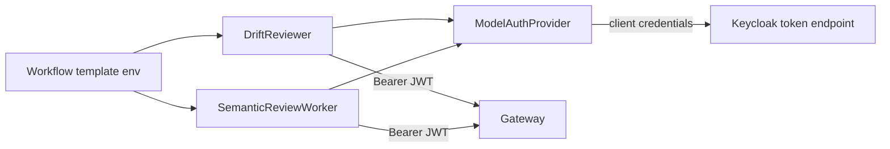

# OIDC token provider for model reviewers

## Product owner: vision

### Problem

The Ontology Kit's model-backed reviewers (drift review and semantic review) authenticate to the
model gateway with a static bearer key held as a repository secret. The home lab gateway is now
public at `https://gateway.tqaentry.com/v1` and rejects the static master key on that name: it
accepts only short-lived Keycloak-issued JWTs. Consumer repositories' GitHub Actions therefore
cannot run the reviewers against it. Because installed scripts must stay byte-identical in every
adopting repository, the fix has to ship in the kit's templates, not in any one consumer.

### Users

- Maintainers of repositories that adopt the kit and run the reviewers in GitHub Actions
  (JEPA-Speech first; DiveVolkTelemetry, Grooveloom, EventBooking and BrightFlagCFS later).
- The home lab operator, who issues the Keycloak client and wants no long-lived model credential
  sitting in consumer repositories.
- Existing adopters on a static key, who must not be broken.

### Outcomes and measures

1. A consumer workflow reaches the gateway with a short-lived JWT. Measure: a run against the live
   gateway returns a model response (not verified in the kit's own pull request).
2. No long-lived gateway credential is needed in consumer repositories. Measure: only the Keycloak
   client secret and public vars are configured.
3. Existing static-key adopters keep working unchanged. Measure: the existing tests pass untouched
   in behaviour, plus a fallback test.
4. Credentials never leak. Measure: tests assert the secret, token and token-endpoint body appear
   in no error text or log.
5. Rollout per consumer is mechanical. Measure: reinstall with `--force`, set vars, enable the
   reviewer in config; no script edits.

### Scope

- A shared async bearer provider used by both reviewers: client-credentials token fetch, caching
  until shortly before expiry, one re-fetch on a 401, fallback to the static key variables, a clear
  error for partial configuration.
- Both workflow templates pass the OIDC variables and secret; the static key becomes optional; the
  configuration check accepts either auth mode.
- Runbooks, README and how-it-works updated with the real gateway values.
- A Narrative entry and the pull request with its sections.

### Out of scope

- Editing any consumer repository (follow-ups are listed in the pull request).
- Changes to Keycloak, LiteLLM or the gateway.
- Other grant types, token introspection or JWT validation on the client.
- Changing model choice, prompts or reviewer behaviour beyond authentication.

### Research

None commissioned: the gateway, issuer, audience, client and model facts come from the home lab
owner's brief and are unverified from this repository.

## Analyst: behaviours

Terms are the ontology names added in this phase: `ModelAuthProvider`, `OidcClientConfig`,
`AuthMode`. The OIDC variables are `ONTOLOGY_OIDC_TOKEN_URL`, `ONTOLOGY_OIDC_CLIENT_ID` and
`ONTOLOGY_OIDC_CLIENT_SECRET`; the static variables are `ONTOLOGY_LLM_API_KEY` (drift review) and
`ONTOLOGY_SEMANTIC_LLM_API_KEY` (semantic review).

### Outcome 1: reviewers reach the gateway with a short-lived JWT

- **B1 Token fetch.** Given all three OIDC variables are set and no token is cached, when a reviewer
  asks the `ModelAuthProvider` for a bearer, then it POSTs a form-encoded
  `grant_type=client_credentials` request to the token URL, authenticating with the client id and
  secret via HTTP Basic, and returns the `access_token`.
- **B2 Token used.** Given a token was obtained, when the reviewer calls the model endpoint, then
  the request carries an Authorization header of the form Bearer followed by the token.
- **B3 401 retry once.** Given a cached token, when the model endpoint answers 401, then the
  provider discards the cached token, fetches a new one and the reviewer repeats the request once;
  a second 401 is reported as an ordinary model failure with no further retry.
- **B4 Both reviewers.** Given the `DriftReviewer` or the `SemanticReviewWorker` runs with the OIDC
  variables set, when it calls the model, then B1 to B3 apply to it identically.

### Outcome 2: no long-lived gateway credential in consumers

- **B5 OIDC only.** Given only the OIDC variables are set (no static key), when a reviewer runs,
  then it completes authentication without any static key being read or required.
- **B6 Workflows.** Given an installed workflow template, when it runs, then it passes the OIDC
  vars and the client secret as `ONTOLOGY_OIDC_*` environment variables, treats the static key as
  optional, and its configuration check passes when either `AuthMode` is complete and fails,
  naming what is missing, when neither is. The semantic secret stays in the
  `ontology-semantic-review` environment.
- **B7 Existing secret reused.** Given a consumer already holds `KEYCLOAK_CLIENT_SECRET`, when the
  workflow runs, then it maps that secret to `ONTOLOGY_OIDC_CLIENT_SECRET`, so no consumer re-sets
  it.

### Outcome 3: existing static-key adopters keep working

- **B8 Static fallback.** Given none of the OIDC variables is set and the static key variable is
  set, when a reviewer asks for a bearer, then it returns the static key and makes no token
  request.
- **B9 No credentials.** Given neither mode is configured, when the `DriftReviewer` asks for a
  bearer, then it returns none and sends no Authorization header, as today; the
  `SemanticReviewWorker` keeps its existing requirement for its secret.
- **B10 Precedence.** Given both OIDC and a static key are set, when a reviewer asks for a bearer,
  then OIDC is used.

### Outcome 4: credentials never leak

- **B11 Partial config.** Given one or two of the three OIDC variables are set, when a reviewer asks
  for a bearer, then it fails before any network call with an error naming the missing variable
  names, never their values, and does not fall back to the static key.
- **B12 Token endpoint failure.** Given the token endpoint answers a non-2xx status, or a 2xx
  without a usable `access_token`, when a bearer is requested, then it fails with an error holding
  the HTTP status only; the response body is never included.
- **B13 No leakage.** Given any failure path, when the error text is produced or logged, then it
  contains neither the client secret, the token, nor the token endpoint's response body.

### Outcome 5: mechanical rollout

- **B14 Caching.** Given a token with `expires_in` N seconds, when a bearer is requested again
  while more than 60 seconds of validity remain, then the cached token is returned with no new
  request; once 60 seconds or fewer remain, a new token is fetched. Concurrent requests share one
  in-flight fetch.
- **B15 Docs.** Given the runbooks, README and how-it-works, when an adopter reads them, then they
  state the gateway values (`https://gateway.tqaentry.com/v1`, model `ontology-review`, the Keycloak
  token URL, client `litellm-ci`), the secret mapping, and the per-consumer steps.
- **B16 Byte-identical scripts.** Given the change, then no repository-specific value appears in any
  script; all variation is in `OntologyConfig`, repository vars and secrets.

### Uncertainties

| # | Question | Decision |
| --- | --- | --- |
| U1 | Secret in body or Basic auth? | Basic auth, so the secret is never in a form body that could be logged. |
| U2 | Partial OIDC config: fall back or fail? | Fail clearly (B11); silent fallback would hide a misconfiguration. |
| U3 | Both modes set? | OIDC wins (B10). |
| U4 | How many 401 retries? | Exactly one (B3). |
| U5 | Token endpoint failure handling? | Status only, no body, no retry loop (B12). |
| U6 | Missing or invalid `expires_in`? | Do not cache; fetch each time. |
| U7 | Is `max_tokens` affected? | No; unchanged. The reasoning model needs it generous, so this feature leaves it alone. |
| U8 | Rename the secret or map the existing one? | Map `KEYCLOAK_CLIENT_SECRET` (B7); architect to record as an ADR. |
| U9 | Check `token_type`, validate the JWT, other grants? | Deferred as out of scope. |
| U10 | Does it work against the live gateway? | Cannot be decided here; unverified until a consumer runs it. |

## Architect: structure

### Components

| Component | Responsibility | Serves |
| --- | --- | --- |
| `ModelAuthProvider` (`templates/scripts/llm-auth.mjs`) | Resolves `AuthMode`; fetches, caches and refreshes the OIDC token; validates `OidcClientConfig`; exports `authorizedFetch` which applies the bearer and retries once on 401; keeps secrets out of errors | B1-B3, B5, B8-B14 |
| `DriftReviewer` (`review-ontology-drift.mjs`, `modelJson`) | Builds an auth provider from `ONTOLOGY_OIDC_*` and `ONTOLOGY_LLM_API_KEY`; calls the model through `authorizedFetch` | B2, B4, B9 |
| `SemanticReviewWorker` and its model module (`semantic-review-worker.mjs`, `semantic-review-model.mjs`) | Worker builds a provider from `ONTOLOGY_OIDC_*` and `ONTOLOGY_SEMANTIC_LLM_API_KEY`; `runSemanticReview` takes it instead of a secret string and keeps its "credential unavailable" outcome when the mode is none; `reviewFiles` calls the model through `authorizedFetch` | B2, B4, B9, B12 |
| Drift and semantic workflow templates | Pass OIDC vars and the mapped secret, make the static key optional, check that one `AuthMode` is complete, drop the network-step comment | B6, B7 |
| `Installer` | Copies `llm-auth.mjs` and its test wherever the reviewers are installed | B16 |
| Runbooks, README, how-it-works | State gateway values, mapping and consumer steps | B15 |
| Tests (`llm-auth.test.mjs`, updated reviewer tests) | Executable form of B1-B14 | B1-B14 |

### Structure

### Deployment and runtime

No service is added. The module runs inside the existing reviewer jobs in GitHub Actions on Node's
built-in `fetch`; the cache lives in process memory for one job. The gateway and Keycloak are
external and unchanged. Each consumer upgrades by re-running the installer with `--force`, then
setting variables and, for the semantic reviewer, adding the secret to its environment.

### Traceability

| Behaviour | Components |
| --- | --- |
| B1 | `ModelAuthProvider` |
| B2 | `ModelAuthProvider`, `DriftReviewer`, `SemanticReviewWorker` |
| B3 | `ModelAuthProvider` (`authorizedFetch`) |
| B4 | `DriftReviewer`, `SemanticReviewWorker`, `ModelAuthProvider` |
| B5 | `ModelAuthProvider`, workflow templates |
| B6 | workflow templates |
| B7 | workflow templates |
| B8 | `ModelAuthProvider` |
| B9 | `ModelAuthProvider`, `DriftReviewer`, `SemanticReviewWorker` |
| B10 | `ModelAuthProvider` |
| B11 | `ModelAuthProvider` |
| B12 | `ModelAuthProvider`, `SemanticReviewWorker` |
| B13 | `ModelAuthProvider`, tests |
| B14 | `ModelAuthProvider` |
| B15 | runbooks, README, how-it-works |
| B16 | `ModelAuthProvider`, `Installer` |

### Decisions

- [ADR 0012: shared provider with a retrying fetch wrapper](../../adr/0012-shared-model-auth-provider.md)
- [ADR 0013: map the existing KEYCLOAK_CLIENT_SECRET](../../adr/0013-reuse-keycloak-client-secret.md)

## User: runbook, guide and acceptance

### Runbook

**Deployed environment used by acceptance:** a consumer repository's GitHub Actions run (JEPA-Speech
first) calling the live gateway `https://gateway.tqaentry.com/v1`, authenticated by Keycloak
(`https://auth.tqaentry.com/realms/homelab/protocol/openid-connect/token`, client `litellm-ci`).

#### Deploy (per consumer)

1. Upgrade the kit-owned files: `node bin/install-ontology.mjs --target <repo> --force --with-drift-review`
   (add `--with-semantic-review` if used). Commit the result to the consumer's default branch.
2. Set repository variables: `ONTOLOGY_LLM_BASE_URL=https://gateway.tqaentry.com/v1`,
   `ONTOLOGY_MODEL=ontology-review`, `ONTOLOGY_OIDC_TOKEN_URL`
   (the Keycloak URL above) and `ONTOLOGY_OIDC_CLIENT_ID=litellm-ci`.
3. Confirm the repository secret `KEYCLOAK_CLIENT_SECRET` exists. For semantic review also add it to
   the `ontology-semantic-review` environment, and enable `semanticReview` in `ontology.config.json`
   on the default branch (model `ontology-review`, base URL the gateway).
4. Health check: open a pull request that changes a Markdown file; the drift review job must finish
   and post or update its comment. In the job log the configuration check passes and no line shows
   a secret or token.

#### Operate

- Tokens last 300 seconds and are refreshed automatically about 60 seconds early; a 401 triggers one
  refetch and retry. Nothing to rotate on the runner.
- Failure signatures: "OIDC settings are incomplete" (set all three or none); "no model credential"
  (neither mode set); "token request failed: HTTP <status>" (identity provider or client problem;
  the response body is deliberately not logged); "model credential could not be obtained" (semantic
  review, same cause).
- To rotate the client secret, update `KEYCLOAK_CLIENT_SECRET` in each consumer (and the semantic
  environment).

#### Recover and roll back

- Roll back a consumer by reverting its upgrade commit; the previous scripts read only the static key,
  so also restore `ONTOLOGY_LLM_API_KEY` if the old behaviour is wanted.
- Static-key mode keeps working: unset the three OIDC values and set `ONTOLOGY_LLM_API_KEY`.

### User guide

For maintainers of an adopting repository and for the home lab operator.

- **Use short-lived tokens (B1-B5, B14).** Set the three OIDC values and the secret; the reviewers fetch
  and refresh a token themselves. You never paste a token.
- **Expect one transparent retry (B3).** If the gateway rejects a token with 401 the reviewer gets a new
  one and tries once more; a second rejection is an ordinary model failure.
- **Keep a static key (B8-B10).** Unset the OIDC values and set the static key secret as before.
  With both configured, OIDC is used. With neither, the drift reviewer sends no credential.
- **Read configuration errors (B6, B7, B11).** A partial OIDC set is refused with the names of the
  missing settings. The workflow reuses your existing `KEYCLOAK_CLIENT_SECRET`.
- **Trust the logs (B12, B13).** Failures show an HTTP status at most; never the secret, token or
  identity-provider response.
- **Upgrade (B15, B16).** Re-run the installer with `--force`; scripts are identical everywhere and
  only variables, secrets and `ontology.config.json` differ.

### Acceptance

Executable tests: `tests/oidc-acceptance.test.mjs` (run with `node --test tests/oidc-acceptance.test.mjs`).
They install the kit into a scratch repository and drive the installed scripts over real HTTP against
a local stand-in for the token endpoint and the gateway. Nothing calls the real gateway or Keycloak.
Walkthroughs use that same local build ("local") or a consumer's Actions run ("deployed").

| Behaviour | Scripted walkthrough (numbered steps, each with its expected result) | Executable test |
| --- | --- | --- |
| B1, B2, B5 | 1. Install the kit with `--with-drift-review` in a scratch repo. Expect the files incl. `scripts/llm-auth.mjs`. 2. Set only the three OIDC values (deployed: the repo variables and secret). 3. Run the drift review on a changed Markdown file. Expect a comment and no static key needed. 4. Read the job log. Expect no secret or token. | B1 B2 B5 test |
| B3 | 1. With OIDC set, make the gateway reject the first token (local: the test stage; deployed: not safely reproducible, mark n/a). 2. Run a review. Expect it to succeed. 3. Expect exactly two token requests. | B3 test |
| B4 | 1. Install with `--with-semantic-review`. 2. Set OIDC values and the environment secret. 3. Open a pull request with changed Markdown. Expect the semantic status to appear with no "credential unavailable" reason. | B4 B2 test |
| B6, B7 | 1. Open the installed drift and semantic workflow files. Expect `KEYCLOAK_CLIENT_SECRET` mapped to `ONTOLOGY_OIDC_CLIENT_SECRET`. 2. Unset every credential and open a pull request. Expect "no model credential". 3. Set one OIDC value. Expect "OIDC settings are incomplete". | B6 B7 test |
| B8, B9, B10 | 1. Unset OIDC, set the static key. Expect a review with the static key. 2. Set both. Expect the token used. 3. Unset both (drift). Expect the workflow check to fail first. | B8 B9 B10 test |
| B11 | 1. Set only the secret. 2. Run a review. Expect an error naming the two missing settings and no values. | B11 test |
| B12, B13 | 1. Point the token URL at a failing endpoint (local only). 2. Run a review. Expect "HTTP <status>" and no response body. | B12 B13 test |
| B14 | 1. Run two reviews inside the token's life. Expect one token request. 2. Run again within 60 seconds of expiry. Expect a new token. | B14 test |
| B15 | 1. Read both runbooks. Expect the gateway values, model name, token URL, client id and the secret mapping. | B15 test |
| B16 | 1. Install, then diff `scripts/llm-auth.mjs` against the kit template. Expect no difference. | B16 test |

#### Results

| Environment | Layer | Result | Date | By |
| --- | --- | --- | --- | --- |
| Local build | Executable tests (all 10 tests) | pass (`node --test tests/oidc-acceptance.test.mjs`; full `npm test` 483 pass at last run, see PR) | 2026-11-18 | run by the agent; not yet approved by the person acting as user |
| Local build | Scripted walkthroughs | pending, not yet followed by a person | - | - |
| Deployed (JEPA-Speech#205, GitHub Actions, merged) | Live run of the drift reviewer | pass: a token was minted as `litellm-ci` and the model call through `https://gateway.tqaentry.com/v1` returned no drift in about 18 s for a 58 KB ontology; all 10 pull request checks passed after #108 fixed the Node 20 and 22 test bug | see JEPA-Speech#205 | the user's consumer run; not a person-run walkthrough |
| Deployed | Not verified live | the 401-retry path (B3) was not exercised against the gateway; the semantic reviewer's OIDC path was not run live; the person-run walkthroughs were not followed and the executable tests were not approved by the user | - | - |
