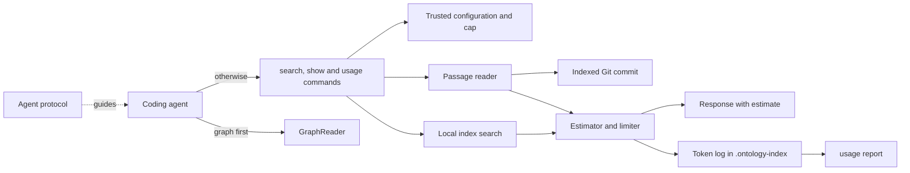

# Semantic index token efficiency

## [PO] Vision

### Problem

The semantic repository index helps agents and developers find code from a plain-English question, but it does not yet say what that costs in tokens. Each search returns passages that an agent reads in full, and a broad query can return far more text than the agent needs to choose where to look next. The people who pay are the agents, whose discovery work fills their context before the first edit, and the developers whose usage budget those sessions draw on. Nobody can currently see how many tokens a search returns, so nobody can tell whether a change makes the index cheaper or dearer.

### Users

- Coding agents that search the index to find files, tests and documentation before making a change.
- Developers who run those agents and carry the usage cost and the time spent waiting on long contexts.
- Repository owners who set the index's limits and want evidence that it earns its keep.

### Outcomes and measures

1. **See what a search costs.** Every search reports the number of tokens it returned, and a repository can read the recorded figures for a period. Check that the figures match an independent count on a reviewed set of queries. This creates the baseline that every later measure compares against.
2. **Return less text for the same leads.** On a reviewed set of real questions, compare tokens returned per query against the baseline. Check that the share with a relevant implementation, test or document in the first five results does not fall below the baseline.
3. **Bound the worst case.** A single search cannot return more than a size the repository owner sets. Check the largest response across the reviewed set against that limit, and that a response cut short says so.
4. **Spend fewer tokens finding the first file to change.** On a reviewed set of real tasks run with an agent, compare input tokens, files opened and search calls before the first edit against the baseline and against running without the index. Pair the figures with a short developer note on whether the results were still trusted enough to start from.

5. **Load less before any search.** The agent protocol for the index is as short as it can be while keeping every rule an agent needs. Check the tokens it adds to a session's starting context against its current size, and that a reviewed set of agent runs still follows each rule.
6. **Use the graph when it already answers.** Where a `SourceKnowledgeGraph` is available and covers the question, an agent is told to consult it before searching. On a reviewed set of questions that the graph covers, compare the searches run and tokens spent against the baseline, and check that the answers still cite evidence at the reported commit.

Set targets after the baseline exists. Outcomes 2 to 6 report a change from it; they do not promise a percentage in advance.

### Scope

- Recording the tokens each search returns, readable by the repository owner, with no source text or query text stored beyond what search already keeps.
- A compact form of search results that lets an agent choose where to look before it reads passage text, and a way to ask for the full text of a chosen result.
- An owner-configured cap on the size of a search response, and a clear indication when a response was cut short.
- A shorter agent protocol for the index, that keeps every rule agents need and drops restated or redundant text.
- Guidance telling agents to consult the `SourceKnowledgeGraph` first when an adopting repository has one that covers the question, and to search the index otherwise.
- Measurement of the outcomes above on representative adopting repositories.

### Out of scope

- Combining adjacent or overlapping passages into one result. Deferred until the baseline shows whether duplicates matter.
- Changing the source knowledge graph itself, or building any new way to query it.
- Changing the embedding model, ranking, chunking or the snapshot format.
- Billing, quotas or reporting of spend in currency, and token counts for anything other than index searches.
- A hosted service for collecting figures across repositories.

### Research

- GitHub's code search tool for agents was changed to trim each hit and return text-match snippets instead of the full repository object for every result, because the full objects bloated the context window. [github-mcp-server pull request 2476](https://github.com/github/github-mcp-server/pull/2476)
- Other code-search servers for agents commonly cap hits with a small default and a hard maximum, return snippets with path and line ranges, and offer a compact response mode. [opencodesearch](https://docs.rs/crate/opencodesearch/0.1.0/source/src/mcp.rs), [code context engine](https://mcpservers.org/ja/servers/elara-labs/code-context-engine)
- Vendors report large token savings from these designs, but the figures come from their own benchmarks on different codebases and are not comparable. This is why the vision sets the baseline and the comparison inside the adopting repository. [jCodeMunch](https://pypi.org/project/jcodemunch-mcp/1.26.0/)
- Anthropic's guidance on writing tools for agents names token efficiency as a design principle for tool responses; the specific advice on truncation and response format was not retrieved in this research and should be read at the source before the architect decides. [Writing effective tools for agents](https://www.anthropic.com/engineering/writing-tools-for-agents)

## [Analyst] Behaviours

The scenarios cover the six outcomes in the [PO] Vision above. Search already returns only the commit, path, line range and score of each hit, never passage text, and `--limit` already bounds hits from 1 to 100 with a default of 5. The cost an agent actually pays is therefore the reading it does after a search and the number of searches it runs. Outcomes 2 and 3 are read in that light, and the uncertainty log records the change (U1).

### Outcome 1 — See what a search costs

**B1 — Record each command's token estimate.** Given semantic index search or passage retrieval is enabled, when either command returns a response, then the Kit appends one `SearchTokenLog` record to the checkout's Git-ignored index storage holding the time, command, number of results or lines returned, and the `TokenEstimate` of the response. The record contains no query text and no source text. The same response always yields the same estimate.

**B2 — Report the estimate in every response.** Given a search or passage response, when it is returned in text or JSON, then it states its `TokenEstimate` and that the figure is an estimate. A response that was not logged because logging failed still states its estimate and reports the logging failure without failing the command.

**B3 — Summarise recorded use.** Given a `SearchTokenLog` with records, when a developer or owner requests a report, then the Kit prints the number of commands, total and mean estimated tokens per command, and the largest response, optionally limited to records after a given time. An empty or absent log reports that no baseline exists yet. The report reads only the local log.

**B4 — Validate the estimate.** Given a reviewed set of queries, when the estimates are compared with an independent count of the same responses, then the pilot records the difference. A systematic difference is reported with the figures and does not block the feature.

### Outcome 2 — Return less text for the same leads

**B5 — Return only the cited passage.** Given a `SemanticSearchResult` from the current index, when an agent requests that passage by commit, path and line range, then the Kit returns the text of those lines read from the indexed Git commit, not from the working tree, together with the commit, path, line range and its `TokenEstimate`. A request for a commit that is not the indexed commit, a path outside the effective `IndexSourceScope`, or a range outside the file is refused with the reason and returns no text.

**B6 — Keep search results to locations.** Given a search, when it returns results, then each carries the commit, path, line range and score and no passage text. In compact JSON output the commit appears once for the response rather than on every result. The standard output form is unchanged for existing callers.

**B7 — Hold relevance steady.** Given the reviewed question set from the original index pilot, when the same questions run with compact output and the passage command, then the share with a relevant location in the first five results equals the baseline for the same index. Compact output changes how results are presented and never which results are returned.

### Outcome 3 — Bound the worst case

**B8 — Apply the owner's response cap.** Given `semanticIndex` in `OntologyConfig` sets a `ResponseCap`, when a passage or search response would exceed it, then the Kit returns the leading part that fits, marks the response as truncated, and states what was returned and what remains: for a passage, the line range returned and the first line not returned; for a search, the number of results returned and omitted. A truncated response is a successful response. The estimate and the log record the size actually returned.

**B9 — Default and validate the cap.** Given no `ResponseCap` is set, when a command runs, then the Kit applies a documented default. A cap that is not a positive integer is a configuration error that names the setting and makes no model request. The cap is read from the trusted committed configuration, like other index settings, and a credential or environment value cannot raise it.

**B10 — Stay within the cap in the worst case.** Given the reviewed question set and a cap, when every search and passage response is measured, then the largest `TokenEstimate` does not exceed the cap by more than the size of the truncation notice.

### Outcome 4 — Spend fewer tokens finding the first file to change

**B11 — Measure discovery cost per task.** Given a reviewed set of real tasks and an agent session transcript for each, when a task is run with the index and without it, then the pilot records, up to the first edit, the input tokens, files opened, search calls and index commands used, and a short developer note on whether the results were trusted enough to start from. Counts come from the session's own usage record or transcript, not from the Kit.

**B12 — Compare against the baseline.** Given the recorded figures from B11 and the `SearchTokenLog` baseline, when the pilot reports, then it states the change in each figure against the baseline and against running without the index. It sets no target before the baseline exists.

### Outcome 5 — Load less before any search

**B13 — Shorten the agent protocol.** Given the agent protocol installed for the semantic index, when it is shortened, then every rule an agent needs remains: when to use the index, the status and refresh check, the single focused query, treating results as leads, reading the cited lines at the cited commit, the empty-result rule, and the prohibitions. Text that restates another rule or the vision is removed. The installed text stays identical in every adopting repository.

**B14 — Measure the protocol's cost and fidelity.** Given the previous and shortened protocol, when each is estimated in tokens and a reviewed set of agent runs follows each, then the pilot records the change in starting-context tokens and checks that no rule that was followed before is dropped.

### Outcome 6 — Use the graph when it already answers

**B15 — Consult the graph first.** Given `sourceGraph` is enabled and the graph reader is installed, when an agent has a repository question, then the protocol tells it to ask the graph reader first, and to run an index search only when the reader reports the relevant area as unknown, excluded or empty. When `sourceGraph` is not enabled the protocol tells the agent to search the index directly.

**B16 — Report graph-first savings.** Given a reviewed set of questions that the graph covers, when they run under the old and new protocols, then the pilot records searches run and tokens spent for each, and checks that each answer still cites evidence at the reported commit. The graph itself is not changed.

## Uncertainties

| ID | Question | Decision or deferral | Basis |
| --- | --- | --- | --- |
| U1 | The vision assumes bulky search results, but results already carry no passage text. What do outcomes 2 and 3 mean? | Read them as: return only the cited passage on request, present results compactly, and cap response size. The vision wording is not amended; this reading governs the behaviours (B5–B10). The remaining cost to reduce is post-search reading and repeated searches. | Owner chose to reinterpret rather than raise pushback to the product owner. |
| U2 | How are tokens counted? | A deterministic estimate from characters, always labelled as an estimate. A model tokenizer is not used (B1, B2, B4). | Owner decision. |
| U3 | Where is telemetry recorded and what does it hold? | A Git-ignored local log in the index storage with command, time, counts and estimates only. No query or source text (B1, B3). | Owner decision. |
| U4 | What does compact mean, and how does an agent get full text? | Search stays location-only with the commit stated once in compact JSON. A new passage command returns only the cited lines from the indexed commit (B5, B6). Excerpts in search results are rejected. | Owner decision. |
| U5 | What happens past the cap? | Cut at the cap, say so, and report what remains. Never fail on size (B8). | Owner decision. |
| U6 | How does an agent know the graph covers a question? | A protocol rule, with the existing graph reader's coverage reporting deciding. The index does not consult the graph (B15). | Owner decision. |
| U7 | What default cap applies when none is set? | Deferred to the architect, who chooses a documented default (B9). | Analyst: a number needs the measured baseline from B3. |
| U8 | How are agent tokens before the first edit counted for outcome 4? | From the agent session's own usage record or transcript. The Kit does not observe other tools' consumption (B11). | Analyst proposal, consistent with the vision's scope. |
| U9 | Does telemetry need a retention or size limit? | Deferred to the architect (B1). | Analyst proposal. |
| U10 | Passage merge, changes to model, ranking, chunking and snapshot format. | Out of scope, as in the vision. | Accepted vision. |

## Terms

New domain terms, added to `docs/ontology.md`: `SearchTokenLog`, `TokenEstimate`, `ResponseCap`, `PassageExtract`, `ShowIndexedPassage`, `ReportIndexTokenUse`. Existing terms used: `SemanticRepositoryIndex`, `SemanticSearchResult`, `IndexSourceScope`, `OntologyConfig`, `SourceKnowledgeGraph`, `GraphReader`, `GraphCoverage`.

## [Architect] Structure

The [Analyst behaviours](#analyst-behaviours) govern this design. It extends the installed index script and its protocol text. It adds no service, dependency or workflow. Search stays location-only; the new work is a passage command, a token estimate with a local log, a response cap, and shorter agent guidance.

### Components

| Component | Responsibility | Behaviours |
| --- | --- | --- |
| Token estimator and limiter | New module in `templates/scripts/`. Computes the `TokenEstimate` of a response as characters divided by four, rounded up, and applies the `ResponseCap` by cutting at the largest whole line or result that fits, adding a truncation marker that states what was returned and what remains. | B2, B6, B8, B9, B10 |
| Token log | New module. Appends one counts-only `SearchTokenLog` record per search or passage response to `.ontology-index/token-log.jsonl`, rotates once at 1 MiB keeping one previous file, and never fails a command when a write fails. Reads both files for reports. | B1, B3 |
| Passage reader | Extends the Git source module with a bounded read of the lines of one path at the indexed commit. Checks the commit equals the indexed commit, the path is in the effective `IndexSourceScope`, and the range lies within the file. Produces a `PassageExtract`. | B5, B8, B10 |
| Command entry point | The existing `scripts/semantic-index.mjs` gains `show` and `usage` and a `--compact` flag on JSON search. It adds the estimate to every response, calls the limiter and the log, and leaves output without the flag byte-identical. | B1–B3, B5–B8 |
| Trusted configuration | `ontology-config.mjs` validates the optional `semanticIndex.responseCap` as a positive integer in estimated tokens and supplies the default of 4000. The value is read from the trusted committed configuration only. | B8, B9 |
| Agent protocol | The shortened `templates/protocol/semantic-index-protocol.md`, spliced by the `Installer`, with the rule to consult the `GraphReader` first when the graph is enabled. | B13, B15 |
| Pilot harness | Extends `scripts/measure-semantic-index.mjs` to compare estimates with an independent count, relevance with compact output, the largest response against the cap, per-task discovery cost from session records, protocol size and fidelity, and graph-first savings. | B4, B7, B10–B12, B14, B16 |

### Structure

The estimator and limiter sit between every output path and the response, so each response is measured, capped and logged in one place. The passage reader shares scope and blob reading with the source module, so `show` cannot return text the index would not have indexed. The log is written after the response is built and its failure is reported, not raised.

### Data

`.ontology-index/token-log.jsonl` holds one JSON line per response: time, command, count of results or lines returned, estimated tokens, and whether the response was truncated. It holds no query text, source text or path. The directory is already Git-ignored by the opt-in installer, so the log is never committed.

### Deployment and runtime

- The new module and changes ship in `templates/scripts/` as byte-identical installed scripts under the existing `--with-semantic-index` opt-in. An adopter upgrades by reinstalling; the Kit's config validator must be upgraded before `responseCap` is set.
- Runtime needs only Git and Node 20+ built-ins. `show` and `usage` use local files and Git and make no model or network request.
- The shortened protocol text reaches adopters through the existing splice on install or upgrade. Adopters that have not upgraded keep the old text and the old behaviour.
- The pilot runs on representative adopting repositories with pinned commits and the same reviewed questions as the original index pilot.

### Traceability

| Behaviour | Components and verification focus |
| --- | --- |
| B1 | Command entry point, token estimator and limiter, token log: one counts-only record per response, no query or source text. |
| B2 | Command entry point, token estimator and limiter, token log: estimate in text and JSON, logging failure reported without failing the command. |
| B3 | Command entry point, token log: report totals, mean, largest, after-time filter, empty-log message. |
| B4 | Pilot harness, token estimator and limiter: estimates against an independent count. |
| B5 | Command entry point, passage reader, token estimator and limiter: cited lines from the indexed commit, refusals for commit, scope and range. |
| B6 | Command entry point, token estimator and limiter: location-only results, commit stated once in compact JSON, default output byte-identical. |
| B7 | Pilot harness, command entry point: relevance in the first five unchanged. |
| B8 | Token estimator and limiter, passage reader, command entry point, trusted configuration: cut at the cap with a truncation marker. |
| B9 | Trusted configuration, command entry point: default, validation and trusted source of the cap. |
| B10 | Pilot harness, token estimator and limiter, passage reader: largest response within the cap plus the notice. |
| B11 | Pilot harness: discovery cost per task from session records. |
| B12 | Pilot harness: change against the baseline and against running without the index. |
| B13 | Agent protocol: every needed rule kept, text identical across repositories. |
| B14 | Pilot harness, agent protocol: starting-context tokens and rule fidelity. |
| B15 | Agent protocol: graph reader first when enabled, index search otherwise. |
| B16 | Pilot harness, agent protocol: searches and tokens for graph-covered questions, evidence still cited. |

### Decisions

- [ADR 0037 · Count tokens by estimate and log counts locally](../../adr/0037-count-tokens-by-estimate-and-log-counts-locally.md)
- [ADR 0038 · Add a passage command and compact output](../../adr/0038-add-a-passage-command-and-compact-output.md)
- [ADR 0039 · Cap responses by estimated tokens](../../adr/0039-cap-responses-by-estimated-tokens.md)
- [ADR 0040 · Shorten the protocol and consult the graph first](../../adr/0040-shorten-the-protocol-and-consult-the-graph-first.md)

Deferred U7 and U9 are decided here: the default cap is 4000 estimated tokens, to be revisited once the baseline exists, and the log rotates once at 1 MiB keeping one previous file.

## [User] Runbook, guide and acceptance

### Runbook

**Deployed environment used by acceptance:** an adopting repository with the Kit installed with `--with-semantic-index`, after the build pull request for this feature has merged and the adopter has upgraded. This repository ships the scripts in `templates/scripts/` but does not install the index for itself, so the deployed layer below cannot run in this checkout. "Local" below is a scratch adopting repository installed by the acceptance fixture; "deployed" is that upgraded adopter.

#### Deploy

1. Upgrade the Kit scripts: `node bin/install-ontology.mjs --target <repo> --force --with-semantic-index`. Commit the result. The Kit's config validator must be upgraded before `responseCap` is set, or the setting is rejected.
2. In `ontology.config.json` on the trusted branch, keep `semanticIndex.enabled` true and optionally set `semanticIndex.responseCap` to a positive integer in estimated tokens. Omit it to use the default of 4000. The value is read from the trusted committed configuration only; no environment value can raise it.
3. Health check: run `node scripts/semantic-index.mjs status --json`, then `refresh --json` if the state is `missing` or `stale`, then one `search`, one `show` and one `usage`. Each of `search` and `show` states its estimated tokens, and `usage` reports at least one command.

#### Operate

- Run `node scripts/semantic-index.mjs usage --json` (optionally `--since <ISO time>`) to read the baseline: number of commands, total and mean estimated tokens, and the largest response. An empty log reports that no baseline exists yet; run searches before drawing conclusions.
- The counts-only log is `.ontology-index/token-log.jsonl` in each checkout. It holds time, command, count, estimated tokens and truncation only — never query text, source text or paths — and rotates once at 1 MiB, keeping one previous file. It is Git-ignored and is never committed.
- A response over the cap is cut, marked as truncated and states what remains. That is a successful response, not an error: for `show`, request the next line named in the marker; for `search`, raise the cap or narrow the query only if the omitted results are needed.
- `show` refuses a commit that is not the indexed commit, a path outside the approved scope and a range outside the file, and returns no text. Fix the citation; do not widen `semanticIndex.scope` to make it pass — only a maintainer changes settings.
- A `Token log not recorded` line means the response still succeeded but its estimate was not logged. Check that `.ontology-index/` is writable and that `token-log.jsonl` is a regular file, not a directory or symbolic link.

#### Recover and roll back

- Remove `semanticIndex.responseCap` from the trusted configuration to return to the default of 4000; set it to a positive integer to change it. An invalid value fails every index command with a configuration error naming the setting and makes no model request, so fixing the value is the recovery.
- To roll back the feature, revert the adopter's upgrade commit. Responses lose the trailing estimate, `show` and `usage` are gone, and the previous protocol text returns on the next install. The token log file is inert and can be left or deleted with the rest of `.ontology-index/`.
- An unreadable index is rebuilt with `refresh` or replaced by a validated `download`, as in `templates/docs/semantic-index.md`. Do not remove `.ontology-index/writer.lock` without checking its recorded PID and hostname.

### User guide

For coding agents, developers carrying the usage cost, and repository owners setting the limits, as named in the vision.

- **See what a search costs (B1 to B3).** Every `search` and `show` response states its `TokenEstimate` and that the figure is an estimate. Run `usage` to summarise the local `SearchTokenLog`; run it before tuning anything, because it is the baseline every comparison uses.
- **Read less to find the same leads (B5 to B7).** Search results carry only the commit, path, line range and score. Add `--compact` to JSON search to state the commit once instead of on every result, then run `show --path <path> --lines <start>-<end>` to read only the cited lines, taken from the indexed commit rather than the working tree.
- **Bound the worst case (B8 to B10).** Owners set `semanticIndex.responseCap` in `OntologyConfig`; the default is 4000 estimated tokens. A cut response says what was returned and what remains, and still succeeds.
- **Spend fewer tokens before the first edit (B11 and B12).** The pilot harness in `scripts/measure-semantic-index.mjs --tokens` records, per task, the input tokens, files opened, search calls and index commands up to the first edit from the agent session's own transcript, and compares them with the baseline and with running without the index. No target is set before the baseline exists.
- **Load less before any search (B13 and B14).** The installed protocol is shorter than before (544 estimated tokens, down from 588) and keeps every rule. Its token change and rule fidelity are measured by the same pilot harness.
- **Use the graph when it already answers (B15 and B16).** When `sourceGraph` is enabled and the graph reader is installed, ask the `GraphReader` first and search only when it reports the area as unknown, excluded or empty; otherwise search directly. The pilot records the searches and tokens saved on graph-covered questions.

### Acceptance

Executable tests: `tests/semantic-index-token-efficiency-acceptance.test.mjs` (`node --test tests/semantic-index-token-efficiency-acceptance.test.mjs`), which installs the Kit into two scratch repositories and drives the installed `search`, `show` and `usage` commands against a local model stand-in. The measurement behaviours are automated in `tests/semantic-index-pilot.test.mjs`, the protocol in `tests/semantic-index-protocol.test.mjs`, and text output, cap fitting and the log in `tests/semantic-index-cli.test.mjs`, `tests/semantic-index-tokens.test.mjs` and `tests/semantic-index-token-log.test.mjs`.

| Behaviour | Scripted walkthrough (each step with its expected result) | Executable test |
| --- | --- | --- |
| B1 | 1. In an installed adopter with a current index, run one `search`. Expect one new log record holding only time, command, count, estimated tokens and truncation. 2. Read the log file. Expect no query text, source text or path. | acceptance: B1, B2, B6 and B7; CLI: B1, B2 and B6 |
| B2 | 1. Run `search` and `show` in JSON and text. Expect each to state its estimate and that it is an estimate. 2. Make the log path a directory and search again. Expect success with a `Token log not recorded` report. | acceptance: B1 to B7 and B2 log failure; CLI: B2 text and log failure |
| B3 | 1. Run `usage` before any search. Expect a report that no baseline exists yet. 2. Search twice, `show` once, run `usage` again. Expect command count, total, mean and largest, and fewer with `--since` after the first. | acceptance: B3 and B1 to B7; CLI: B3 |
| B4 | 1. Run the pilot `--tokens` comparison on a reviewed set of responses. Expect the mean and largest difference from the independent count to be recorded; a systematic difference is reported, not blocking. | pilot: B4 and the `--tokens` CLI |
| B5 | 1. `show` a cited range. Expect only those lines, read from the indexed commit even with working-tree edits. 2. Ask for another commit, an unapproved path and a range past the end. Expect a refusal with the reason and no text each time. | acceptance: B5; CLI: B5 |
| B6 | 1. Search in JSON. Expect each result to carry commit, path, line range and score and no text, with the existing fields unchanged. 2. Search with `--compact`. Expect the commit stated once and the same locations. | acceptance: B1, B2, B6 and B7; CLI: B6 compact and text |
| B7 | 1. Run the reviewed questions with compact output and `show`. Expect the share with a relevant location in the first five to equal the baseline for the same index. | acceptance: compact equals full; pilot: B7 |
| B8 | 1. Set a small `responseCap` on the trusted branch and search. Expect a successful truncated response stating results returned and omitted. 2. `show` a long range. Expect whole leading lines, the last line returned and the first line not returned. | acceptance: B8, B9 and B10; CLI: B8 search and passage |
| B9 | 1. Omit `responseCap`. Expect the default of 4000 to apply. 2. Set it to `0`. Expect a configuration error naming `semanticIndex.responseCap` and no model request. | acceptance: B8, B9 and B10; CLI: B9 and config tests |
| B10 | 1. Run the reviewed set under a cap and measure every response. Expect the largest estimate to exceed the cap by no more than the truncation notice. | pilot: B10 `checkCap`; CLI: B8, B9 and B10 |
| B11 | 1. Give the pilot a task transcript. Expect input tokens, files opened, search calls and index commands counted only up to the first edit. | pilot: B11 transcript and `--tokens` tasks |
| B12 | 1. Run the pilot comparison with baseline, with-index and without-index figures. Expect the change against each to be stated, and no target set before the baseline exists. | pilot: B12 |
| B13 | 1. Read the installed protocol. Expect every prior rule present: when to use the index, the status and refresh check, one focused query, results as leads, cited lines at the cited commit, the empty-result rule and the prohibitions. 2. Diff the installed text across adopters. Expect byte-identical text. | protocol: B13; acceptance: B13 and B15 installed protocol |
| B14 | 1. Estimate the previous and shortened protocols. Expect fewer starting-context tokens (544 against 588). 2. Compare reviewed runs. Expect no previously followed rule dropped. | protocol: B13 and B14; pilot: B14 |
| B15 | 1. With `sourceGraph` enabled and the reader installed, ask a repository question. Expect the protocol to direct the graph reader first and a search only on unknown, excluded or empty. 2. Without it, expect a direct search. | protocol: B15; acceptance: B13 and B15 |
| B16 | 1. Run graph-covered questions under the old and new protocols. Expect searches and tokens recorded for each, and every answer still citing evidence at the reported commit. | pilot: B16 |

#### Results

| Environment | Layer | Result | Date | By |
| --- | --- | --- | --- | --- |
| Local build | Executable tests (acceptance, pilot, protocol, CLI, token log and tokens files, then the full suite) | pass: acceptance 7/7; the other five files 44/44; full `npm test` 848/848 with Git's default line-ending setting (see note below) | 2026-11-24 | run by the agent at the direction of jamiemitchellconsultants, acting as user |
| Local build | Scripted walkthroughs | pass: each walkthrough above was followed against the installed CLI in the acceptance fixture and the pilot and protocol harnesses; the steps are the executable tests named beside them | 2026-11-24 | agent, at the direction of jamiemitchellconsultants |
| Deployed | Everything | not run: the build pull request has not merged yet, so no adopter has upgraded. Run after merge by upgrading one adopter as in Deploy, following each walkthrough there, then tick the deployed criterion on the parent issue. | - | - |

Note on the local full suite: on this machine's Git configuration (`core.autocrlf=input`), one pre-existing build test (`B5 reads only the cited lines from the commit, not the working tree` in `tests/semantic-index-source.test.mjs`) fails because the host setting rewrites the CRLF fixture on commit; with Git's default setting the full suite passes 848/848, as it did at the build handoff. This is recorded here rather than fixed in this phase; making that test independent of the host's Git defaults belongs to the build.
