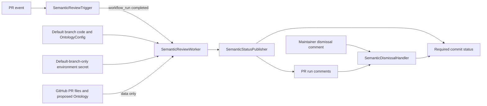

# Semantic ontology matching — architecture

This design implements the [accepted behaviours](02-behaviours.md) as an optional, blocking
companion to the deterministic `TermChecker`. It replaces neither the deterministic check nor the
existing advisory `DriftReviewer` during the pilot. The repository maintainer opts in to the new
workflow and can turn it off through `OntologyConfig`.

## Components

| Component | Responsibility | Behaviours |
| --- | --- | --- |
| `SemanticReviewTrigger` | A small `pull_request` workflow runs for every PR event, with no path filter, secret, artifact, or execution of PR code. Its completion requests the trusted follow-up workflow. | B1, B6, B14 |
| `SemanticReviewWorker` | A `workflow_run` job executes kit-owned code from the default branch. It resolves the current PR and revision through GitHub, checks same-repository author eligibility, reads the default branch's `OntologyConfig`, fetches changed eligible Markdown and the proposed `Ontology` as data, sends bounded full-file coverage to the configured model, and validates grounded findings. | B1–B5, B10–B14 |
| `SemanticStatusPublisher` | Writes a fixed commit-status context and a durable, PR-visible run comment. It applies valid dismissals to the current run, reports coverage and failure reasons, and keeps prior run comments visible. | B4–B12, B14 |
| `SemanticDismissalHandler` | A trusted `issue_comment` workflow accepts a finding ID and reason from an authorized maintainer, records the dismissal on the PR, and recomputes the current status without invoking the model. | B8–B9 |
| PR author's agent or another agent | Reads the finding and proposed correction on the PR. An agent with the author's identity may commit a fix; another agent posts a proposal for the author. The kit does not impersonate either agent or edit the branch. | B6–B7 |

## Structure

The trigger and the deterministic term check stay separate. The follow-up worker checks out only
trusted default-branch code; it never runs PR scripts, workflow files, dependencies, or model output.
It obtains PR metadata, changed-file pagination, and file contents through GitHub APIs using the
verified PR head SHA. Eligibility requires a same-repository head and the PR author's current
write, maintain, or admin access; a same-repository branch alone is insufficient. It applies the
default branch's `ignorePaths` and Markdown scope, not a config proposed in the PR. It obtains the
ontology from the PR head when that file changed; otherwise the
same path at the base revision. Rename destinations are assessed; deleted files have no current
content. If listing or reading a file is incomplete, that file is recorded as unreviewed.

Every byte of each selected current file is covered by one or more bounded model requests. The
worker splits large files without dropping content and repeats the ontology projection in each
request. Model output must name an exact source passage and a real ontology row and supply a
suggested correction. Invalid or empty output counts as unreviewed coverage, never as a clean
result. A stable finding ID is derived from the head SHA, path, exact passage, and ontology row so
a dismissal survives another run on the same revision. Model prose is displayed as data and never
used as a command. The worker avoids logging file contents or credentials.

The publisher posts `pending` when review starts and then `failure` for an active finding or
`success` for all other outcomes. Its fixed context is `ontology/semantic-match`; maintainers
require that context in branch protection. It publishes against the current PR head and, when
GitHub evaluates a verified test-merge commit, that commit too. Each run gets a separate PR comment
with revision, reviewed and unreviewed files, grounded findings, and outcome. A later unavailable
run posts a successful *not reviewed* status and comment; the earlier finding comment remains
visible as history. If review finds a finding before losing coverage, that finding still makes the
status fail. A run with no eligible files or with matching files posts success with the appropriate
coverage statement. The worker rechecks the PR head before publishing and discards an obsolete
result. Review and dismissal updates for a PR are serialized to prevent an older result from
replacing a newer one.

The dismissal handler recognizes a documented command containing the current finding ID and a
non-empty reason. It verifies the comment author's current repository role through GitHub's
collaborator-permissions API: owner, admin, or maintain. It ignores other comments. The comment is
the durable, visible `FindingDismissal`; reruns read valid comments for the same SHA and finding ID.
A new head SHA invalidates them. A dismissal event recomputes the status from the latest run and
the valid dismissal comments; another active finding keeps it failing. It trusts run records only
when the marked comment was authored by the workflow bot. Proposed corrections from non-author
agents are ordinary PR comments linked to the finding, not dismissal commands.

## Deployment and runtime

- Add an opt-in `--with-semantic-review` installation path for the kit-owned trigger, worker,
  dismissal workflow, scripts, tests, and runbook. Existing `--with-drift-review` installations
  remain advisory; moving to the new pilot requires explicitly disabling their old workflow to
  avoid duplicate review comments. No installed script carries repository-specific values.
- Add an optional `semanticReview` section to adopter-owned `OntologyConfig` for `enabled`, model
  identifier, and OpenAI-compatible endpoint URL. The worker reads it from the trusted default
  branch. The credential is the dedicated `ONTOLOGY_SEMANTIC_LLM_API_KEY` secret in a GitHub Actions
  environment restricted to the default branch. Only the trusted worker job references it, with
  deployment creation disabled. The credential never appears in a PR file or model prompt.
  Missing or invalid settings, including an unavailable protected environment, yield a visible,
  successful *not reviewed* outcome.
- The trusted worker needs `contents: read`, `pull-requests: write`, `issues: read`, and
  `statuses: write`; the dismissal handler needs only the permissions required to read comments,
  check a commenter's role, and update statuses or PR comments. Configure the fixed status as a
  required check after the workflow is installed. Do not path-filter the trigger: even a code-only
  PR needs a successful *no eligible files* status. Fork PRs receive no model review and a visible
  out-of-scope result when the trigger runs. GitHub may require maintainer approval before a fork
  PR's trigger runs, leaving the required context pending until then; [issue #21](https://github.com/jamiemitchellconsultants/InternalOntology/issues/21)
  owns that manual path.
- The pilot is disabled by `semanticReview.enabled: false`. The workflow still reports a
  successful *disabled* result; the deterministic `TermChecker` runs independently. Maintainership
  judges whether the pilot has subjective value. No external database, service, or numerical value
  metric is required.

GitHub's documentation supports the separation: [`workflow_run` executes the follow-up on the
default branch with access to secrets](https://docs.github.com/en/actions/reference/workflows-and-actions/events-that-trigger-workflows#workflow_run),
while [commit statuses expose the latest state for a SHA and context](https://docs.github.com/en/rest/commits/statuses).
[Required status checks may evaluate the head or test-merge commit](https://docs.github.com/en/pull-requests/how-tos/merge-and-close-pull-requests/troubleshooting-required-status-checks#conflicts-between-head-commit-and-test-merge-commit),
so the publisher verifies and covers both. The worker's isolation protects this feature's
execution path. [Environment branch restrictions](https://docs.github.com/en/actions/reference/workflows-and-actions/deployments-and-environments#deployment-branches-and-tags)
prevent a PR-ref workflow from receiving this model secret. Adopters whose plan does not support
protected environment secrets leave semantic review disabled until they can supply this boundary.

## Traceability

| Behaviour | Components |
| --- | --- |
| B1 | `SemanticReviewTrigger`, `SemanticReviewWorker` |
| B2 | `SemanticReviewWorker` |
| B3 | `SemanticReviewWorker` |
| B4 | `SemanticReviewWorker`, `SemanticStatusPublisher` |
| B5 | `SemanticReviewWorker`, `SemanticStatusPublisher` |
| B6 | `SemanticReviewTrigger`, `SemanticStatusPublisher`, PR author's agent |
| B7 | `SemanticStatusPublisher`, other agent |
| B8 | `SemanticDismissalHandler`, `SemanticStatusPublisher` |
| B9 | `SemanticDismissalHandler`, `SemanticStatusPublisher` |
| B10 | `SemanticReviewWorker`, `SemanticStatusPublisher` |
| B11 | `SemanticReviewWorker`, `SemanticStatusPublisher` |
| B12 | `SemanticReviewWorker`, `SemanticStatusPublisher` |
| B13 | `SemanticReviewWorker` |
| B14 | `SemanticReviewTrigger`, `SemanticReviewWorker`, `SemanticStatusPublisher` |

## Decisions

- [ADR 0001 — Isolate model review in a trusted follow-up workflow](../../adr/0001-trusted-semantic-review-workflow.md).
- [ADR 0002 — Publish the latest semantic outcome as a commit status](../../adr/0002-semantic-outcome-status.md).
- [ADR 0003 — Keep findings and dismissals in PR comments](../../adr/0003-semantic-review-pr-ledger.md).
- [ADR 0004 — Introduce blocking review as a separate opt-in](../../adr/0004-semantic-review-opt-in.md).
