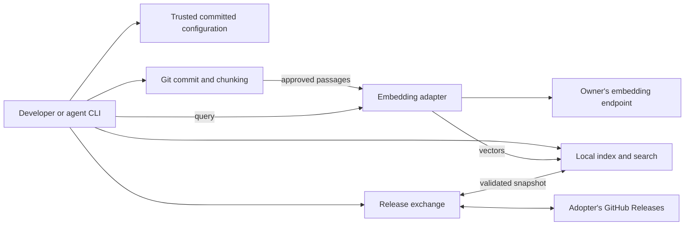

# Semantic Repository Index — architecture

The [accepted behaviours](02-behaviours.md) govern this design. The local index belongs to one
checkout, and every result names the commit it came from. GitHub Releases distribute copies of
the index. The repository owner chooses the model, and the Kit calls it only for source or query
embeddings. The ADRs record the architecture choices for review.

## Components

| Component | Responsibility | Behaviours |
| --- | --- | --- |
| Command entry point | The installed `scripts/semantic-index.mjs` exposes `status`, `refresh`, `search`, `download`, and `upload`. It reports recovery directions and offers structured JSON for agents. `refresh` also handles an initial build. | B1, B2, B4–B14, B16 |
| Trusted configuration | Validates the optional `semanticIndex` section through `OntologyConfig`. Loads settings from a trusted committed Git ref and resolves `IndexSourceScope`, `EmbeddingProfile`, and release publishing policy. | B2, B4–B7, B9, B11, B13–B16 |
| Git source and chunking | Captures one Git commit, filters its tracked regular text files and assigns stable source references and passage order. Reuses the existing Git tree reader with mode-aware, bounded blob reads. | B1, B4–B6, B9–B12, B15 |
| Embedding adapter | Sends bounded OpenAI-compatible embeddings requests to the approved endpoint. Validates batch responses and supplies query and source vectors. Resolves the embedding credential separately. | B1, B4, B10, B12–B16 |
| Local index and search | Validates the portable data format, reuses compatible vectors, and promotes complete writes atomically. Compares index provenance with the current checkout and performs exact cosine search. | B1, B2, B4–B7, B9–B12, B14–B16 |
| Release exchange | Uses authenticated `gh` for the approved GitHub repository. Resolves the selected release and its commit, verifies publisher access, and transfers an `IndexSnapshot` without overwriting assets. Delegates validation and promotion to the local index. | B4–B8, B13, B16 |
| Pilot harness | Runs the acceptance scenarios on representative repositories with pinned commits and reviewed questions. Compares search with a keyword baseline and captures source embedding counts, refresh time, compressed bytes, and time to first search. | B3, B4, B7, B10, B14–B16 |

## Structure

### Configuration and source

The owner maintains scope, model settings, and optional GitHub repository and publisher list in
`OntologyConfig` on the trusted default branch. Commands read its committed settings from the local
remote-tracking default ref, normally `refs/remotes/origin/HEAD`. Adopters with a different setup
can select an owner-trusted full ref or commit with `ONTOLOGY_INDEX_CONFIG_REF`. A missing
trusted ref or invalid policy is reported before network activity. The configuration ref is
independent of the source commit, so checking out a feature branch or importing an asset cannot
change the approved scope or endpoint. Status shows the effective configuration revision, and a
change to scope or model identity makes an existing index stale or incompatible as appropriate.

`refresh` captures `HEAD` once and enumerates regular blobs from that commit. Scope selectors are
case-sensitive repository-relative paths or directory prefixes ending in `/`, with exclusions
taking precedence. UTF-8 text is decoded strictly. Symlinks, submodules, binaries, and paths outside
scope are ineligible. An eligible file above the supported read limit produces an actionable error
and preserves the previous index. The source reader also checks both staged and unstaged changes
for the notice that search covers committed content. A local unpushed commit is a valid source.

The chunker uses ordered, versioned text windows within each file. It preserves line ranges, and
splits an overlong line on character boundaries while keeping the line reference. The format version
identifies the chunking recipe. The store uses path, blob identity, and recipe version to reuse every
unchanged eligible file under the same embedding space. It emits only records present at the new
commit under current scope. A rename uses the new path. A repeated refresh at the same commit with
the same effective settings makes zero source embedding requests.

### Embedding and retrieval

One HTTP adapter accepts OpenAI-compatible embeddings endpoints on approved HTTPS destinations
or local loopback HTTP. The `EmbeddingProfile` declares the model name, owner-managed model revision,
expected dimensions, and optional document and query prefixes. Compatibility fingerprints encode
the protocol, model identity, revision, dimensions, and prefixes. Changing the model behind a stable
endpoint requires the owner to advance the revision. The endpoint remains part of approved settings
and is excluded from the compatibility fingerprint so owners can approve two hosts for the same
embedding space. All source calls and query calls use the approved settings of the current checkout.

The adapter validates complete indexed batch results, finite nonzero vectors, and the configured
dimensions before giving vectors to the store. Calls use `ONTOLOGY_INDEX_EMBEDDING_TOKEN` when set
and never follow redirects. Endpoint URLs allow a path and reject embedded credentials, query
strings, and fragments. Model failure reports a bounded diagnostic. Status does not contact
the provider. Search checks the local index and its compatibility before embedding a query. It
normalizes vectors and performs a bounded top-k cosine scan with a stable tie order by path, line
range and passage position. Results give committed source locations. `SourceKnowledgeGraph` is an
independent follow-on for investigating those locations.

### Storage and snapshot exchange

The active store is `.ontology-index/index-v1.jsonl`. A header identifies the version, repository,
full source commit, normalized scope, and embedding space fingerprint. Ordered passage records hold
path, Git blob identity, line range, passage position, and little-endian Float32 vectors encoded as
base64. A footer binds the header and records with a SHA-256 digest and record count. Source text,
model destinations, and credentials stay outside the format.

Build and import write to a temporary sibling file, enforce bounded record and file sizes, validate
the whole candidate, and then promote it with an atomic rename under a checkout-level writer lock.
The rename is the commit point. Until promotion, readers keep the previous complete file. Search
validates from one open file before contacting the model and scores that same file after the query
returns. Errors identify a missing, stale, incompatible, or unreadable index. If `HEAD` moves during
refresh, the new index names the commit it actually read and reports stale at the new `HEAD`. If it
moves during search, report staleness before emitting results for the old commit.

An `IndexSnapshot` is a gzip-compressed copy of the validated index. Release commands use an
explicit `--release <tag>`. The deterministic asset name includes the format version, source commit,
scope digest, and embedding space digest. `download` resolves the selected release in the approved
repository and verifies the asset digest when GitHub supplies one. It validates the internal digest,
limits, source commit, approved scope, and compatibility before promotion. Git objects at the indexed
commit confirm the paths, blobs, and line ranges. The default requires the exact checkout commit.
`--allow-ancestor` permits an explicitly selected ancestor and leaves it stale pending refresh.

`upload` reads the repository's current default-branch policy through GitHub. It checks the actor
against that policy's publisher list, verifies repository write access, and checks the snapshot's
scope and embedding space against the policy. It verifies that the local index is current and that the release's remote tag, or
the draft's target if it has no tag yet, resolves to the indexed commit in the same GitHub repository.
For an untagged draft, the commit must also be verified on a pushed branch or tag in that repository.
Upload rejects immutable published releases, collisions, and assets at or above 2 GiB. The exchange
checks the resulting asset and release provenance before reporting success.

## Deployment and runtime

- The `Installer` ships byte-identical scripts and a runbook with the opt-in `--with-semantic-index`
  option. Install or upgrade the Kit's config validator before adding `semanticIndex` to adopter
  config. Missing settings leave the feature disabled. The opt-in setup ensures `/.ontology-index/`
  is ignored and refuses to overwrite tracked paths in that directory.
- Runtime uses Git and Node 20+ with built-in modules. `gh` is needed for the two release transfer
  commands. The Kit installs no vector service, daemon or required CI workflow. The optional model
  endpoint can be local or owner-approved remote.
- Status uses local files and Git only. Explicit refresh and search can call the approved model.
  Explicit download and upload can call GitHub. Download never re-embeds source. The actor's GitHub
  access controls release downloads, and publishing requires both the configured allowlist and
  GitHub write permission. Teams can use product releases or dedicated index releases.
- The pilot exercises a local Ollama endpoint and an approved remote OpenAI-compatible endpoint,
  and tests two adopting checkouts through snapshot upload, download, and a subsequent refresh.
  Compare top-five retrieval at pinned commits and check every citation using Git. Capture the
  compressed asset size, time to first search, and refresh counts and timing before setting targets.

## Traceability

| Behaviour | Components and verification focus |
| --- | --- |
| B1 | Command entry point, Git source and chunking, embedding adapter, local index and search — ranked pinned source locations with optional graph follow-up. |
| B2 | Command entry point, trusted configuration, local index and search — missing, stale, incompatible, unreadable before model call. |
| B3 | Pilot harness — top-five comparison and citation verification. |
| B4 | Command entry point, trusted configuration, Git source and chunking, embedding adapter, local index and search, release exchange, pilot harness — zero source re-embedding and time to first search. |
| B5 | Command entry point, trusted configuration, Git source and chunking, local index and search, release exchange — explicit ancestor import and refresh. |
| B6 | Command entry point, trusted configuration, Git source and chunking, local index and search, release exchange — validated import and preservation on failure. |
| B7 | Command entry point, trusted configuration, local index and search, release exchange, pilot harness — current index, pushed commit, release and authorised publisher. |
| B8 | Command entry point and release exchange — collisions, size limits and no asset overwrite. |
| B9 | Command entry point, trusted configuration, Git source and chunking, local index and search — committed inputs and clear dirty-checkout notice. |
| B10 | Command entry point, Git source and chunking, embedding adapter, local index and search, pilot harness — reuse and exact change handling. |
| B11 | Command entry point, trusted configuration, Git source and chunking, local index and search — detect and apply scope changes. |
| B12 | Command entry point, Git source and chunking, embedding adapter, local index and search — complete promotion or prior state, including interrupted writes. |
| B13 | Command entry point, trusted configuration, embedding adapter and release exchange — disabled or incomplete settings fail before network activity. |
| B14 | Command entry point, trusted configuration, embedding adapter, local index and search, pilot harness — compatible model for both modes and model change detection. |
| B15 | Trusted configuration, Git source and chunking, embedding adapter, local index and search, pilot harness — approved tracked regular text only. |
| B16 | Command entry point, trusted configuration, embedding adapter, local index and search, release exchange, pilot harness — credentials outside artefacts, data-only imports. |

## Decisions

- [ADR 0029 · Use an opt-in CLI and read trusted committed settings](../../adr/0029-semantic-index-local-cli-and-trusted-settings.md)
- [ADR 0030 · Index a committed tree and search it locally](../../adr/0030-semantic-index-pinned-source-and-exact-search.md)
- [ADR 0031 · Use a versioned portable index file](../../adr/0031-semantic-index-portable-file-and-promotion.md)
- [ADR 0032 · Use an OpenAI-compatible embeddings adapter](../../adr/0032-semantic-index-embedding-adapter.md)
- [ADR 0033 · Exchange snapshots through commit-matched releases](../../adr/0033-semantic-index-release-exchange.md)
