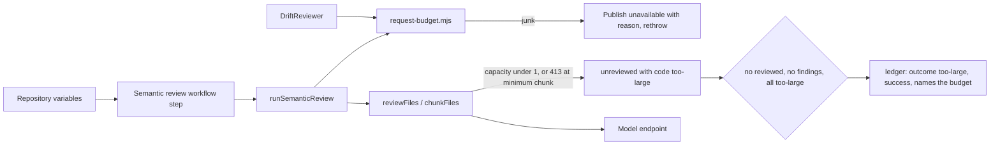

# Configurable semantic reviewer request budget

## Product owner: vision

### Problem

The blocking semantic reviewer plans every model request against a fixed 24,000-character budget in
`templates/scripts/semantic-review-model.mjs`. Feature #100 raised and made configurable the budget of
the advisory drift reviewer only. For a repository whose ontology projection is larger than that
budget (JEPA-Speech 58,094 and Grooveloom 73,517 characters, as measured for #100), the semantic
reviewer never reviews anything. Reproduced with the real review function and a 62,826-character
ontology: no model call is made, every changed file is listed as unreviewed with the reason
"ontology projection exceeds semantic review request budget", the run outcome is `unavailable`, and
the published status is a **success** reading "Semantic match not reviewed: service or configuration
unavailable". So a blocking reviewer fails open, silently, and with text that blames the service or
configuration instead of the size. Adopters cannot change the budget without editing a script that
must stay byte-identical in every repository, and the same models that now accept 131,072 tokens
could easily review these ontologies.

### Users

- Maintainers of adopting repositories with a large ontology (JEPA-Speech, Grooveloom) who want to
  turn on the semantic pilot.
- Maintainers who move to cloud models with larger windows and want to raise the budget without a kit
  release.
- Pull request authors, who see the status and need to know whether their Markdown was actually checked.
- The kit maintainer, who needs a regression guard for large ontologies in the semantic reviewer.

### Outcomes and measures

1. The semantic reviewer reviews repositories with large ontologies. Measure: with the default
   budget, a fixture ontology of about 60 KB reaches the model (no "exceeds request budget" outcome).
2. An adopter can change the budget without editing a script, using the same conventions as #100.
   Measure: one repository variable changes it, with the same positive-integer validation and a clear
   error for junk.
3. A too-large ontology no longer looks like a service outage. Measure: when the ontology still does
   not fit, the published status and pull request record say that the ontology is too large for the
   configured budget and how to fix it, not "service or configuration unavailable".
4. The blocking reviewer's contract stays coherent. Measure: the decision on how a too-large ontology
   surfaces in the status model (see below) is made explicitly, recorded in an ADR, and covered by tests.
5. The gap is guarded. Measure: a large-ontology case exists in the semantic reviewer's tests and in
   the acceptance tests.

### Decision to settle

How should a too-large ontology surface in the blocking reviewer's status model? Today it publishes a
success status with the text "service or configuration unavailable". Options for the analyst and
architect to weigh, not decided here:

- keep the non-blocking `unavailable` outcome but give it an accurate reason and description;
- introduce a distinct, still non-blocking outcome for "ontology too large";
- fail the status, so a pull request cannot merge unreviewed (this conflicts with ADR 0002's rule that
  an unavailable review permits merge, and with the rule that the reviewer must not silently pass).

The constraint from the request: a blocking reviewer must neither silently pass nor hard-fail on size
without a clear message.

### Scope

- Raise the default request budget of the semantic reviewer and make it overridable by an environment
  variable fed from a repository variable, with the same validation and error conventions as #100.
- A graceful, explained too-large outcome that fits the semantic reviewer's status model, per the
  decision above, including its pull request record.
- Review of the interplay between the larger budget, the model timeout and the output cap in the
  semantic reviewer (its own timeout and request shape), and a decision on a configurable timeout.
- Unit tests, a large-ontology case in the acceptance tests, and updates to the runbook
  `templates/docs/ontology-semantic-review.md` and the README.

### Out of scope

- Splitting the ontology projection across requests.
- Changing the projection, prompts, finding semantics or the dismissal flow.
- The drift reviewer (done in #100) and authentication (done in #92).
- Editing any consumer repository.

### Research

One finding, from reproduction in this repository: with a 62,826-character ontology the semantic
review function makes no model call and reports the file unreviewed with the reason above; the status
mapping publishes `success` with "Semantic match not reviewed: service or configuration unavailable"
for the `unavailable` outcome (`semantic-review-ledger.mjs`). This was shown by calling the review
function directly, not by a full worker run. The 58,094 and 73,517 sizes come from the #100 request and
were not re-measured. Nothing was checked against the live gateway.

## Analyst: behaviours

Terms: no new domain term. The existing `RequestBudget` (settings `ONTOLOGY_MAX_REQUEST_CHARS` and
`ONTOLOGY_MODEL_TIMEOUT_MS`) now also governs the `SemanticReviewWorker`; the ontology row, one
relationship and the invariant are updated. If the architect adds a new run outcome, the ontology
gains that value in the architect phase. "Capacity" means the budget minus the 1,000-character request
overhead, the ontology projection and the file path, which must be at least one character for any
Markdown to be sent.

### Outcome 1: the semantic reviewer reviews large ontologies

- **B1 Raised default.** Given neither setting is present, a 60,000-character ontology projection and a
  changed Markdown file, when the `SemanticReviewWorker` runs, then it sends the file to the model in
  requests no larger than the default budget and the file counts as reviewed.
- **B2 Headroom.** Given the default budget, then a projection leaves usable capacity until the
  capacity above falls below one character; only then does the too-large behaviour (B7) apply.

### Outcome 2: the budget is configurable without editing a script

- **B3 Override.** Given `ONTOLOGY_MAX_REQUEST_CHARS` is a valid positive integer N, then the semantic
  reviewer plans every request against N.
- **B4 Unset or empty.** Given the setting is unset, empty or whitespace, then the default applies.
- **B5 Junk rejected.** Given the setting is not digits forming a positive safe integer (for example
  `abc`, `0`, `-5`, `1.5`, `2e5`, `200_000`), when the review runs, then it fails before any model call
  with an error naming the variable and the offending value. (Which status the pull request then
  shows is open question OQ2.)
- **B6 Workflow wiring.** Given the installed semantic review workflow, then its review step passes
  `ONTOLOGY_MAX_REQUEST_CHARS` and `ONTOLOGY_MODEL_TIMEOUT_MS` from repository variables of the same
  names, no value is baked in, and the model credential stays an environment secret.

### Outcome 3: a too-large ontology is explained, not a silent pass

- **B7 Explained, never silent.** Given the capacity is below one character at the configured budget,
  when the review runs, then no model call is made, every eligible file is recorded as not reviewed
  with a reason that says the ontology is too large for the configured budget, and the status
  description and the pull request record both say so and name `ONTOLOGY_MAX_REQUEST_CHARS` as the
  setting to raise. The text "service or configuration unavailable" is not used for this cause.
- **B8 Status state per decision.** Given the situation in B7, then the published status state (and
  therefore whether the pull request can merge) is the one chosen in OQ1, recorded in an ADR. Whatever
  is chosen, the reviewer neither passes silently nor fails without the message in B7.
- **B9 Persistent token limit.** Given the model keeps answering 413 even for the smallest chunk,
  when the review runs, then the file is reported with the same too-large explanation as B7 rather than
  the bare "model rejected minimum-size chunk".
- **B10 413 split stays.** Given the endpoint answers 413 for a larger chunk, then the chunk is split
  and retried exactly as today.
- **B11 Non-regression.** Given an ontology that fits, then findings, stable finding ids, dismissals,
  partial and unavailable outcomes for other causes (credential, timeout, unusable answer) behave
  exactly as before.

### Outcome 4: requests stay within what the gateway can answer

- **B12 Timeout setting.** Given `ONTOLOGY_MODEL_TIMEOUT_MS` is valid, then each semantic model request
  uses it as its timeout; junk fails as in B5; unset or empty uses the default. The default value is
  open question OQ3 (the semantic reviewer's request timeout is 30,000 ms today, against 300,000 ms
  for the drift reviewer).
- **B13 Documented coupling.** Given the runbook, then it states that larger prompts take longer, that
  the timeout default has not been measured near the budget against any gateway, and that the
  semantic request sets no output cap of its own.

### Outcome 5: the gap is guarded

- **B14 Unit cases.** Given the unit tests of the model module and the worker, then they include a
  roughly 60,000-character projection that is reviewed by default, a projection that is too large at a
  small budget and a persistent-413 case.
- **B15 Acceptance.** Given an installed repository with a roughly 60 KB ontology and a local stand-in
  for the model endpoint, when the installed semantic reviewer runs, then it sends a request and
  records the file as reviewed; with a tiny budget it records the too-large result of B7.
- **B16 Docs.** Given the semantic runbook and README, then they state the default, the override, the
  too-large outcome and the timeout caveat.
- **B17 Byte-identical.** Given the change, then no repository-specific value appears in any script.

### Open questions for the architect (deliberately not decided here)

- **OQ1 Status model for a too-large ontology.** Three options from the vision, with what each
  implies:
  1. *Keep `unavailable`, give it an accurate reason and description.* Smallest change; state stays
     `success` and the pull request can merge; the outcome is indistinguishable by code from a real
     outage, only by text.
  2. *A distinct non-blocking outcome for "ontology too large".* State `success`, but a separate
     outcome, description and record line; needs the ledger's outcome list, its status mapping and the
     ontology updated; keeps ADR 0002's rule that an unreviewed run permits merge.
  3. *A failing status.* Blocks merge until the budget is raised; prevents a silent unreviewed merge but
     contradicts ADR 0002 and the rule that a later unavailable run permits merge (B10 there), and would
     break pull requests for every adopter whose ontology outgrows the budget.
  Constraint from the request for all three: neither silently pass nor hard-fail without a clear message.
- **OQ2 Junk setting and the status.** B5 fails the job; the architect decides whether the existing
  finalize path leaves a misleading status or whether the review step must publish an explicit result.
- **OQ3 Default semantic timeout.** Keep 30,000 ms or raise it. Relevant evidence (relayed, not
  re-measured): the drift reviewer took about 18 s for a 58 KB ontology on the live gateway.

### Uncertainties

| # | Question | Decision |
| --- | --- | --- |
| U1 | Variable names? | Reuse `ONTOLOGY_MAX_REQUEST_CHARS` and `ONTOLOGY_MODEL_TIMEOUT_MS` for both reviewers, as the request asked ("same override variable"). A repository using different models for the two reviewers shares one value; the architect confirms this is acceptable. |
| U2 | Default budget? | 200,000 characters as in #100; the architect restates the justification. |
| U3 | Validation rules? | Identical to #100: digits only, positive safe integer, empty or unset is the default. |
| U4 | Budget in `ontology.config.json` instead? | No: keep one convention with #100 (environment variable fed from a repository variable). |
| U5 | Does a persistent 413 count as too large? | Yes (B9), as in #100. |
| U6 | Which status state for a too-large ontology? | Explicitly deferred to the architect as OQ1, not out of scope: it must be decided in the architect phase. |
| U7 | Status after a junk setting? | Deferred to the architect (OQ2). |
| U8 | Default semantic timeout? | Deferred to the architect (OQ3). |
| U9 | Cap the semantic output (max_tokens)? | Out of scope; not changed. |
| U10 | Split the ontology projection across requests? | Out of scope (vision). |
| U11 | Is the budget right for the live gateway? | Cannot be decided here; unverified until a large-ontology consumer runs the semantic reviewer. |

## Architect: structure

OQ1 to OQ3 are settled in ADRs 0016, 0017 and 0018 below; each ADR states what the options mean for a
blocking reviewer, and the user reviews the choices on the design pull request.

### Components

| Component | Responsibility | Serves |
| --- | --- | --- |
| `request-budget.mjs` (new, installed with either reviewer) | `readPositiveInteger`, `resolveRequestBudget`, the 200,000-character and 300,000 ms defaults; the one copy of the parsing and error text | B3, B4, B5, B12 |
| `review-ontology-drift.mjs` (`DriftReviewer`) | Imports and re-exports the settings code, so existing behaviour and imports are unchanged | B11, B17 |
| `semantic-review-model.mjs` | `reviewFiles` takes `maxRequestChars` and `timeoutMs`, passes the budget to `chunkFiles`; marks unreviewed entries with a code `too-large` when capacity is below one character or a persistent 413 cannot be split; the 413 split is unchanged | B1, B2, B7, B9, B10, B12 |
| `semantic-review-worker.mjs` (`SemanticReviewWorker`) | `runSemanticReview` resolves the budget first; on junk it publishes an explained `unavailable` run and rethrows (ADR 0017); assigns outcome `too-large` when no file was reviewed, no finding exists and every unreviewed file has the `too-large` code (ADR 0016); passes the budget and timeout to `reviewFiles`; finalize path unchanged | B3, B5, B7, B8, B9, B11, B12 |
| `semantic-review-ledger.mjs` (`SemanticStatusPublisher`) | `statusFor` maps `too-large` to `success` with the description naming the budget variable; the pull request record adds the "permits merge" line for it | B7, B8 |
| Semantic review workflow template | Review step passes the two variables from repository variables; credential stays an environment secret | B6 |
| `Installer` | Plans `request-budget.mjs` and its test whenever either reviewer is installed | B17 |
| Runbooks, README | State default, override, outcome, timeout default and caveat | B13, B16 |
| Tests | Unit tests beside the scripts and `tests/` acceptance, including a roughly 60 KB ontology with a local stand-in for the model | B1-B17 |
| Ontology | `SemanticOutcome` enum (with `too-large`), `RequestBudget` relationships | B8 |

### Structure

### Deployment and runtime

No new service. The change ships in installed scripts, the workflow template and the runbook. A
consumer re-runs the installer with `--force`, which now also copies `request-budget.mjs`; the two
repository variables are optional. The semantic review job reads them from repository variables; the
model credential stays an environment secret.

### Traceability

| Behaviour | Components |
| --- | --- |
| B1 | `request-budget.mjs`, `semantic-review-model.mjs`, `semantic-review-worker.mjs` |
| B2 | `semantic-review-model.mjs` |
| B3 | `request-budget.mjs`, `semantic-review-worker.mjs` |
| B4 | `request-budget.mjs` |
| B5 | `request-budget.mjs`, `semantic-review-worker.mjs` |
| B6 | workflow template |
| B7 | `semantic-review-model.mjs`, `semantic-review-worker.mjs`, `semantic-review-ledger.mjs` |
| B8 | `semantic-review-worker.mjs`, `semantic-review-ledger.mjs`, ontology |
| B9 | `semantic-review-model.mjs`, `semantic-review-worker.mjs` |
| B10 | `semantic-review-model.mjs` |
| B11 | `semantic-review-worker.mjs`, `semantic-review-ledger.mjs`, `review-ontology-drift.mjs` |
| B12 | `request-budget.mjs`, `semantic-review-model.mjs`, `semantic-review-worker.mjs` |
| B13 | runbook |
| B14 | tests |
| B15 | tests |
| B16 | runbook, README |
| B17 | `Installer`, `request-budget.mjs` |

### Decisions

- [ADR 0016: a too-large ontology is its own non-blocking outcome](../../adr/0016-too-large-ontology-outcome.md) (OQ1)
- [ADR 0017: an invalid budget setting publishes an explained unavailable run, then fails the job](../../adr/0017-invalid-budget-setting-status.md) (OQ2)
- [ADR 0018: one shared budget module and a 300,000 ms default timeout](../../adr/0018-shared-request-budget-module-and-timeout-default.md) (OQ3)

## User: runbook, guide and acceptance

### Runbook

**Deployed environment used by acceptance:** a consumer repository's GitHub Actions run of the semantic
review with `semanticReview` enabled, driven by the user. No consumer has the semantic reviewer enabled
today, so this layer cannot run until one is set up (see Deploy). Nothing in this repository calls a
real model, GitHub or the gateway.

#### Deploy (per consumer)

1. Install or upgrade the kit-owned files:
   `node bin/install-ontology.mjs --target <repo> --force --with-semantic-review` (add
   `--with-drift-review` if used). Commit to the default branch. This copies `scripts/request-budget.mjs`
   with the reviewers.
2. Create the Actions environment `ontology-semantic-review`, restricted to the default branch, with the
   model credential as an environment secret (`KEYCLOAK_CLIENT_SECRET`, mapped by the workflow, or a
   static key), and the OIDC repository variables if used (see the semantic runbook).
3. On the default branch set `semanticReview` in `ontology.config.json` to `enabled: true` with the
   model and base URL, and require the status `ontology/semantic-match`.
4. Optional repository variables `ONTOLOGY_MAX_REQUEST_CHARS` (default 200000) and
   `ONTOLOGY_MODEL_TIMEOUT_MS` (default 300000; it was 30000). Positive integers only.
5. Health check: open a pull request that changes a Markdown file. The `ontology/semantic-match` status
   must leave `pending` and the pull request must get a "Semantic ontology review" comment.

#### Operate

- Status "Semantic match not reviewed: ontology too large for the configured budget (raise
  ONTOLOGY_MAX_REQUEST_CHARS)" means no model call was made. It is a success, so merging is not
  blocked. Raise the variable to a size the model accepts and push to re-run.
- Status "...service or configuration unavailable" with a reason naming `ONTOLOGY_MAX_REQUEST_CHARS` (or the
  timeout variable) means the setting is not a positive integer; the review job is red until fixed.
- Requests timing out: raise `ONTOLOGY_MODEL_TIMEOUT_MS`. The 300,000 ms default has not been measured near
  the budget, and chunks are reviewed one after another. The semantic request has no output cap of its own.

#### Recover and roll back

- Delete the two variables to return to the defaults. To roll back the code, revert the consumer's upgrade
  commit; the old script again reports ontologies above about 24,000 characters as unavailable, and its
  30,000 ms timeout returns.
- To switch the pilot off, set `semanticReview.enabled` to `false` on the default branch.

### User guide

For maintainers of an adopting repository, and for pull request authors reading the status.

- **A large ontology is reviewed (B1, B2).** After upgrading, a projection up to roughly 199,000 characters
  needs no setting.
- **Change the budget without editing a script (B3, B4, B6).** Set the repository variable; unset or blank
  means the default. The drift reviewer reads the same variable.
- **Typos are explained (B5).** A non-integer value turns the job red and the pull request record names the
  variable and your value.
- **"Too large" is not an outage (B7, B8, B9).** You get a green status that says the ontology is too large
  and which variable to raise, plus a comment listing each file. It permits merge; it never blocks.
- **The model's own limit still applies (B10).** If the endpoint rejects a request as too long, the file is
  split and retried.
- **Nothing else changes (B11).** Findings, dismissals, partial and other unavailable results behave as before.
- **Mind the timeout (B12, B13).** The default is now 300,000 ms; raise `ONTOLOGY_MODEL_TIMEOUT_MS` if needed.
- **Upgrades stay mechanical (B14 to B17).** Only variables, secrets and `ontology.config.json` differ.

### Acceptance

Executable tests: `tests/semantic-budget-acceptance.test.mjs` (`node --test tests/semantic-budget-acceptance.test.mjs`),
12 tests that install the kit into a scratch repository and drive the INSTALLED semantic reviewer against a
roughly 60 KB ontology, a local HTTP stand-in for the model and an in-memory GitHub client. Unit-level
cases (B14) are in the shipped `semantic-review-model`, `semantic-review-worker`, `semantic-review-ledger` and
`request-budget` tests. "Local" below is a scratch repository; "deployed" is a consumer Actions run.

| Behaviour | Scripted walkthrough (each step with its expected result) | Executable test |
| --- | --- | --- |
| B1 | 1. Install with `--with-semantic-review`, replace the ontology with a 60 KB one. 2. Run the installed review for a changed file with default settings. Expect a model request and the file reviewed. Deployed: open a pull request in a large-ontology consumer; expect a reviewed or finding result, not "not reviewed". | B1 B15 test |
| B2 | 1. Plan with a budget one character above the overhead, projection and path. Expect the file in one-character pieces. 2. At exactly that floor. Expect no request and the too-large code. | B2 test |
| B3, B4 | 1. Run with `ONTOLOGY_MAX_REQUEST_CHARS=90000`. Expect the model module to receive 90000. 2. Unset, then empty, then spaces. Expect 200000. | B3 B4 B12 test |
| B5 | 1. Run with `abc`. Expect the job to fail, an unavailable record naming the variable and `abc`, and no model call. 2. Same value with the pilot disabled. Expect no failure. | B5 test |
| B6 | 1. Open the installed semantic workflow. Expect both variables mapped from `vars`, no number, credential still an environment secret. | B6 test |
| B7, B8 | 1. Run with a budget the ontology cannot fit. Expect no model call, outcome too-large, status success reading "ontology too large for the configured budget" and naming the variable, never "service or configuration unavailable", and the comment saying it permits merge. Deployed: set the variable very low in a consumer and open a pull request. | B7 tests |
| B9, B10 | 1. Make the model answer 413 to everything. Expect each file coded too-large. 2. Make it answer 413 once to a larger chunk. Expect a split, a retry and the file reviewed. | B9 B10 test |
| B11 | 1. Return a finding. Expect failure. 2. Make the model time out. Expect the "service or configuration unavailable" wording and outcome unavailable. | B11 test |
| B12 | 1. Hang the model with a 20 ms timeout. Expect "model timed out". 2. Check defaults 45000 override and 300000. | B12 tests |
| B13, B16 | 1. Read the installed runbook and README. Expect the default, variables, too-large result, timeout default of 300,000 ms with the "has not been measured" caveat and the lack of an output cap. | B13 B16 tests |
| B14 | 1. Run the shipped unit tests alone. Expect the large-ontology, too-large and persistent-413 cases to pass on Node 20, 22 and 24. | shipped test files (run in Docker for #116) |
| B15 | covered by B1 and B7 above | B1 B15, B7 tests |
| B17 | 1. Install, then diff `scripts/request-budget.mjs` and the three reviewer scripts against the templates. Expect no difference, and both reviewers import the same module. | B17 test |

#### Results

| Environment | Layer | Result | Date | By |
| --- | --- | --- | --- | --- |
| Local build | Executable tests (12 tests) | pass; full `npm test` exits 0 | 2026-11-18 | run by the agent; not yet approved by the person acting as user |
| Local build | Shipped unit and installed tests on Node 20, 22, 24 (Docker, from the build PR #116) | pass: `npm test` 529/529 on each; every shipped test file alone passes with none cancelled | 2026-11-18 | run by the agent |
| Local build | Scripted walkthroughs | pending, not yet followed by a person | - | - |
| Deployed | Everything | not run: no consumer has the semantic reviewer enabled. It needs a consumer reinstall with `--with-semantic-review`, `semanticReview` enabled in its `ontology.config.json`, the `ontology-semantic-review` environment secret, and a pull request that changes Markdown. No live call was made. | - | - |
| Not verified live | - | the 200,000-character default and the 300,000 ms timeout for semantic prompts; the real GitHub client end to end; the too-large and junk-setting records as GitHub displays them; the person-run walkthroughs, which the user has not approved | - | - |
