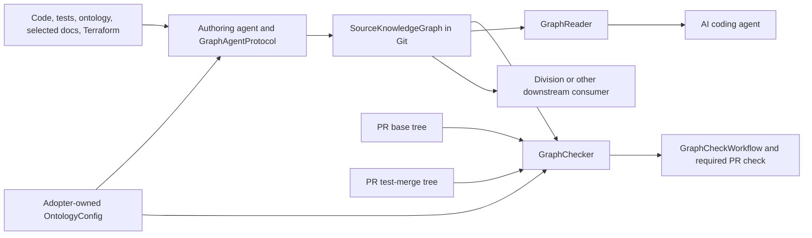

# Source knowledge graph for AI agent grounding — architecture

This design serves the [accepted behaviours](02-behaviours.md) through a source-owned
`SourceKnowledgeGraph` committed with the repository it describes. The Kit supplies an agent
authoring protocol, a local reader, and a deterministic checker. It supplies no graph-generating
model, hosted service, or language-specific extractor. The Git commit containing the graph is its
effective source revision.

## Components

| Component | Responsibility | Behaviours |
| --- | --- | --- |
| `Installer` and `OntologyConfig` | An explicit `--with-source-graph` option installs Kit-owned scripts, a workflow, the authoring protocol, and a runbook. Adopter-owned configuration names the graph root and eligible evidence selectors; adopter-owned graph data survives `--force`. | B8–B15 |
| `GraphAgentProtocol` | Tells the authoring agent to consult the `Ontology`, review changed covered files before a PR, update assertions or record no fact change, and use graph evidence with its basis and gaps when answering tasks. | B1–B9, B12–B15 |
| `SourceKnowledgeGraph` | Git-tracked Turtle files hold `GraphNode`s, `GraphAssertion`s, `GraphEvidence`, `GraphCoverage`, and `GraphRefreshRecord`s. A versioned `GraphVocabulary`, stable IRIs, and canonical ordering make assertions consistent and reviewable. | B1–B4, B7–B12, B15 |
| `GraphReader` | A dependency-free local command reads a graph at a named Git revision, finds relevant nodes and bounded relationship paths, and emits each assertion's basis, evidence, and coverage status. It reports the revision used and whether it differs from the agent's working revision. | B1–B7, B12–B15 |
| `GraphChecker` | A dependency-free local command checks schema, identities, references, evidence paths and locations, coverage, and file review records. In PR mode it compares the base and proposed trees to detect unreviewed changes in declared coverage. It emits specific failures without judging semantic truth. | B8–B14 |
| `GraphCheckWorkflow` | Runs `GraphChecker` on each pull request and default-branch push with read-only repository access and no model or secret. The checker makes no network call. Maintainers require the workflow's stable check name and review the graph diff and evidence themselves. | B8–B11, B13–B14 |
| Downstream consumer | Reads the pinned commit's graph files and coverage using the published schema. It chooses which C4 or other views can be constructed and marks unsupported parts incomplete. | B12, B15 |

## Structure

The adopter owns `docs/source-knowledge-graph/manifest.ttl`,
`docs/source-knowledge-graph/nodes.ttl`, and assertion and evidence shards under
`docs/source-knowledge-graph/assertions/`. These are the default paths; `OntologyConfig` names the
graph root and eligible evidence-role selectors. The Kit installs a fixed `graph-schema.ttl` with
the core vocabulary. The manifest identifies the schema version and named `GraphCoverage` and
`GraphRefreshRecord` resources. Each node is a named resource with a stable IRI, kind, and label.
Each assertion is its own named resource with subject and object IRIs, a relationship IRI, a
`direct` or `inferred` basis, and at least one named `GraphEvidence` resource. Evidence records a
normalized repository-relative path, line range, source blob ID, and role such as implementation,
test, selected document, ontology, or deployment. A concept node links through `kit:denotes` to
its canonical concept IRI in the same commit's configured ontology Turtle source. Graph-local
IRIs use that source's `OntologyConfig.namespaceUri`. The reader resolves the containing Git
commit as the recorded revision for every resource; no file embeds its own commit hash. A consumer
must pin a commit rather than interpret detached Turtle files as current.

Graph files use a canonical, valid Turtle subset: fixed prefix declarations, one named subject
block at a time, one predicate-object pair per line, and deterministic subject and predicate
ordering. Values are named IRIs, escaped string literals, or decimal integer literals. Blank
nodes, RDF-star, collections, multiline literals, and compacted multi-object syntax are outside
the accepted input form. `GraphChecker` parses and validates this documented subset without a
third-party RDF dependency. The existing ontology reader can supply concept IRIs, but it only
parses the Turtle subset produced by its own writer; it is not a general graph parser.

The Kit-owned schema defines these required predicates. Each resource is a named IRI, so one
assertion and its evidence remain identifiable across revisions. Graph files may be sharded, but
the checker reads every tracked `.ttl` under the configured graph root except the Kit-owned
schema; an unreferenced shard cannot silently disappear from validation. The `kit:` prefix keeps
the ontology tooling's existing `https://ontology-kit.dev/schema#` namespace.

| Resource class | Required predicates |
| --- | --- |
| `kit:SourceKnowledgeGraph` | `kit:schemaVersion`, references to coverage and review resources |
| `kit:GraphNode` | `kit:kind`, `rdfs:label`; a concept node also has `kit:denotes` pointing to its canonical ontology IRI |
| `kit:GraphAssertion` | `kit:subject`, `kit:relationship`, `kit:object`, `kit:basis`, one or more `kit:evidence` links |
| `kit:GraphEvidence` | `kit:path`, `kit:startLine`, `kit:endLine`, `kit:blobId`, `kit:role` |
| `kit:GraphCoverage` | `kit:pathSelector`, `kit:status`, `kit:priority`, and a reason for unknown or excluded status |
| `kit:GraphRefreshRecord` | `kit:path`, current `kit:blobId` or `kit:deleted`, and `kit:reviewOutcome` |

The core basis values are `kit:direct` and `kit:inferred`. Core evidence roles distinguish
implementation, test, selected document, ontology, and deployment sources. The schema declares
their stable IRIs; adopter-owned `OntologyConfig` selects paths eligible for each role. The
checker verifies that each concept node's `kit:denotes` target exists in the proposed commit's
canonical ontology Turtle source, whose path derives from `OntologyConfig.ontologyPath`.

The schema version fixes a small cross-repository `GraphVocabulary`. Initial core node kinds are
`kit:concept`, `kit:source-file`, `kit:source-symbol`, `kit:test`, `kit:dependency`, `kit:document`,
`kit:deployment-resource`, `kit:system`, and `kit:component`. Initial core relationships are
`kit:contains`, `kit:implements`, `kit:tested-by`, `kit:depends-on`, `kit:documented-by`,
`kit:calls`, `kit:communicates-with`, and `kit:deployed-by`. Their definitions ship as `kit:` IRIs
in the Kit's schema, independent of any repository's domain names. A repository can declare
additional kind or relationship IRIs in its own namespace in the manifest, each with a non-empty
definition. `GraphChecker` rejects undeclared values and collisions with the core; it does not
infer meaning or enforce language-specific endpoint types. Consumers can rely on core values and
treat local values as opaque until they have an explicit mapping.

| Core kind | Meaning |
| --- | --- |
| `kit:concept` | A canonical `Ontology` concept. |
| `kit:source-file` | A tracked implementation file. |
| `kit:source-symbol` | A named code element in a source file. |
| `kit:test` | A test file or named test case. |
| `kit:dependency` | A declared package or external dependency. |
| `kit:document` | A selected design, architecture, or other authored document. |
| `kit:deployment-resource` | A resource declared by eligible deployment evidence. |
| `kit:system` | A software system named by reviewed source or selected documents. |
| `kit:component` | A logical part of a system named by reviewed source or selected documents. |

| Core relationship | Meaning |
| --- | --- |
| `kit:contains` | The subject contains the object. |
| `kit:implements` | A source element realizes the named concept or behaviour. |
| `kit:tested-by` | The subject has the named test as evidence of expected behaviour. |
| `kit:depends-on` | The subject declares or uses the named dependency. |
| `kit:documented-by` | The subject is described by the named document. |
| `kit:calls` | A source element invokes another source element. |
| `kit:communicates-with` | A system or component exchanges information with another. |
| `kit:deployed-by` | A system or component is deployed through the named resource. |

`GraphCoverage` uses repository-relative file selectors with `covered`, `unknown`, or `excluded`
status, an integer priority, and a reason for gaps. The highest matching priority wins; equal
priority conflicts are invalid, and unmatched paths are unknown. This avoids treating RDF triple
order as meaningful while allowing a specific exclusion within a broad covered area. The graph
root itself must resolve as excluded, preventing self-referential file review records. Selected
design and architecture documents are explicit eligible paths. The JointBooking configuration
permits Terraform paths for the deployment evidence role; other deployment strategies cannot cite
that role. Evidence paths must be within covered scope and match the role's selector. This
selection is repository data and configuration, never a value baked into an installed script. A
graph can cover only part of a repository or only the facts available for a downstream view.

Each `GraphRefreshRecord` identifies a covered path, its current Git blob ID or deletion, and
whether the agent changed graph facts or reviewed the file and found no fact change. It is a
current snapshot, not an ever-growing event log. The authoring agent updates affected assertions,
evidence, coverage, and records before opening a PR. The checker compares changed paths against
the union of base and proposed covered scopes, including new files and deletions. It requires a
matching record changed in the PR for each covered change, and review records for files newly
brought into coverage. Narrowing coverage in the same PR cannot erase that PR's review obligation;
future PRs use the reviewed new scope. A removed scope remains visible as unknown or excluded with
a reason. The checker also verifies that every cited blob and line range exists in the proposed
tree, that node and assertion IDs are unique and references resolve, and that inferred assertions
are explicitly marked and cite observations. It cannot prove that an observation truly supports a
claim; maintainers inspect the diff for that judgement.

`GraphReader` offers local search by node ID or term, neighbors, and bounded path traversal. It
returns every edge separately with its evidence and basis; a path never becomes a new direct edge.
File coverage does not establish that every relationship about a topic was captured. For an
empty result, it reports the answer as unknown and shows the applicable file coverage; if no path
can be associated with the query, it shows the coverage inventory and says topic coverage cannot
be determined. If the requested graph commit differs from the working revision, it marks the
result stale and points the agent to the current source. The `GraphAgentProtocol` requires the
agent to verify current source before claiming the relationship is current and to use the
canonical `Ontology` name when a graph or document conflicts with it.
The reader and checker operate on repository data; neither invokes a model or executes source
files. Division-ontology can consume the same versioned files without requiring a C4 renderer in
the source repository.

## Deployment and runtime

- Add an explicit `--with-source-graph` installer option. The Kit installs identical Node.js
  scripts and a separate workflow in every participating repository, plus a marked graph protocol
  in its `AgentInstructionFile`. The graph files and `OntologyConfig` are adopter-owned and survive
  normal upgrades. A repository without the option retains its existing ontology checks. Before
  enabling the graph check, the adopter commits its canonical ontology Turtle source; the existing
  `build-ontology.mjs` command can migrate an older Markdown-only ontology.
- Run the reader and checker with the existing Node.js runtime and Git. The checker uses only
  standard-library code and local Git objects. A local author runs its staged-candidate mode
  before committing; that mode validates Git's index and reports the candidate tree ID until a
  commit exists. CI validates the PR test-merge tree against the latest base tree, with both
  available after checkout. Checkout fetches the needed history before validation; the script
  performs no network access afterward. The workflow has `contents: read`, no secrets, and no
  write permission. It does not generate or alter graph data.
  [GitHub's checkout action](https://github.com/actions/checkout) documents full-history checkout
  with `fetch-depth: 0`; [the pull-request event documentation](https://docs.github.com/en/actions/reference/workflows-and-actions/events-that-trigger-workflows#pull_request)
  describes its default test-merge ref.
- Set the graph check as a required branch-protection check for participating repositories. It
  runs on every PR, including graph-only and coverage changes, so the required result is always
  published. It also runs after default-branch pushes to detect an invalid merged state. The
  checker prints the affected path or assertion and reason on failure. A passing result means the
  artifact is structurally valid and covered file changes have review records; human review owns
  semantic correctness.
- Agent authoring uses available repository tools for C#, TypeScript, Java, and Python. No shared
  language parser is required for the contract or CI. Graphify may inform a local research spike,
  but neither it nor another external service is installed as a dependency. Pilot evaluations
  report retrieval, citation validity, unsupported claims, and coverage per language; numeric
  targets await a representative baseline.

## Traceability

| Behaviour | Components |
| --- | --- |
| B1 | `GraphAgentProtocol`, `SourceKnowledgeGraph`, `GraphReader` |
| B2 | `GraphReader`, `SourceKnowledgeGraph` |
| B3 | `GraphReader`, `GraphCoverage` |
| B4 | `GraphAgentProtocol`, `GraphReader`, `GraphEvidence` |
| B5 | `GraphReader`, `GraphAgentProtocol` |
| B6 | `GraphAgentProtocol`, `Ontology` |
| B7 | `SourceKnowledgeGraph`, `GraphAgentProtocol`, `GraphChecker` |
| B8 | `GraphAgentProtocol`, `GraphRefreshRecord`, `GraphChecker` |
| B9 | `GraphChecker`, `GraphCheckWorkflow` |
| B10 | `GraphChecker`, `SourceKnowledgeGraph` |
| B11 | `GraphChecker`, `GraphCheckWorkflow`, maintainers |
| B12 | `GraphCoverage`, `GraphReader`, downstream consumer |
| B13 | `GraphAgentProtocol`, `GraphReader`, `GraphChecker` |
| B14 | `OntologyConfig`, `GraphEvidence`, `GraphChecker` |
| B15 | `SourceKnowledgeGraph`, `GraphCoverage`, `GraphVocabulary`, downstream consumer |

## Decisions

- [ADR 0005 — Store the source graph as Turtle in Git](../../adr/0005-source-graph-git-data.md).
- [ADR 0006 — Check freshness with covered file blob records](../../adr/0006-source-graph-freshness.md).
- [ADR 0007 — Install a local graph workflow explicitly](../../adr/0007-source-graph-opt-in-runtime.md).
- [ADR 0008 — Use a versioned core graph vocabulary](../../adr/0008-source-graph-vocabulary.md).
